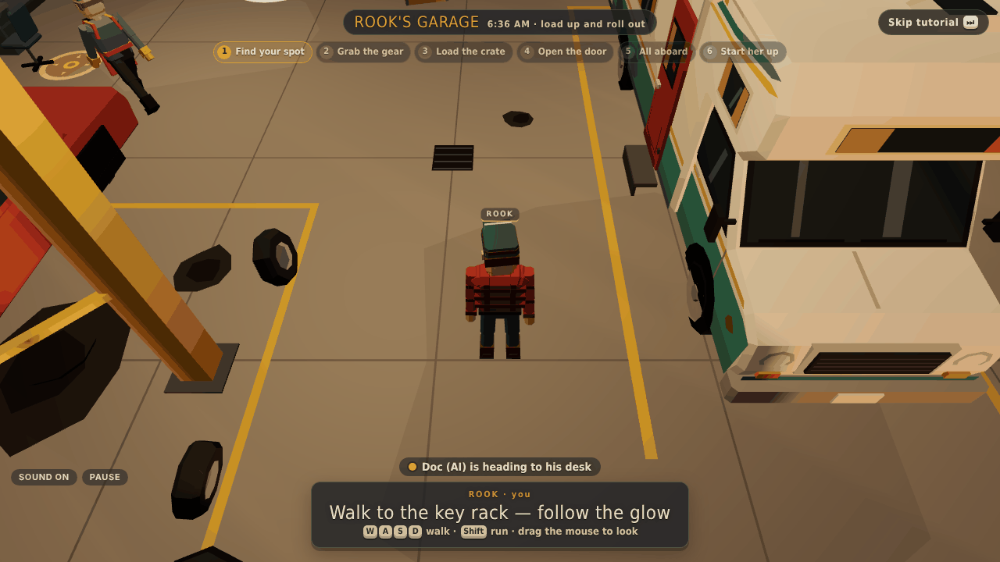
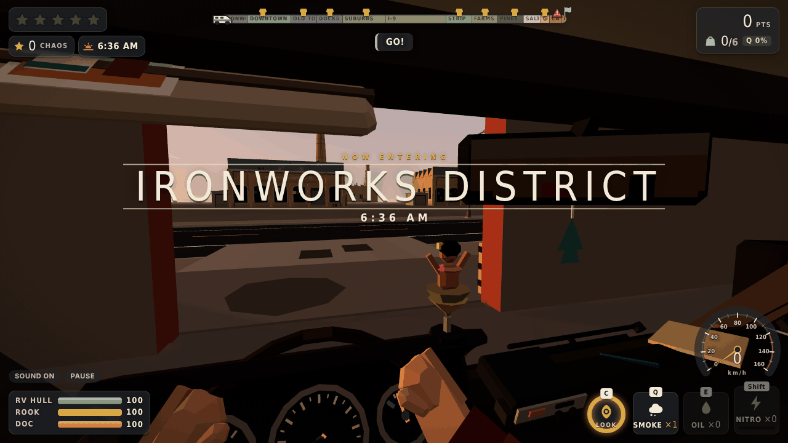
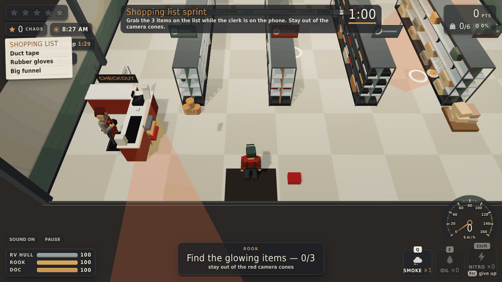
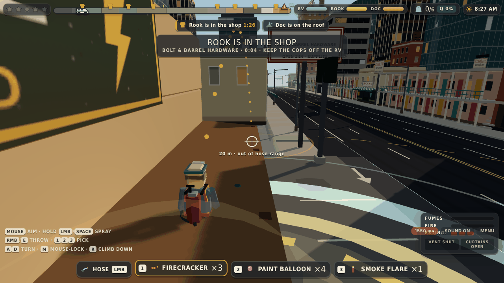
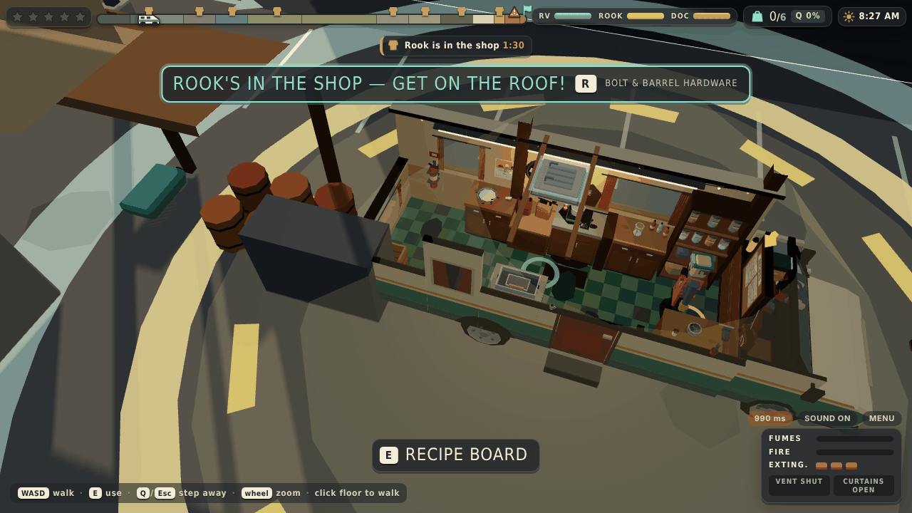
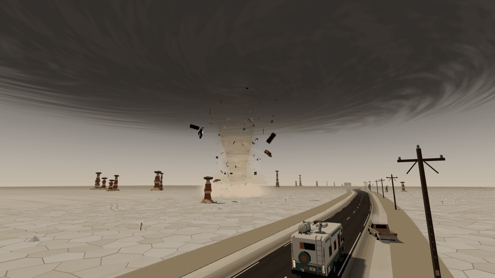
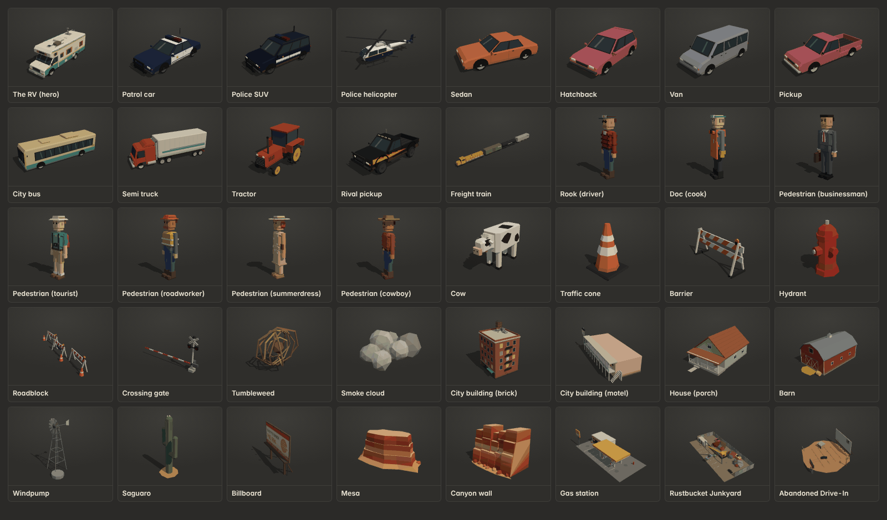

# Cook & Run

## What it is

A two-player co-op browser game (three.js + Node), about 40 minutes per run. One player, **Rook**, drives a battered RV 40 km from the Ironworks District through downtown, the docks, the suburbs, the interstate, farmland, the foothills, the salt flats and a ghost town to a canyon, losing the cops, stopping for supplies and jumping a broken bridge. The other, **Doc**, works the mobile lab in the back: you walk him around a cut-away 3D lab inside the moving van and cook at real benches (grind with the pestle, pour from the bottle, turn the gas knob, stir the pot, level the ice tray, snap the crystal into bags, hammer a patch over a hole). Doc cooks the (entirely fictional) product "Desert Glass", crafts gadgets for the driver and keeps the fumes, the fires and the nosy cops under control, while every pothole Rook hits knocks him off his feet. Arrive at the buyer's drive-in with the RV, the crew and enough product intact.

Every run starts on foot in **Rook's Garage**: a short co-op tutorial where you grab the keys and the notebook, load the crate, open the roll-up door, climb in and start her up. Then Rook drives **in first person** from the cab (press **C** for a 3-second look around the outside, every 30 seconds). At each of the **8 supply stops** Rook runs into the shop and plays a short challenge while Doc climbs out of the roof vent and holds the cops off with a hose, firecrackers, paint balloons and smoke flares.

Play online with a friend (one drives, one cooks), or solo: press Tab to climb into the back and cook while an autopilot drives (an AI Doc defends the roof while you shop).

| Rook's Garage (tutorial) | Driving from the cab |
| --- | --- |
|  |  |
| **Rook's shop challenge** | **Doc on the roof at a stop** |
|  |  |
| **Cooking in the van (Doc)** | **The tornado on the salt flats** |
|  |  |



## Controls

**In the garage (both players)**

| Key | Action |
| --- | --- |
| W A S D or arrows | Walk (relative to the camera) |
| Shift | Run |
| Space | Jump |
| E (tap or hold) | Use: take the keys, the notebook or the crate, hit the door button, climb in, crank the engine |
| Mouse drag / wheel | Turn and zoom the camera |
| Skip tutorial button | Driver (host) only |

**Driver (keyboard)**

| Key | Action |
| --- | --- |
| W / S or ↑ / ↓ | Throttle / brake (reverse) |
| A / D or ← / → | Steer |
| Space | Handbrake |
| Shift | Nitro |
| Q | Smoke bomb |
| E | Oil slick |
| H | Horn |
| C | Look around outside the RV for 3 s (recharges in 30 s) |
| Mouse | Turn your head in the cab (click the view for mouse-look) |
| R | Reset if stuck |
| Esc / P | Pause (solo) or menu (online) |
| M | Mute |

**Driver in a shop (supply stops)**

| Key | Action |
| --- | --- |
| W A S D or arrows | Move Rook (or the forklift, trolley, crane) |
| Shift | Run |
| Space | Jump (in the forklift or crane, and while haggling, Space interacts instead) |
| E, Enter or click | Interact (grab, haggle, pump, drop the magnet…) |
| R / F | Forklift forks up / down |
| Esc | Give up the shop (no supplies) |

**Cook: Doc in the van (keyboard + mouse, or touch)**

| Input | Action |
| --- | --- |
| W A S D or arrows | Walk (W = up the screen) |
| Space | Jump (at a station Space still works the step, e.g. hold to pour) |
| E | Use the station you're at: open the recipe board, start the step, switch the vent fan or curtains, grab or spray the extinguisher, beat out a fire |
| Q or Esc | Step away from the station, or put the extinguisher down |
| Click the floor | Walk there |
| Click a station | Walk there and use it |
| Drag or click while working | Play the step on the 3D props. A / D or ← / → also turn the gas knob and level the ice tray; hold Space to pour |
| Mouse wheel | Zoom |
| R (at a stop) | Climb onto the roof through the vent / climb back down |
| Touch | Tap to walk or use, drag to play |
| M | Mute |

**Cook on the roof (at a stop)**

| Input | Action |
| --- | --- |
| Mouse | Aim |
| Hold left click or Space | Hose (soaks and pushes a cop car back) |
| 1 / 2 / 3 | Pick firecracker (stalls cars) / paint balloon (blinds the driver) / smoke flare (uses a smoke charge) |
| Right click or E | Throw the picked device |
| A / D | Turn |
| R | Climb back down |

The cook's camera is a cut-away "dollhouse" view over the van, so you see the lab and the road around it (roofs and walls between the camera and the van are cut away). Working a bench zooms in on it. The next station is marked with a glowing ring on the floor.

**Solo:** one player, one tab. You play Rook through the garage, then start at the wheel. Press **Tab** to climb into the back and cook: an autopilot takes over the driving (it follows the road, stops at supply stores, drops your gadgets on chasing cops and takes the jump). Press **Tab** again to take the wheel back. While you drive, Doc waits at his bench, but a lit burner keeps cooking. At the stops an AI Doc goes up on the roof by himself while you do the shop challenge.

The original flat 2D lab panel is still there as a fallback: add `?lab2d=1` to the URL.

## How to play

1. **The goal.** Reach the Abandoned Drive-In at the end of the 40 km route with **at least 6 bags** of product, the RV in one piece, both of you alive and nobody busted. You get paid for every bag (more for high quality and Premium), and rated one to three stars on points. A good run takes about 40 minutes.
2. **The garage.** Both players walk to their glowing marker, then Rook grabs the keys, Doc carries the crate to the side door, Rook opens the roll-up door, both climb in, and Rook holds E to crank the engine. Drive out of the door and turn right onto the road.
3. **Driver: get supplies.** A **STOP AT …** banner and an arrow on the road appear 800 m before each of the 8 stores. Pull into the lot and stop: Rook runs inside for a challenge, and the better you do, the more you load (a score of 80 % or more earns a bonus supply).
   - Bolt & Barrel Hardware: grab the 3 items on the list while dodging the security camera cones.
   - Old Town Market: haggle with a swinging needle, then carry the crates out.
   - Harbour Chandlery: forklift a pallet onto the RV's rear rack.
   - Sunny Gas & Ice: stop the fuel pump on the line, then mash out bags of ice before they melt.
   - MegaMart: a trolley run through the aisles, then beat the self-checkout.
   - Prickly Pete's Farm Supply: catch the goat, then carry the feed sacks.
   - Rustbucket Junkyard: fish the copper coil out of a wreck pile with the magnet crane.
   - Last Chance Gas: grab the solvent in a dark stockroom before the silent alarm trips, and get out.

   While Rook shops, the RV sits in the lot: a cop next to it for 2.5 s is a bust, and loading pauses while a cop is within 25 m. That's Doc's job on the roof.
4. **Driver: keep heat down.** Hitting people (they bounce back up, cartoon-style), ramming cops and speeding past parked patrol cars raise your wanted stars. Heat fades when no cop has seen you for a few seconds. From two stars motorcycle cops join, from three there are roadblocks and spikes, and at five stars an armoured "Rhino" truck drives ahead of you and throws flash and foam canisters into your path. Use the gadgets Doc makes for you: Smoke (Q), Oil (E), Nitro (Shift). You start with one smoke bomb.
5. **Driver: watch the road.** Steam leaks from burst sewer mains (they fog the windscreen), open manholes, trench plates, sinkholes, speed bumps, broken-down cars, downed power lines, logs, dust devils, flash floods and more. The RV slowly repairs itself 10 s after the last hit.
6. **Every area has an event.** A runaway freight train in the Ironworks, the masked "Midnight Comet" outrunning six cop cars downtown, the Founders' Day parade blocking Main Street, a rising drawbridge at the docks, a house on a wide-load truck in the suburbs, a car carrier shedding cars on the interstate, a toll plaza, a giant inflatable gorilla, a car wash that drops a star, a cattle drive, a combine harvester across both lanes, a log spill, a biker gang after the product, a **tornado throwing cars** on the salt flats, a runaway stagecoach in the ghost town, and Sergeant Pratt chasing you all the way to the bridge.
7. **Driver: drive for your cook.** Hard corners shove Doc across the van, and potholes and rocks make him stumble, spill and drop the extinguisher. Smooth driving while he cooks earns bonus points.
8. **Cook: pick a batch.** Walk to the recipe board at the front and choose a recipe (the pantry shelf shows what you have). Street Batch works from the start; Premium needs Copper Coil and Prickly Syrup and is worth twice as many bags at twice the value. Gadgets and repairs (Patch the Hull, Ice Pack) cost ingredients too.
9. **Cook: work the stations.** Each step happens at its own bench: follow the highlight, press E and play it with the mouse. Walking takes time, and while you're away every step waits, except the burner: it keeps heating, and an unwatched pot catches fire.
10. **Cook: manage the lab.** Fumes build up while you cook: switch on the vent fan (but the chimney smoke makes cops suspicious). A cop alongside spots the lab through open curtains: pull the curtain cord. A fire grows and then explodes: beat it out with E or fetch the extinguisher from the back. If Doc passes out, he lies on the floor for 12 s.
11. **The jump.** At 38.9 km the canyon bridge is broken: hit the ramp at 88 km/h (24.5 m/s) or faster. Saving a Nitro helps. The cops give up there, and the drive-in is just past the canyon.

## Run locally

Requires Node 18+ (22 recommended).

```bash
npm install     # also copies three.js into public/vendor (postinstall)
npm start       # → http://localhost:3000
```

`npm run dev` restarts the server on file changes. To test multiplayer on one machine, open two browser windows at http://localhost:3000. To test from a phone on the same Wi-Fi, use your computer's LAN IP (for example http://192.168.1.20:3000).

Solo without the menu: http://localhost:3000/?solo=1 · bots playing both roles: http://localhost:3000/?demo=1 · old flat 2D lab: add `?lab2d=1`. Add `&seed=1337` to any of these for a repeatable run.

Tests:

```bash
npm test                    # everything below that runs in Node (no browser needed)
npm run test:sim            # simulation: full autopilot run, canyon jump, busting, determinism, snapshot size
npm run test:cook           # lab logic: every recipe/minigame, hazards, station presence
npm run test:assets         # every model × variant, named parts, budgets
npm run test:net            # server protocol, relay, rate limit, NetClient/LocalBus
npm run test:e2e            # a whole online game through the real server: bot driver + bot cook
npm run test:net:browser    # + headless Chromium lobby flow (needs Python Playwright), saves docs/lobby-*.png
```

Module tests (Node unless noted):

```bash
node public/js/sim/setpieces/test/run.js        # all 17 area events, each on its own and inside a full run
node public/js/onfoot/test/garage-headless.js   # the garage tutorial on the real GameSim
node public/js/van/roof/test/roof-headless.js   # roof defence: hose, throws, ammo, the solo AI
python3 public/js/onfoot/test/onfoot_browser_test.py   # headless Chromium: garage as driver/cook/solo + all 8 shops
```

Test pages (open with the server running): `assets.html` (asset kit showroom + .glb export, including the expansion kit), `van-test.html` (3D van lab), `van-presenters-test.html` (3D cooking stations), `view-test.html` (world/HUD presets), `cook-test.html` (2D lab), `net-test.html` (lobby).

## Multiplayer

1. One player clicks **Create Online Room** and gets a 4-character room code.
2. They click **Copy invite link** and send it to their partner. The link opens the game with the code filled in.
3. The partner clicks **Join Room**. The creator starts as Driver, the joiner as Cook. Click the other role card to swap.
4. Both press **I'm ready**, then the room creator (host) presses **Start**.

The game is host-authoritative: the **driver's browser runs the simulation** and streams snapshots to the cook about 15 times a second. The cook sends lab state and commands back. The server only pairs players and relays their messages, so it stays cheap enough for a free hosting tier. When a game ends, both players can go back to the same room and play again.

## Deploy on Render

Render web services support WebSockets, so the game and the relay run as a single service.

### Option A: Blueprint (recommended)

1. Push this repository to GitHub (or GitLab/Bitbucket).
2. In the [Render Dashboard](https://dashboard.render.com), choose **New → Blueprint**.
3. Select the repository. Render reads `render.yaml`.
4. Click **Apply**. The first build takes a minute or two. Your game is then live at `https://cook-and-run.onrender.com` (or similar).

`render.yaml` sets up one free web service in Frankfurt (closest region to the UK), Node 22, build `npm install`, start `npm start`, health check `/healthz`, and auto-deploy on every push.

### Option B: manual Web Service

**New → Web Service**, connect the repo, then:

| Setting | Value |
| --- | --- |
| Runtime | Node |
| Build command | `npm install` |
| Start command | `npm start` |
| Health check path | `/healthz` |
| Instance type | Free |
| Environment variable | `NODE_VERSION` = `22` (optional; `.node-version` already says 22) |

Don't set `PORT`: Render provides it and the server reads it.

### Free tier notes

- A free service **sleeps after 15 minutes without traffic**. The next visit wakes it, which takes **about 30-60 seconds** (up to a minute). The menu says so if connecting is slow.
- Render restarts the service on every deploy. Players in a game see "Connection lost" and need to create a new room.
- Free services get 750 instance hours per month per workspace, which is enough for one always-on service.

## Project structure

```
server/
  index.js          Express static hosting, /healthz, WebSocket server on /ws, heartbeat, graceful shutdown
  rooms.js          Room manager: codes, roles, ready/start, relay, rate limit, idle sweep
public/
  index.html        Game page (import map for three.js)
  css/              style.css (game), hud.css, van.css (3D lab HUD), cook.css (2D lab), lobby.css (menus), onfoot.css (garage, shops)
  js/
    main.js             Entry point: lobby → session (solo / online driver / online cook)
    shared/protocol.js  Message contract (lobby + game messages, snapshot shape)
    data/*.json         Route, lab recipes, tuning rules, van interior layout (pure data)
    sim/                GameSim: deterministic 60 Hz simulation, runs in the driver's browser
    sim/setpieces/      The 17 area events (freight train, Midnight Comet, parade … tornado, handover) as plugins
    sim/garage.js       Garage tutorial logic;  sim/stops.js  supply-stop state machine;  sim/roof.js  roof defence
    cook/               CookLab logic (recipes, hazards, station presence) + minigame logic + 2D CookUI fallback
    van/                3D van lab: interior, Doc's walking controller, cameras (with cut-away), hazards, HUD
    van/presenters/     3D cooking stations: one presenter per step (grind, pour, heat, stir, cool, break, hammer)
    van/roof/           Doc on the roof: climb, hose, throws, roof camera, solo AI view
    onfoot/             Garage tutorial view (both roles) and the 8 shop challenges (onfoot/shops/)
    render/             three.js world view, cameras, effects, audio (V8 engine, tyres, brakes, starter)
    render/fp/          First-person cab: head look, gauges, wipers, live mirrors, windscreen fog, look-around
    render/world/       Areas, terrain, structures (garage, drawbridge, toll, canyon bridge), stop arrows, time of day
    render/ents/        Entity animation: cops (states, Rhino, motorbikes), people, set-piece actors, tornado
    assets/             Low-poly model builders (no external model files); assets/expansion/ = the 40 km kit
    net/                NetClient (WebSocket) and LocalBus (solo, same tab)
    ui/                 Lobby screens and in-game HUD
  vendor/three/     Generated by npm install, not committed
scripts/            copy-vendor.js (postinstall), test-net.mjs, test-e2e.mjs
docs/               Screenshots, notes, Unity port guide
```

How it maps to Unity:

| Web | Unity |
| --- | --- |
| `js/data/*.json` | ScriptableObjects or TextAssets (same files) |
| `js/shared/protocol.js` | `[Serializable]` C# message structs |
| `js/sim/` | Plain C# simulation classes ticked from `FixedUpdate` at 60 Hz |
| `js/cook/` | Lab logic + minigame logic as plain C# classes |
| `js/van/`, `js/data/van.json` | Van interior prefab on the RV, Doc controller in van-local space, Cinemachine dollhouse + close-up cameras |
| `js/van/presenters/` | One MonoBehaviour per cooking station reading the C# minigame state |
| `js/sim/setpieces/` | One C# class per event behind an `ISetPiece` interface, registered by type name |
| `js/onfoot/` | A garage scene + one small scene per shop challenge (additive scene loads) |
| `js/render/fp/` | A cab prefab parented to the RV with a Cinemachine first-person camera |
| `js/render/`, `js/assets/` | Scenes, prefabs, materials, Cinemachine cameras |
| `js/net/NetClient.js` + `server/` | Netcode for GameObjects/Relay or the same WebSocket server via a C# client |
| `js/net/LocalBus.js` | An in-memory transport for single-player |

## Porting to Unity

The game logic is kept free of DOM and three.js so it ports almost line for line: the simulation is deterministic given a seed, all tuning lives in JSON, and every network message is plain JSON with a fixed shape. See [docs/UNITY_PORT.md](docs/UNITY_PORT.md) for the step-by-step guide.

## Credits and license

Code released under the [MIT License](https://opensource.org/licenses/MIT). All art, characters, vehicles, place names and the in-game product are original to this project and built procedurally (no third-party models or fonts). The game's chemistry is invented for gameplay and has no real-world basis. Uses [three.js](https://threejs.org) (MIT), [Express](https://expressjs.com) (MIT) and [ws](https://github.com/websockets/ws) (MIT).
