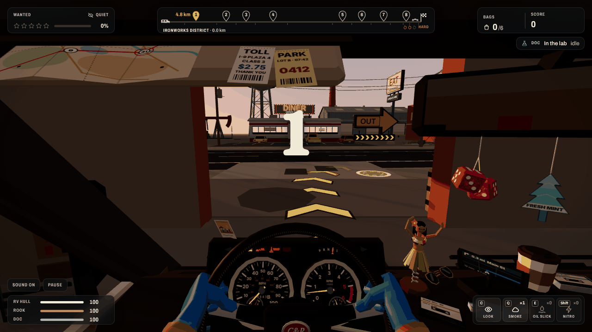
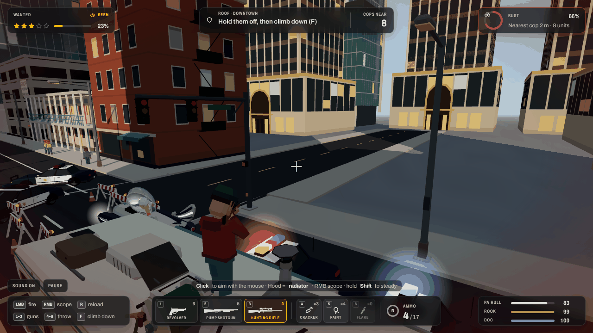
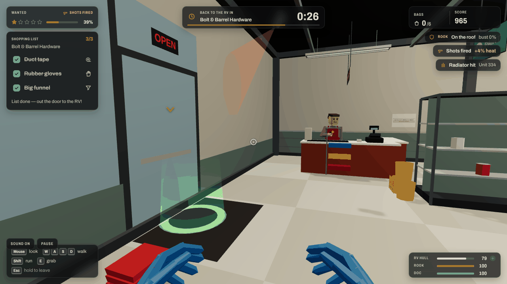
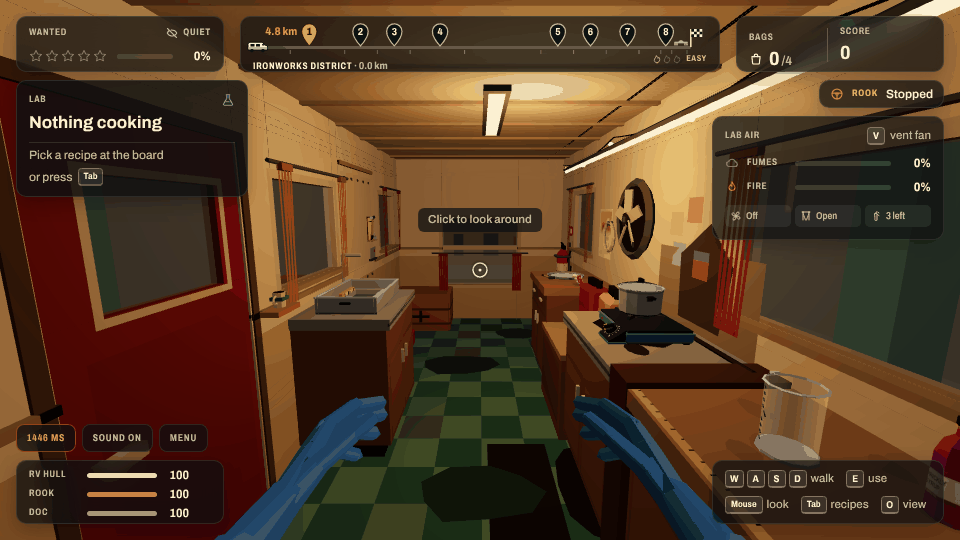
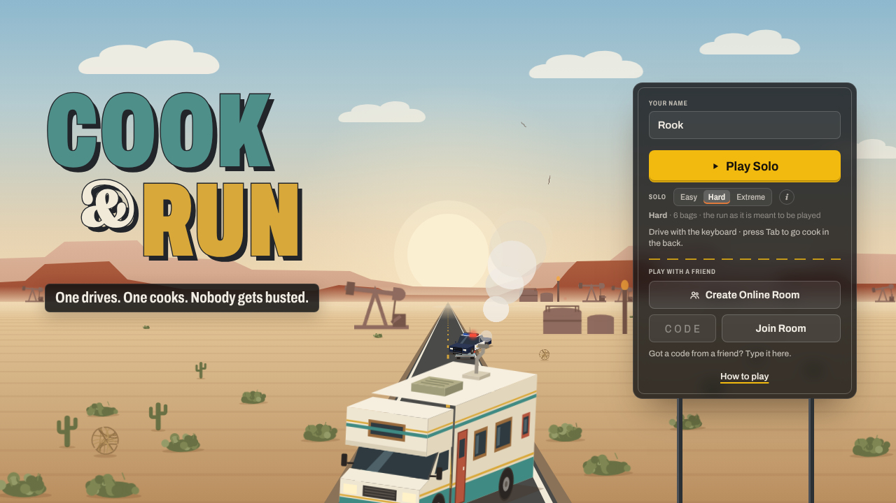
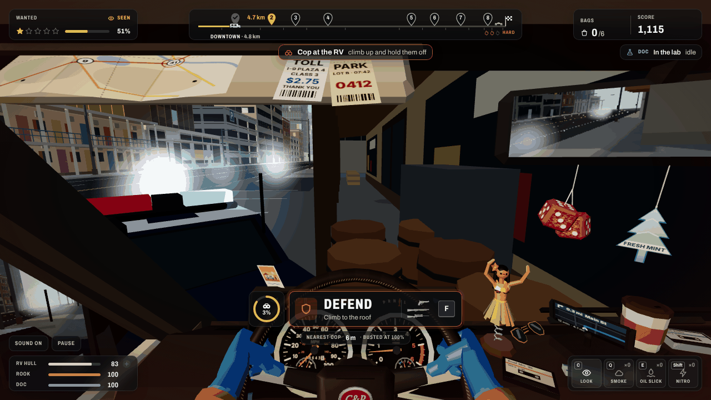

# Cook & Run

## What it is

A two-player co-op browser game (three.js + Node), about 40 minutes per run. **Rook** (player 1) drives a battered RV 40 km, from the Ironworks District through downtown, the docks, the suburbs, the interstate, farmland, the foothills, the salt flats and a ghost town to a canyon. On the way he loses the cops, stops for supplies and jumps a broken bridge. **Doc** (player 2) works the mobile lab in the back, **in first person**:
- he walks the moving van and cooks the entirely fictional product "Desert Glass" at real benches;
- he crafts gadgets for the driver;
- he keeps the fumes, the fires and the nosy cops under control;
- every pothole Rook hits knocks him off his feet.

Arrive at the buyer's drive-in with the RV, the crew and enough product intact.

**Round 3** changes who does what:
- **At each of the 8 supply stops**, Doc jumps out of the side door and runs the shop task in first person, against a short timer.
- **Rook stays with the RV.** When the cops close in he presses **F** (DEFEND), climbs onto the roof and holds them off with a revolver, a pump shotgun or a scoped rifle, plus firecrackers, paint balloons and smoke flares.
  - **Shots only ever hit the police cars:** tyres burst, radiators steam, windscreens crack and cars stall. There is no blood anywhere.
  - **Shooting is risky:** every shot raises your heat, and the cops shoot back.
- **Someone calls the cops at every stop.**
- **Stopping never busts you at once.** A bust needs an undefended RV, a short grace period and a cop right beside you.
- **All three health bars** (RV hull, Rook, Doc) slowly heal.
- **Pick Easy, Hard or Extreme.** Extreme needs 8 bags and the cops shoot a lot more.

Every run starts on foot in **Rook's Garage**: a short co-op tutorial where you suit up, grab the keys and the notebook, load the crate, open the roll-up door, climb in and start her up. Yellow chevrons then show the way out onto the street.

Play online with a friend (one drives, one cooks), or solo. In solo you drive; at a stop you play Doc's shop run while an AI Rook defends the roof. Press **Tab** any time to climb into the back and cook while an autopilot drives.

| Driving from the cab | Rook on the roof (DEFEND) |
| --- | --- |
|  |  |
| **Doc's shop run (first person)** | **Doc cooking in the van (first person)** |
|  |  |
| **The live title screen** | **A stop with the cops called in** |
|  |  |


## Controls

**In the garage (both players)**

| Key | Action |
| --- | --- |
| W A S D or arrows | Walk (relative to the camera) |
| Shift | Run |
| Space | Jump |
| E (tap or hold) | Use: hold at the suit rack to suit up, take the keys, the notebook or the crate, hit the door button, climb in, crank the engine |
| Mouse drag / wheel | Turn and zoom the camera |
| Esc / Skip tutorial button | Skip the tutorial (driver / host only) |

**Rook, driving (keyboard)**

| Key | Action |
| --- | --- |
| W / S or ↑ / ↓ | Throttle / brake (reverse) |
| A / D or ← / → | Steer |
| Space | Handbrake |
| Shift | Nitro |
| Q | Smoke bomb |
| E | Oil slick |
| H | Horn |
| C | Look around outside the RV for 3 s (recharges in 20 / 30 / 45 s by difficulty) |
| F | **Defend**: climb onto the roof. It works while the RV stands still with cops close, or at any supply stop |
| Mouse | Turn your head in the cab (click the view for mouse-look) |
| R | Reset if stuck |
| P | Pause (solo) or menu (online) |
| M | Mute |

**Rook on the roof**

| Input | Action |
| --- | --- |
| Mouse | Aim (click the view to capture the mouse) |
| Left click | Fire the selected gun (or throw the selected throwable) |
| Right click | Scope (rifle) / aim down the sights |
| Shift (held) | Steady the rifle |
| R | Reload |
| 1 / 2 / 3 | Revolver (3 hits stall a car) / pump shotgun (bursts a tyre) / hunting rifle (a radiator hit stalls it at range) |
| 4 / 5 / 6, G | Firecracker / paint balloon / smoke flare, G throws |
| Mouse wheel | Next gun |
| W or F | Climb back down into the seat |

Ammo refills at every supply stop. Between stops you only have what's left.

**Doc in the van (first person)**

| Input | Action |
| --- | --- |
| Mouse | Look around (click the view to capture the mouse; Esc frees it) |
| W A S D or arrows | Walk, relative to where you look |
| E or left click | Use what you're looking at: the recipe board, a bench (starts the step), the vent fan, the curtain cord, the extinguisher, a fire |
| Drag / click while working | Play the step on the 3D props. A / D or ← / → also turn the gas knob and level the ice tray; hold Space to pour |
| Q | Step away from the bench, or put the extinguisher down |
| Tab | Recipe board (online; in solo Tab swaps seats) |
| V | Vent fan |
| O | Switch to the old cut-away overview (and back) |
| At a stop | Walk to the side door and press E: the shop run starts |
| M | Mute |

**Doc's shop run (first person)**

| Input | Action |
| --- | --- |
| Mouse | Look (click to capture the mouse) |
| W A S D, Shift | Walk, run |
| E, Enter or left click | Grab / use what you're looking at |
| W S, A D | Drive the forklift / swing the crane boom and run its trolley |
| R / F | Forklift forks up / down |
| Esc (hold 1 s) | Give up the shop (no supplies) |

**Solo:** one player, one tab. You play Rook through the garage, then start at the wheel. At a stop the shop run starts by itself (you are Doc for a minute) while the AI Rook defends the roof. Press **Tab** to climb into the back and cook: an autopilot takes the wheel (it cruises, skips the stores and takes the jump). Press **Tab** again to drive.

The original flat 2D lab panel is still there as a fallback: add `?lab2d=1` to the URL.

## How to play

1. **The goal.** Reach the Abandoned Drive-In at the end of the 40 km route with enough bags of product: **4 on Easy, 6 on Hard, 8 on Extreme**. Keep the RV in one piece and both of you alive, and don't get busted. You get paid for every bag (more for high quality and Premium) and rated one to three stars on points. Extreme scores ×1.5 and Easy ×0.75. A good run takes about 40 minutes.
2. **Difficulty.** Solo: pick it next to Play Solo. Online: the room creator picks it in the room, both of you see it, and it is locked once the run starts. Hard is the standard game.
   - **Easy:** gentler cops, faster healing, wider minigame targets, longer shop timers.
   - **Extreme:** harder rams, more cops, the armoured truck from 4★, cops shooting a lot more, less ammo, shorter grace before a bust.
3. **The garage.** Both players walk to their glowing marker, then **suit up** at the rack (hold E for 1.5 s). Rook grabs the keys and Doc the notebook, Doc carries the crate to the side door, Rook opens the roll-up door, both climb in, and Rook holds E to crank the engine. Follow the yellow chevrons out of the door and turn right onto the road.
4. **Supply stops.** A **STOP AT …** banner and a pin on the route strip appear 800 m before each of the 8 stores. Pull into the lot and stop.
   - Doc gets **SHOP RUN — side door [E]**: he walks to the side door, jumps out and plays the shop task in first person. The better he does, the more you load; 80 % or more earns a bonus supply.
     - Bolt & Barrel Hardware: sprint the aisles, look at each listed item and grab it, and stay out of the camera cones.
     - Old Town Market: stop the haggle needle on green 3 times, then carry two crates out.
     - Harbour Chandlery: drive the forklift from its seat and set the pallet on the RV's rear rack.
     - Sunny Gas & Ice: hold the pump nozzle and stop the meter on the line, then mash E at the ice chest.
     - MegaMart: push the trolley through the aisles, then beat the self-checkout beam.
     - Prickly Pete's Farm Supply: corner the goat in the barn, then carry the feed sacks.
     - Rustbucket Junkyard: work the magnet crane from its cab and fish out the copper coil.
     - Last Chance Gas: find the solvent by flashlight in a dark stockroom before the silent alarm trips.
   - **Someone always calls the cops when you park**, and they arrive a few seconds later. **Rook defends:** press **F** and hold them off from the roof until Doc is back and the supplies are loaded. Loading pauses while a running police car is within 25 m.
5. **Busts and DEFEND.** You can always stop. The bust meter only starts after a short grace period (5 / 3 / 1.5 s by difficulty), and only while a running police car is right beside the RV. While Rook defends, a car with a burst tyre, a steaming radiator, a stalled engine or a paint-blinded driver adds nothing, so hit them; don't just stand there. **Every shot adds heat, and cops shoot back** at the hull and at Rook while he is up there. How often depends on the difficulty. From high stars they also take the odd shot at the moving RV.
6. **Keep heat down.** Hitting people (they bounce back up, cartoon-style), ramming cops, speeding past parked patrol cars and gunfire raise your wanted stars. The slider beside the stars shows how close the next star is: **SEEN** while a cop can see you, **COOLING** once nobody has for a few seconds.
   - From two stars motorcycle cops join, and from three there are roadblocks and spikes.
   - At five stars (four on Extreme) an armoured "Rhino" truck throws flash and foam canisters into your path.
   - Use the gadgets Doc makes for you: Smoke (Q), Oil (E), Nitro (Shift).
7. **Watch the road.** Steam leaks fog the windscreen, and there are open manholes, sinkholes, speed bumps, broken-down cars, downed power lines, logs, dust devils, flash floods and more. **All three bars heal slowly** (0.45 / 0.3 / 0.15 HP per second) once that bar has taken no damage for a while. A green **+** shows which ones are healing. A bar at zero never heals. If the RV's hull hits zero, it blows up and the run is over.
8. **Every area has an event.** A runaway freight train, the masked "Midnight Comet" pulling the cops away downtown, the Founders' Day parade, a rising drawbridge, a house on a wide-load truck, a car carrier shedding cars, a toll plaza, a giant inflatable gorilla, a car wash that drops a star, a cattle drive, a combine harvester, a log spill, a biker gang, a **tornado throwing cars** on the salt flats, a runaway stagecoach, and Sergeant Pratt chasing you all the way to the bridge.
9. **Cook: pick a batch.** Look at the recipe board at the front and press E, or press Tab. Street Batch works from the start; Premium needs Copper Coil and Prickly Syrup and is worth twice as many bags at twice the value. Gadgets and repairs cost ingredients too.
10. **Cook: work the benches.** Each step happens at its own bench. Look at the glowing one and press E, then play the step on the props with the mouse. While you're away every step waits, except the burner: it keeps heating, and an unwatched pot catches fire. That includes while you're out on a shop run.
11. **Cook: manage the lab.** Fumes build up: switch on the vent fan (V), but the chimney smoke makes cops suspicious. A cop alongside spots the lab through open curtains, so pull the curtain cord. Fires grow: beat them out or grab the extinguisher. If Doc passes out, he lies on the floor for 12 s.
12. **The jump.** At 38.9 km the canyon bridge is broken: hit the ramp at 88 km/h (24.5 m/s) or faster. The cops give up there, and the drive-in is just past the canyon.

## Run locally

Requires Node 18+ (22 recommended).

```bash
npm install     # also copies three.js into public/vendor (postinstall)
npm start       # → http://localhost:3000
```

`npm run dev` restarts the server on file changes. To test multiplayer on one machine, open two browser windows at http://localhost:3000. To test from a phone on the same Wi-Fi, use your computer's LAN IP (for example http://192.168.1.20:3000).

Solo without the menu: http://localhost:3000/?solo=1 · bots playing both roles: http://localhost:3000/?demo=1 · old flat 2D lab: add `?lab2d=1`. Add `&seed=1337` to any of these for a repeatable run, and `&difficulty=easy|hard|extreme` to pick the level.

Tests:

```bash
npm test                    # everything below that runs in Node (no browser needed)
npm run test:sim            # simulation: full autopilot run, canyon jump, busting, determinism, snapshot size
npm run test:cook           # lab logic: every recipe/minigame, hazards, station presence
npm run test:assets         # every model × variant, named parts, budgets
npm run test:net            # server protocol, relay, rate limit, NetClient/LocalBus
npm run test:e2e            # a whole online game through the real server: bot driver + bot cook
npm run test:net:browser    # + headless Chromium lobby flow (needs Python Playwright), saves docs/lobby-*.png
```

Module tests (Node unless noted):

```bash
node public/js/sim/setpieces/test/run.js        # all 17 area events, each on its own and inside a full run
node public/js/onfoot/test/garage-headless.js   # the garage tutorial on the real GameSim
node public/js/sim/test/roof-defend.js           # Rook's roof defence: guns, hits, heat, ammo, the AI Rook (also run by test:sim)
python3 public/js/onfoot/test/onfoot_browser_test.py   # headless Chromium: garage as driver/cook/solo
```

Test pages (open with the server running): `assets.html` (asset kit showroom + .glb export, including the expansion kit), `van-test.html` (Doc's first-person lab), `shop-test.html?type=crane&bot=1` (the first-person shop runs), `defend-test.html` (Rook's roof defence), `hud-test.html` (the dark-glass HUD states), `fp-test.html` (the cab), `hands-test.html` (Doc's gloved hands), `van-presenters-test.html` (3D cooking stations), `view-test.html` (world/HUD presets), `cook-test.html` (2D lab), `net-test.html` (lobby).

## Multiplayer

1. One player clicks **Create Online Room** and gets a 4-character room code.
2. They click **Copy invite link** and send it to their partner. The link opens the game with the code filled in.
3. The partner clicks **Join Room**. The creator starts as Driver, the joiner as Cook. Click the other role card to swap.
4. The room creator picks the difficulty (Easy / Hard / Extreme); both players see it.
5. Both press **I'm ready**, then the room creator (host) presses **Start**.

The game is host-authoritative: the **driver's browser runs the simulation** and streams snapshots to the cook about 15 times a second. The cook sends lab state and commands back. The server only pairs players and relays their messages, so it stays cheap enough for a free hosting tier. When a game ends, both players can go back to the same room and play again.

## Deploy on Render

Render web services support WebSockets, so the game and the relay run as a single service.

### Option A: Blueprint (recommended)

1. Push this repository to GitHub (or GitLab/Bitbucket).
2. In the [Render Dashboard](https://dashboard.render.com), choose **New → Blueprint**.
3. Select the repository. Render reads `render.yaml`.
4. Click **Apply**. The first build takes a minute or two. Your game is then live at `https://cook-and-run.onrender.com` (or similar).

`render.yaml` sets up one free web service in Frankfurt (closest region to the UK), Node 22, build `npm install`, start `npm start`, health check `/healthz`, and auto-deploy on every push.

### Option B: manual Web Service

**New → Web Service**, connect the repo, then:

| Setting | Value |
| --- | --- |
| Runtime | Node |
| Build command | `npm install` |
| Start command | `npm start` |
| Health check path | `/healthz` |
| Instance type | Free |
| Environment variable | `NODE_VERSION` = `22` (optional; `.node-version` already says 22) |

Don't set `PORT`: Render provides it and the server reads it.

### Free tier notes

- A free service **sleeps after 15 minutes without traffic**. The next visit wakes it, which takes **about 30-60 seconds** (up to a minute). The menu says so if connecting is slow.
- Render restarts the service on every deploy. Players in a game see "Connection lost" and need to create a new room.
- Free services get 750 instance hours per month per workspace, which is enough for one always-on service.

## Project structure

```
server/
  index.js          Express static hosting, /healthz, WebSocket server on /ws, heartbeat, graceful shutdown
  rooms.js          Room manager: codes, roles, ready/start, relay, rate limit, idle sweep
public/
  index.html        Game page (import map for three.js)
  css/              style.css (game), hud.css, van.css (3D lab HUD), cook.css (2D lab), lobby.css (menus), onfoot.css (garage, shops)
  js/
    main.js             Entry point: lobby → session (solo / online driver / online cook)
    shared/protocol.js  Message contract (lobby + game messages, snapshot shape)
    data/*.json         Route, lab recipes, tuning rules, van interior layout (pure data)
    sim/                GameSim: deterministic 60 Hz simulation, runs in the driver's browser
    sim/setpieces/      The 17 area events (freight train, Midnight Comet, parade … tornado, handover) as plugins
    sim/garage.js       Garage tutorial logic;  sim/stops.js  supply-stop state machine;  sim/roof.js  roof defence
    cook/               CookLab logic (recipes, hazards, station presence) + minigame logic + 2D CookUI fallback
    van/                3D van lab: interior, Doc's walking controller, cameras (with cut-away), hazards, HUD
    van/presenters/     3D cooking stations: one presenter per step (grind, pour, heat, stir, cool, break, hammer)
    van/roof/           Doc on the roof: climb, hose, throws, roof camera, solo AI view
    onfoot/             Garage tutorial view (both roles) and the 8 shop challenges (onfoot/shops/)
    render/             three.js world view, cameras, effects, audio (V8 engine, tyres, brakes, starter)
    render/fp/          First-person cab: head look, gauges, wipers, live mirrors, windscreen fog, look-around
    render/world/       Areas, terrain, structures (garage, drawbridge, toll, canyon bridge), stop arrows, time of day
    render/ents/        Entity animation: cops (states, Rhino, motorbikes), people, set-piece actors, tornado
    assets/             Low-poly model builders (no external model files); assets/expansion/ = the 40 km kit
    net/                NetClient (WebSocket) and LocalBus (solo, same tab)
    ui/                 Lobby screens and in-game HUD
  vendor/three/     Generated by npm install, not committed
scripts/            copy-vendor.js (postinstall), test-net.mjs, test-e2e.mjs
docs/               Screenshots, notes, Unity port guide
```

How it maps to Unity:

| Web | Unity |
| --- | --- |
| `js/data/*.json` | ScriptableObjects or TextAssets (same files) |
| `js/shared/protocol.js` | `[Serializable]` C# message structs |
| `js/sim/` | Plain C# simulation classes ticked from `FixedUpdate` at 60 Hz |
| `js/cook/` | Lab logic + minigame logic as plain C# classes |
| `js/van/`, `js/data/van.json` | Van interior prefab on the RV, Doc controller in van-local space, Cinemachine dollhouse + close-up cameras |
| `js/van/presenters/` | One MonoBehaviour per cooking station reading the C# minigame state |
| `js/sim/setpieces/` | One C# class per event behind an `ISetPiece` interface, registered by type name |
| `js/onfoot/` | A garage scene + one small scene per shop challenge (additive scene loads) |
| `js/render/fp/` | A cab prefab parented to the RV with a Cinemachine first-person camera |
| `js/render/`, `js/assets/` | Scenes, prefabs, materials, Cinemachine cameras |
| `js/net/NetClient.js` + `server/` | Netcode for GameObjects/Relay or the same WebSocket server via a C# client |
| `js/net/LocalBus.js` | An in-memory transport for single-player |

## Porting to Unity

The game logic is kept free of DOM and three.js so it ports almost line for line: the simulation is deterministic given a seed, all tuning lives in JSON, and every network message is plain JSON with a fixed shape. See [docs/UNITY_PORT.md](docs/UNITY_PORT.md) for the step-by-step guide.

## Credits and license

Code released under the [MIT License](https://opensource.org/licenses/MIT). All art, characters, vehicles, place names and the in-game product are original to this project and built procedurally (no third-party models or fonts). The game's chemistry is invented for gameplay and has no real-world basis. Uses [three.js](https://threejs.org) (MIT), [Express](https://expressjs.com) (MIT) and [ws](https://github.com/websockets/ws) (MIT).
