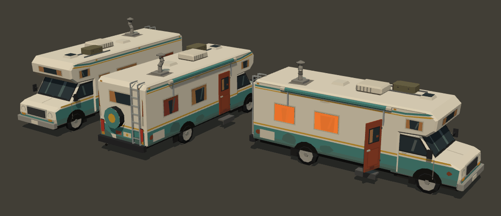
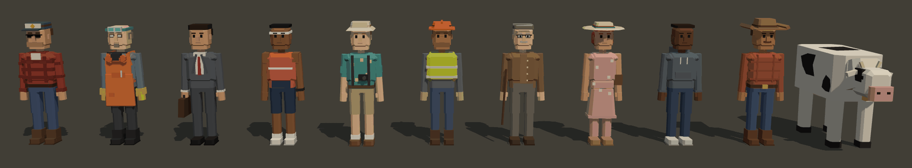

# Cook & Run: asset kit (Agent ART)

Procedural, stylised low-poly "mock" assets for every physical thing in the game. They're built from
code at load time with no external files. Use the showroom at `public/assets.html` to browse, inspect
and export them.


| | |
|---|---|
|  |  |

## Files

| Path | What |
|---|---|
| `public/js/assets/index.js` | Public API: registry, prototype cache, clone, footprint, helpers |
| `public/js/assets/palette.js` | Colour tokens (`PAL`) and cached material factory (`vcolMaterial`, `lambert`, `basic`, `glossy`) |
| `public/js/assets/models/kit.js` | Modelling toolkit: `Kit` (vertex-colour triangle builder), chamfer boxes, extrusions, decals, `Rig`, `ModelRoot`, sign textures |
| `public/js/assets/models/vehicles.js` | rv, cop, cop_suv, heli, sedan, hatch, van, pickup, bus, truck, tractor, rival, train |
| `public/js/assets/models/characters.js` | ped (8 styles), driver "Rook", cook "Doc", cow |
| `public/js/assets/models/props.js` | Obstacles and gadgets (cone … roadblock) |
| `public/js/assets/models/scenery.js` | Every `biomes[].scenery` kind plus canyon_wall and warning_sign |
| `public/js/assets/models/stores.js` | store_hardware, store_gas, store_junkyard, store_farm, sell_point |
| `public/js/assets/models/bridge.js` | bridge_ramp, bridge_landing (driven by `route.bridge`) |
| `public/js/assets/showroom.js` + `public/assets.html` | Showroom: turntable grid, inspector, .glb export, road test, lineups |
| `public/js/assets/test/check-assets.js` | Headless self-check: `node public/js/assets/test/check-assets.js` |

## API (`public/js/assets/index.js`)

```js
import { createModel, KINDS_3D, CATEGORIES, variantCount, getFootprint, preloadAssets,
         cloneInstanceMaterials, configureAssets, toRigid, NAMED_PARTS, labelOf, statsOf, PAL } from './assets/index.js';

createModel(kind, variant = 0) → THREE.Object3D   // cheap clone of a cached prototype; never throws
KINDS_3D                       // all 65 kind names
CATEGORIES                     // { vehicles, characters, props, scenery, stores, bridge }
variantCount(kind)             // ≥ 1; any variant number is wrapped modulo this
getFootprint(kind, variant)    // { w (X), l (Z), h (Y) } in metres (= userData.size)
preloadAssets({ kinds?, allVariants? }) → Promise   // warms every prototype, time-sliced (≤12 ms per frame)
cloneInstanceMaterials(obj)    // per-instance copies of animated materials → obj.userData.flashMaterials
configureAssets({ bridge })    // pass route.bridge; the bridge prototypes rebuild with those numbers
toRigid(obj)                   // no-op for createModel output (already rigid); kept for custom skinned builds
NAMED_PARTS[kind]              // the parts the renderer may rely on (checked by the self-test)
```

- An unknown kind returns a magenta 1 m box (`userData.missing = true`) and logs `console.warn` once per kind.
  A builder that throws does the same.
- Every model root has `userData = { kind, variant, size: {w,h,l}, … }`. Some kinds add `style` (ped, house and
  building names), `character` (Rook or Doc), `perInstanceMaterials`, `bridge`, `arm`, `wireAttach` (power poles)
  or `viewBox` (showroom framing hint).
- Geometry and materials are shared by every clone. Never dispose them, and never mutate a shared material.
  Clone it first, or use `cloneInstanceMaterials`.

## Conventions (the renderer depends on these)

- Metres, Y up, origin at the **ground centre of the footprint**, **front faces +Z** (glTF convention). Facing +Z,
  the vehicle's right side is **−X** (it matches the game: the RV's driver-right door is on −X).
- Models are **rigid hierarchies of plain `THREE.Mesh`** (no skinning, no Bones) using shared materials.
  Almost everything uses one vertex-coloured `MeshLambertMaterial` (`CR_Matte_VCol`, flat-shaded), so the
  renderer's bake step merges each model into one draw call.
- Animated parts are **named `Object3D` pivots**. Each holds its geometry in a child Mesh named `<part>_mesh`
  (vehicles and characters also have a `body` pivot at the origin or pelvis that holds `body_mesh`).
  Static props are a single Mesh named `body`.

### Named parts (exact)

| Kind | Parts | How to animate |
|---|---|---|
| all wheeled vehicles | `wheel_fl`, `wheel_fr`, `wheel_rl`, `wheel_rr` (truck adds `wheel_rl2`, `wheel_rr2`, `wheel_tl`, `wheel_tr`, `wheel_tl2`, `wheel_tr2`) | Pivot at the axle centre. Local X is the axle. `rotation.x` spins (**+ = rolling forward**). `rotation.order = 'YXZ'`, so set `rotation.y` to steer the front wheels. |
| `rv` | `body`, `door`, `window_glow`, `vent`, `exhaust`, `light_brake_l`, `light_brake_r`, `headlight_l`, `headlight_r` | `door` hinge is the front edge of the rust-red door on −X; **`rotation.y > 0` opens it outward** (~1.25 = fully open). `window_glow` is a hidden `MeshBasicMaterial` (transparent, orange) over every coach window; show it and tint it for fire. `vent` is an empty at the crooked chimney's outlet (smoke). `exhaust` is an empty at the rear pipe tip (nitro flames). `light_brake_*` are emissive Lambert lenses (emissiveIntensity 0.15 idle). |
| `cop`, `cop_suv` | `light_red`, `light_blue`, `body` | Meshes with their **own** emissive `MeshLambertMaterial` (`emissive` red or blue, `emissiveIntensity` 0). The material is shared between clones of the same kind, so either call `cloneInstanceMaterials(obj)` per car and drive `obj.userData.flashMaterials.light_red.emissiveIntensity`, or (as VIEW does) bake them as emissive parts. |
| `heli` | `rotor`, `tail_rotor`, `spot`, `body` | `rotor`: `rotation.y`. `tail_rotor`: `rotation.x`. `spot` is an empty under the nose; the beam points along its local −Y. Hovering pose with skids at y = 0. |
| `ped`, `driver`, `cook` | `body`, `head`, `arm_l`, `arm_r`, `leg_l`, `leg_r` | `body` is at the pelvis (0, 0.88, 0) and parents the rest. Arms pivot at the shoulders, legs at the hips (`_l` = +X). **`rotation.x > 0` swings a limb backward** (toward −Z). Walk cycle: `leg_l.x = A·sin t`, `leg_r.x = −A·sin t`, arms opposite. `head` pivots at the neck. |
| `cow` | `body`, `leg_fl`, `leg_fr`, `leg_rl`, `leg_rr` | Same swing convention as people. |
| `train` | `car_0` … `car_3` | Built along +Z, ~61 m: `car_0` is the locomotive at the front (+Z), then boxcar, tank car, hopper. The sim rotates the whole train to cross the road. |
| `crossing_gate` | `arm`, `lamp_l`, `lamp_r`, `body` | Origin at the post. `arm` extends along **local −X** (7.6 m). **`rotation.z = 0` is DOWN (closed); `rotation.z = −1.45` is UP (raised).** Lamps are emissive meshes (clone per instance to flash them alternately). Place it on the road's +X edge to block traffic. |
| `roadblock` | `lamp_0`, `lamp_1`, `lamp_2` | Amber emissive lamps (`emissiveIntensity` 0.6) on three sawhorses. |
| `smoke_cloud` | `puff_0` … `puff_7` | Grey icospheres sharing one transparent material. `cloneInstanceMaterials` gives each cloud its own copy to fade. |
| `windmill` | `blades` | `rotation.z` spins the wheel (it faces +Z). |
| `tumbleweed` | `ball` | Pivot at the ball's centre; spin it to roll. |
| `falling_rock` | `chunk` | Whole rock, for tumbling. |
| `sell_point` | `buyer_car`, `handoff` | Empties: the parked mystery car (baked into the lot mesh) and where the RV should stop. |
| `streetlight`, `trafficlight` | `light`, `signals` | Empties at the lamp head and the signal heads. |
| `powerpole` | (none) | `userData.wireAttach` = three local insulator points for drawing wires along X. |

### Placement rules

- **Roadside facing:** buildings, houses, stores, billboards, the shack and lamp/light arms put their front
  toward **local +Z = toward the road**. For something on the driver's right (x < road, side = +1) use
  `rotation.y = +π/2`; on the left (side = −1) use `−π/2`.
- **Runs along the road:** `fence`, `fence_wood` (4 m segments) and `canyon_wall` (40 m, cliff face toward +Z) run
  along local X. Rotate them by ±π/2 as above.
- **Stores and landmarks:** 34–40 m lots along local X. The band z ∈ [−1, +8] in front of the building is
  kept free of solid props so the RV can pull in.
- **Bridge:** `bridge_ramp`'s origin is the ramp **start** (world `rampStart`), and it extends toward +Z for
  `lip − rampStart` (50 m). The deck top is exactly `y = rampHeight · z / L`, matching `Track.surfaceY`, so
  place it at `(centerX(rampStart), 0, rampStart)` with no rotation. It has a jagged lip with dangling rebar,
  guard rails, and pillars down to `−canyonDepth`. `bridge_landing`'s origin is the far broken edge (`gapEnd`),
  flat at `landingHeight`, extending +Z for `landingEnd − gapEnd` (28 m). Call
  `configureAssets({ bridge: route.bridge })` to rebuild with different numbers.
- **Flat decals** (`pothole`, `oil_slick`, `sanddrift`, `spikes`) sit at y ≈ 0.02 so they never z-fight the road.

## Every kind

Footprint is `userData.size` (w × l × h, metres). Triangles are per instance (range across variants).

| Category | Kind | Variants | Footprint w×l×h | Tris | Notes |
|---|---|---|---|---|---|
| vehicles | `rv` | 1 | 2.6 × 8.6 × 3.4 | 1988 | Original 1980s cab-over motorhome: off-white, teal band, mustard pinstripe, rust-red door on −X, AC box, crooked lab chimney, ladder, spare tyre, curtains, rust and mud. Visual bounds 2.9 × 9.1 × 4.0 (mirrors, spare, chimney). |
| vehicles | `cop` | 1 | 1.95 × 4.95 × 1.6 | 1426 | Navy body, white doors, star badge, push bar, light bar |
| vehicles | `cop_suv` | 1 | 2.1 × 5.3 × 2.15 | 1412 | Darker, taller, push bar, roof rails |
| vehicles | `heli` | 1 | 2.6 × 12 × 3.4 | 694 | Police helicopter, rotor ⌀ 10 m |
| vehicles | `sedan` | 6 | 1.9 × 4.6 × 1.4 | ~1140 | 6 dusty pastels; wear varies (rust, primer fender, dents) |
| vehicles | `hatch` | 6 | 1.8 × 3.9 × 1.45 | ~1180 | Roof rails on odd variants |
| vehicles | `van` | 6 | 2.0 × 5.0 × 2.1 | ~1180 | Even: panel van with ladder rack; odd: window van |
| vehicles | `pickup` | 6 | 2.0 × 5.4 × 1.75 | ~1400 | Bed load on even variants |
| vehicles | `bus` | 3 | 2.6 × 11 × 3.1 | 1255 | Three liveries, doors on −X |
| vehicles | `truck` | 4 | 2.6 × 12 × 4.0 | 1974 | Semi cab and trailer, 10 wheels |
| vehicles | `tractor` | 3 | 2.2 × 4.2 × 2.9 | 1640 | Big lugged rear wheels |
| vehicles | `rival` | 1 | 2.1 × 5.4 × 2.2 | 1642 | Lifted black pickup, bull bar, original flame decal, light bar |
| vehicles | `train` | 1 | 3.1 × 60 × 4.6 | 2766 | Locomotive and 3 freight cars |
| characters | `driver` | 1 | 0.62 × 0.36 × 1.78 | 1124 | "Rook": trucker cap, flannel, sunglasses, stubble |
| characters | `cook` | 1 | 0.62 × 0.36 × 1.78 | 1200 | "Doc": orange apron, goggles on forehead, respirator at neck, rubber gloves |
| characters | `ped` | 8 | 0.62 × 0.36 × 1.78 | 896–1168 | 0 businessman, 1 jogger, 2 tourist, 3 hi-vis worker, 4 older man in cardigan, 5 summer dress, 6 hoodie, 7 cowboy hat. Adults only. |
| characters | `cow` | 2 | 0.85 × 2.3 × 1.55 | 498 | Holstein and brown |
| props | `cone` | 1 | 0.5 × 0.5 × 0.75 | 132 | |
| props | `trashcan` | 3 | 0.7 × 0.75 × 1.1 | 260 | Wheelie bins |
| props | `mailbox` | 5 | 0.4 × 0.6 × 1.35 | 164 | Also used as `mailbox_deco` |
| props | `hydrant` | 2 | 0.5 × 0.45 × 0.85 | 268 | Red or yellow |
| props | `barrier` | 1 | 2.6 × 0.7 × 1.2 | 170 | Orange and white striped, amber lamp |
| props | `sprinkler` | 1 | 0.5 × 0.5 × 0.4 | 119 | |
| props | `hay` | 1 | 1.5 × 1.6 × 1.5 | 140 | Round bale lying along X |
| props | `tumbleweed` | 3 | 1.4 × 1.4 × 1.4 | 272 | Twisted tori |
| props | `pothole` | 3 | 2.0 × 1.8 × 0.04 | 88 | Decal |
| props | `sanddrift` | 2 | 6.2 × 3.6 × 0.35 | 152 | Low mound |
| props | `rock_small` | 3 | 1.6 × 1.5 × 0.9 | 40 | |
| props | `rock` | 3 | 3.0 × 2.8 × 1.9 | 80 | |
| props | `cactus_road` | 1 | 1.0 × 0.6 × 1.4 | 288 | |
| props | `spikes` | 1 | 4.2 × 0.4 × 0.12 | 264 | Strip across X |
| props | `falling_rock` | 2 | 3.2 × 3.0 × 2.6 | 48 | With a dust ring |
| props | `smoke_cloud` | 1 | 9 × 9 × 5 | 640 | 8 puffs |
| props | `oil_slick` | 1 | 7.5 × 7.5 × 0.04 | 47 | Glossy Phong (the only non-matte material) |
| props | `crossing_gate` | 1 | 8 × 0.8 × 4.6 | 450 | Crossbuck, bell, lamps |
| props | `roadblock` | 1 | 7.2 × 1.4 × 1.4 | 777 | 3 sawhorses, cones, amber lamps |
| scenery | `building` | 6 | 14 × 12 × 20 (v0) | 414–1462 | 0 brick walk-up (water tower, fire escape), 1 concrete office, 2 glass office, 3 corner shop with awnings ("LUCKY'S"), 4 parking garage, 5 motel ("STARLITE MOTOR INN"). Heights 8–33 m. |
| scenery | `streetlight` | 1 | 0.6 × 3.2 × 8.4 | 208 | Arm reaches toward +Z |
| scenery | `trafficlight` | 1 | 1 × 6.2 × 7 | 820 | Mast arm toward +Z |
| scenery | `tree_city` | 2 | 4.4 × 4.4 × 7.5 | 308 | Tree grate |
| scenery | `bench` | 2 | 1.9 × 0.7 × 0.95 | 372 | |
| scenery | `house` | 6 | ~10–15 × 13 × 5–10 | 376–674 | 0 ranch, 1 two-storey, 2 with garage, 3 porch, 4 two-storey with garage, 5 bungalow with bay window. Door faces +Z. |
| scenery | `tree_round` | 3 | 5 × 5 × 7.5 | 87–291 | 2 = conifer |
| scenery | `fence` | 3 | 4 × 0.3 × 1.1 | 140–580 | Picket, board, hedge |
| scenery | `mailbox_deco` | 5 | 0.4 × 0.6 × 1.35 | 164 | |
| scenery | `barn` | 2 | 13 × 19 × 11.5 | 788 | Gambrel roof, cupola |
| scenery | `silo` | 2 | 5.6 × 5.6 × 17 | 744–1224 | Single or twin |
| scenery | `farmhouse` | 2 | 13 × 14 × 10 | 702 | Wraparound porch, metal roof |
| scenery | `fence_wood` | 2 | 4 × 0.3 × 1.3 | 64 | Ranch rails (v1 barbed wire) |
| scenery | `windmill` | 1 | 4 × 4 × 12.5 | 728 | Windpump with stock tank |
| scenery | `powerpole` | 2 | 0.5 × 2.6 × 9.6 | 276–340 | v1 has a transformer |
| scenery | `cactus` | 3 | 3 × 1.2 × 4.5–7.2 | 516–630 | Saguaro |
| scenery | `rock_big` | 3 | 9 × 8 × 6 | 169 | |
| scenery | `mesa` | 3 | 50–94 wide × 26–50 × 22–32 | 384 | Layered far-background rock |
| scenery | `shack` | 1 | 6 × 6 × 4.2 | 634 | |
| scenery | `billboard` | 3 | 10.5 × 1.4 × 8.5 | 170 | Original ads (CanvasTexture): "DUSTY'S DINER — PIE 99¢", "LAST CHANCE GAS 40 MI", "SEE THE GIANT LIZARD! IT'S REAL*" |
| scenery | `canyon_wall` | 3 | 42 × 22 × 25–45 | 566–726 | Layered red rock, strata colours |
| scenery | `warning_sign` | 2 | 1.8 × 0.3 × 3.2 | 31–43 | v0 "BRIDGE OUT" yellow diamond, v1 "BRIDGE OUT — NO, REALLY." |
| stores | `store_hardware` | 1 | 34 × 16 × 9.5 | 1728 | Bolt & Barrel Hardware |
| stores | `store_gas` | 2 | 34 × 16 × 10 | ~1610 | v0 "Sunny Gas & Ice", v1 "Last Chance Gas" (weathered) |
| stores | `store_junkyard` | 1 | 40 × 18 × 14 | 5908 | Rustbucket Junkyard: fence, scrap, crushed cars, crane |
| stores | `store_farm` | 1 | 36 × 16 × 12 | 4926 | Prickly Pete's Farm Supply: barn store, feed bags, grain bin |
| stores | `sell_point` | 1 | 40 × 40 × 16 | 2332 | Abandoned drive-in: blank screen, broken "DRIVE-IN" sign, parked mystery car, shack |
| bridge | `bridge_ramp` | 1 | 9.6 × 52 × (8 + 60) | 3552 | See placement rules |
| bridge | `bridge_landing` | 1 | 9.6 × 30 × (0 + 60) | 2074 | See placement rules |

Signs use `CanvasTexture` (own `MeshLambertMaterial` per sign, 1 extra draw call each). Without a DOM (Node),
signs fall back to a plain colour.

## Showroom (`public/assets.html`)

- Category tabs, then a grid of turntable cards. One `WebGLRenderer` on a fixed canvas draws every card via
  scissor/viewport. Each card has a variant stepper and **Export .glb**.
- Click a card to open the inspector: orbit (OrbitControls), stats, named parts, "Animate named parts",
  "Show attachment points", turntable and export.
- **Export category** writes one .glb with that category laid out in a row along X.
- Extras: `?view=road` shows a town or desert road test through the game's chase camera (12 m behind, 6 m up).
  `?view=lineup&set=peds|rv|vehicles|cars|houses|buildings|big` and `?view=sheet&items=rv,cop,ped:3,…`
  (doc images). `&shot=1` freezes the turntables for screenshots.

## Unity notes

- Export from the showroom (binary glTF 2.0, one node per named part). Import with **glTFast** or
  **UnityGLTF**. 1 unit = 1 m.
- glTF faces +Z. The importers convert handedness so the asset still faces **Unity forward (+Z)**, `wheel_fl`
  stays front-left, and the RV door stays on the right. Pivots arrive as child transforms with the same names,
  so drive the same transforms (wheel `localRotation` about X, `door` about Y, gate `arm` about Z: in Unity
  the sign of rotations about X and Z may flip with handedness, so check one in the editor).
- Materials export as matte PBR (`roughness 1, metallic 0`) with **vertex colours (COLOR_0)**. The glTF
  importers' own shaders apply vertex colour. If you switch to URP/Lit you need a vertex-colour shader graph.
- `userData` is exported as glTF `extras` (kind, size, style, …); both importers can read it.
- **Replacing with real art:** keep the same node names, pivot positions and axes (front +Z, wheel axle =
  local X, limb pivots at hip/shoulder), and the origin at the ground centre. The game code and the renderer
  only depend on those.

## Testing

```
node public/js/assets/test/check-assets.js        # 65 kinds × 154 variants, prints a tris/size table
```
The check covers every protocol `KIND` and route.json scenery or stop model; named parts; rigid hierarchy (no
skinning); wheel meshes centred on their axle; ground contact and centring; triangle budgets (vehicles < 2k,
props ≤ 300, scenery ≤ 1.5k, with documented exceptions); traffic sizes vs `rules.json`; the RV's size, facing
and door side; train length; bridge deck height vs `Track.surfaceY` (raycast); shared geometry/material
between clones; independent pivot animation; the ped-leg, gate-arm and door rotation directions;
`cloneInstanceMaterials`; and the unknown-kind fallback.

Browser checks (headless Chromium with SwiftShader) produced zero console errors on every showroom tab, the
inspector, phone width, the road test and lineups. .glb downloads (RV, a whole category, a textured store,
characters) are valid glTF 2.0 with named nodes. In the game view (`view-test.html`), the real assets load
(`models: "assets"`) with zero console errors or warnings: see `docs/view-real-300.png`, `-2000`, `-5000`,
`-6150`, `-zoo`.
