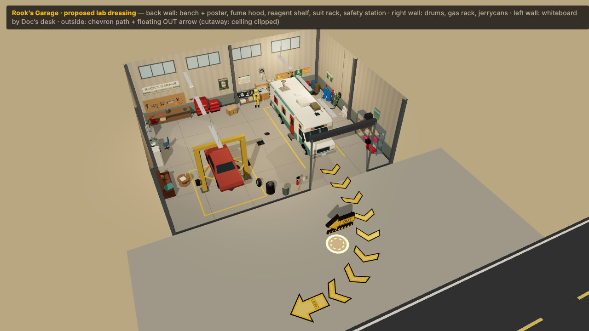
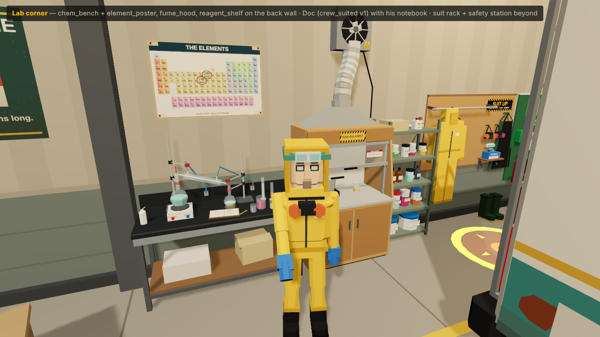
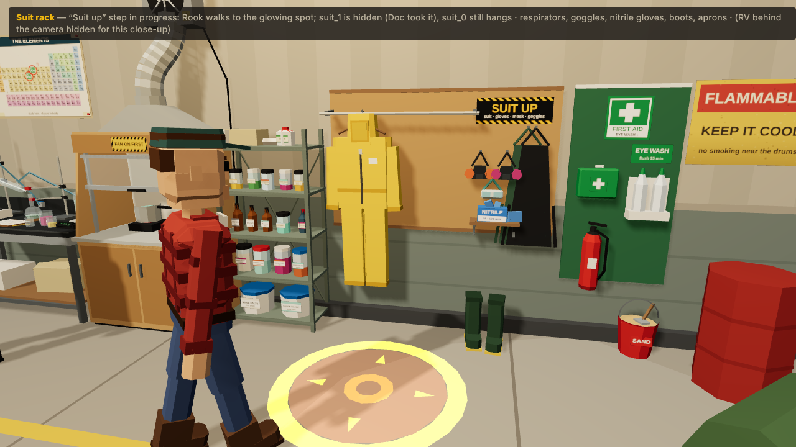
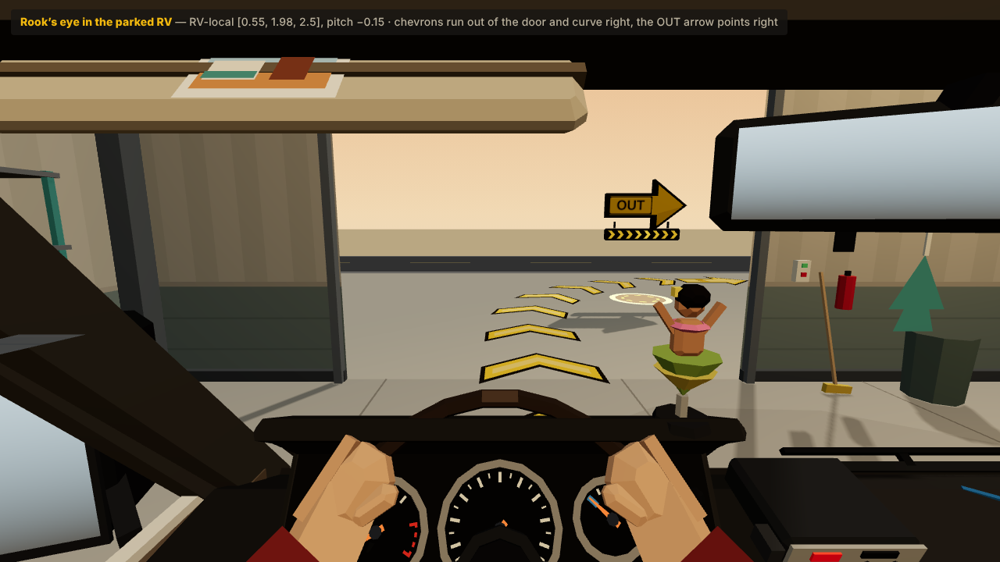
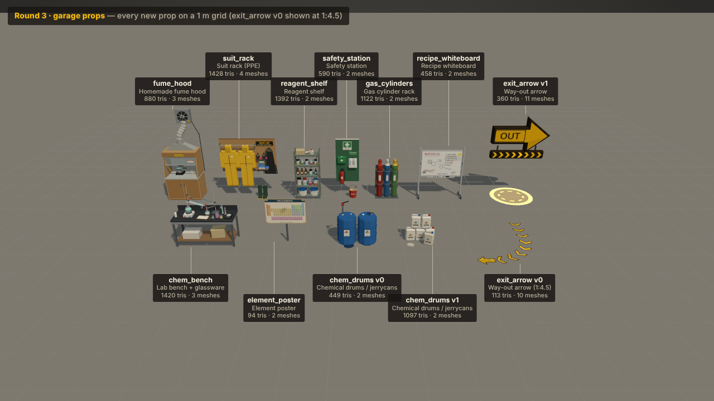
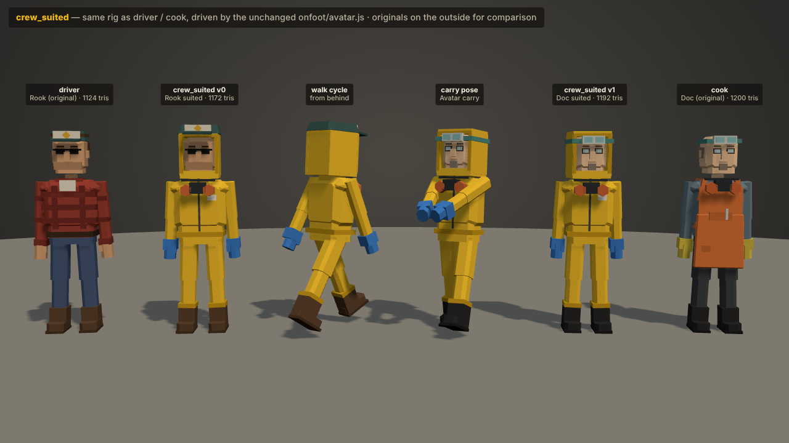

# Round 3 · garage lab, suits and the way out (agent R3-GARAGE)

**Status: proposed.** None of this is wired into the game. The new kinds are registered in the asset kit, under the `x_round3` tab ("Round 3 · Proposed"), and shown in a standalone preview page.

The pack dresses Rook's Garage as Doc's home lab:

- chemistry and cooking gear;
- protective apparel on a wall rack;
- Rook and Doc in yellow protective suits;
- a way-out arrow from the parked RV's nose, out of the roll-up door and to the right.

Everything is an original, low-poly design in the existing kit style. All labels are invented:

- **Jar, drum and cylinder labels** use the game's own ingredient names from `data/lab.json`: MESA SALTS, CANYON SOLVENT, BURNER GAS, PRICKLY SYRUP, COPPER COIL, SCRAP METAL and DESERT GLASS.
- **Hazard diamonds** are four coloured quads with made-up codes.
- **The whiteboard** has only hexagon doodles, arrows, a crossed-out list of the game's own fictional steps and "BATCH #1". It does not show any real synthesis.
- **The element poster** is an original drawing of the periodic-table layout. The **Co** (27) and **Ru** (44) tiles are circled in red: Co + Ru = **Co**ok & **Ru**n.
- **No real brands** appear anywhere.

## Images (1280 × 720)

| | |
|---|---|
|  |  |
| `garage-overview.png`: high three-quarter cutaway (ceiling clipped at 6.2 m, roll-up door hidden) | `garage-lab-corner.png`: bench, poster, hood, shelf; Doc suited with his notebook |
|  |  |
| `garage-suit-rack.png`: the "Suit up" step in progress (suit_1 already taken) | `garage-exit-cab-view.png`: Rook's eye in the parked RV (`rv_cab_fp`, RV-local eye [0.55, 1.98, 2.5], pitch −0.15) |
|  |  |
| `props-lineup.png`: every prop with its tris and meshes | `crew-suited.png`: originals vs suited, plus the walk and carry poses from `onfoot/avatar.js` |

### Preview page

Open `public/r3-garage-preview.html?view=overview|lab|rack|cab|lineup|crew`. The optional parameters are:

| Parameter | What it does |
|---|---|
| `&orbit=1` | Adds orbit controls. |
| `&animate=1` | Runs the chevron chase and the arrow bob live. |
| `&door=0..1` | Sets how far the roll-up door is open. |
| `&cam=x,y,z,tx,ty,tz,fov` | Sets a free camera. |
| `&clip=y\|none` | Sets the cutaway height. |

### Re-rendering

Run `python3 docs/r3/render_r3_garage.py`. It uses Playwright with headless Chromium and SwiftShader, and expects the game server on :3100.

## Files (all new; nothing else was modified)

| Path | What |
|---|---|
| `public/js/assets/expansion/r3-garage.js` | `PACK`: builders, the `x_round3` category, labels and named parts. `userData.size` is set from the measured bounds. |
| `expansion/r3-garage-lab.js` | chem_bench, fume_hood, chem_drums, gas_cylinders, reagent_shelf, recipe_whiteboard, element_poster, safety_station |
| `expansion/r3-garage-gear.js` | suit_rack, crew_suited, exit_arrow. It exports `EXIT` / `exitPath(s)` (the path maths) and `SUIT_HOOKS`. |
| `expansion/r3-garage-atlas.js` | One 1024 × 1280 canvas atlas for every label, sign and drawing, and a `Labels` quad builder. It also has two pack materials: `CR_LabGlass` (translucent) and `CR_ExitChevron` (unlit, per-instance chase). |
| `expansion/r3-garage-layout.js` | **Pure data, with no three.js**: the proposed placements, the extra colliders, the Suit up spots and the arrow placements. The preview imports it, and `sim/garage.js` could import it later. |
| `public/r3-garage-preview.html` | Preview page with camera presets. |
| `docs/r3/*.png`, `docs/r3/render_r3_garage.py` | Renders and the render script. |

## Every kind

Size is the measured bounds, w (X) × h (Y) × l (Z) in metres. Each model's front faces +Z, and the origin is the ground centre of its footprint. Wall props have their back flat at z = −l/2.

Budgets: each prop is at most 1,500 tris and each crew member at most 1,200.

| Kind | v | Size w × h × l | Tris | Meshes | Named parts | Notes |
|---|---|---|---|---|---|---|
| `chem_bench` | 0 | 1.82 × 1.80 × 0.72 | 1,420 | 3 (body, glass, labels) | — | Steel frame with a dark epoxy top. Two retort stands hold two round-bottom flasks in clamps, and a condenser with blue tubing runs to two taps. Also: hot plate, three beakers, two graduated cylinders, a digital scale reading "0.64 g", an open notebook with a pencil, and a wash bottle. |
| `fume_hood` | 0 | 1.25 × 3.24 × 0.75 | 880 | 3 | — | Plywood cabinet and box with a raised glass sash and "FAN ON FIRST" / "SASH DOWN" stickers. A burner and pot sit inside. A galvanised funnel feeds a ribbed foil duct in an S-bend up to a wall exhaust fan (blades, grille, warning triangle). |
| `chem_drums` | 0 | 1.22 × 1.38 × 0.70 | 449 | 2 | — | Two blue HDPE drums with hazard-diamond labels (CANYON SOLVENT, MESA SALTS), a hand pump, a funnel and a drip stain. |
| `chem_drums` | 1 | 0.89 × 0.88 × 0.53 | 1,097 | 2 | — | A stack of six white jerrycans with labelled diamonds (CANYON SOLVENT, PRICKLY SYRUP, RINSE WATER). |
| `gas_cylinders` | 0 | 0.88 × 1.49 × 0.35 | 1,122 | 2 | — | Wall rack with a channel and two mustard bars, with link chains round each cylinder. The three cylinders are maroon BURNER GAS, blue SHOP AIR and green MIX-7, with coloured shoulders and valve caps. A valve key hangs on the rack. |
| `reagent_shelf` | 0 | 0.90 × 1.87 × 0.42 | 1,392 | 2 | — | Five-level metal shelf: two tubs, four big jars, amber bottles, five small jars, a carton and a jug. All 18 label designs come from lab.json names plus hand-written extras. |
| `recipe_whiteboard` | 0 | 1.61 × 1.93 × 0.53 | 458 | 2 | — | Mobile board on T-feet with casters and a marker tray (markers, eraser), a sticky note and a photo. |
| `element_poster` | 0 | 1.24 × 0.84 × 0.02 | 94 | 2 | — | **Origin at the bottom centre** (asset rule). Hang it with `position.y = userData.mountY` (1.95). |
| `safety_station` | 0 | 0.84 × 2.20 × 0.36 | 590 | 2 | — | Green backboard with a green-cross FIRST AID sign, a first-aid box, an eyewash bottle station with its sign, and an extinguisher with a hose on a bracket. A red SAND bucket with a scoop stands on the floor. |
| `suit_rack` | 0 | 2.07 × 2.19 × 0.50 | 1,428 | 4 | `suit_0`, `suit_1` | Plywood board with a SUIT UP sign. Two hanging yellow suits (hood, zip, tag, waist and cuff elastics) hang from pivots at their hanger hooks (`userData.suits.hooks`). Also: two half-face respirators (orange and pink cartridges), goggles, a shelf with a NITRILE glove box, two rubber aprons, and green rubber boots. |
| `crew_suited` | 0 | footprint 0.62 × 1.91 × 0.36 (bounds 0.70 × 1.91 × 0.52) | 1,172 | 6 | `body`, `head`, `arm_l`, `arm_r`, `leg_l`, `leg_r` | **Rook**: hood up, sunglasses and stubble, and he keeps his teal trucker cap on over the hood. |
| `crew_suited` | 1 | footprint 0.62 × 1.85 × 0.36 (bounds 0.67 × 1.85 × 0.44) | 1,192 | 6 | same | **Doc**: hood up, lab goggles pushed up onto the hood, wire glasses and goatee. |
| `exit_arrow` | 0 | 8.77 × 0.01 × 11.28 | 113 | 10 | `chev_0`…`chev_7`, `arrow` | Floor decal path of eight #F2B90F chevrons (1.5 m wide, dark edge). Path: 4.5 m straight, then a 90° right turn with R = 6 m (13.9 m in all). `arrow` is a painted end arrow with "OUT", 0.9 m past the curve. See `userData.path`. |
| `exit_arrow` | 1 | 2.00 × 3.02 × 1.56 | 360 | 11 | same + `spot` | Floating thick arrow (pointing +X, the viewer's right) with an "OUT" plate on both faces, at restY 2.4. A strip of eight chevron lamps `chev_i` hangs under it, and an additive glow `spot` sits on the ground. |

Both crew_suited variants use the same body as `driver` and `cook`:

- Suit #f2c230 with darker #c99a1c seams (neck skirt, waist elastic, ankle bands) and a zip.
- A white tag.
- The respirator hangs round the neck with orange filters.
- Blue nitrile gloves with cuffs.
- Each keeps his own boots.

### Rig check for crew_suited

`crew_suited` v0 and v1 have **identical pivot names, hierarchy and pivot positions** to `driver` and `cook` (checked programmatically). Each is plain `Object3D` pivots holding `<name>_mesh`, built by `people-human.js` `person()`. So `new Avatar(createModel('crew_suited', v))` animates unchanged: `crew-suited.png` shows the stock walk and carry poses. `userData.swapFor` is `'driver'` or `'cook'`.

### Why exit_arrow has the same parts in both variants

`namedParts` is per kind, and the asset check requires every listed part in **every** variant. So each variant carries the other's parts:

- v0 adds the painted end arrow `arrow`, which is where the chase ends.
- v1 adds a chevron lamp strip `chev_0..7` under the floating arrow.

One animation recipe drives either variant:

- **Chase:** call `cloneInstanceMaterials(obj)`. Then each frame, for i = 0..7 for the chevrons and i = 8 for `arrow` (v0), set `k_i = max(0, 1 − |((t/1.2) mod 1)·9 − i| / 1.6)` and `material.color.setScalar(0.62 + 0.38·k_i)`. The material is unlit vertex colour and the colour is a brightness multiplier, so the dark edges stay dark.
- **Bob (v1):** `arrow.position.y = 2.4 + 0.12·sin(2.4t)`.

### Draw calls

The draw calls in each prop are:

- one vertex-colour body;
- one atlas label mesh;
- a translucent glass mesh, for the bench and hood only;
- the separately hideable or animated pivots.

### Asset check

`node public/js/assets/test/check-assets.js` passes every R3-GARAGE kind. At the time of writing, the only failures are `rv_cab_fp_r3#0/#1` (7,173 and 7,133 tris over 6,000). Those belong to the R3-CAB agent's in-progress `r3-cab*.js`.

## Proposed positions (garage_interior-local)

These come from `r3-garage-layout.js` `R3_GARAGE_PLACEMENTS`. Rotation is `rotY`:

- 0 = back to the back wall (z = −7);
- −π/2 = back to the right wall (x = +9);
- +π/2 = back to the left wall (x = −9).

Props sit 2 cm off the wall plane.

| Kind | Position [x, y, z] | rotY | World AABB x / z | Where |
|---|---|---|---|---|
| `chem_bench` | [1.08, 0, −6.62] | 0 | 0.17…1.99 / −6.98…−6.26 | Back wall, just right of the wall column at x ≈ 0. In view of the tutorial's start camera. |
| `element_poster` | [1.08, **1.95**, −6.99] | 0 | 0.46…1.70 / wall | Above the bench (y 1.95…2.79) |
| `fume_hood` | [2.66, 0, −6.605] | 0 | 2.05…3.30 / −6.98…−6.23 | Back wall; the fan sits at y 3.0, under the clerestory windows (4.5 m). |
| `reagent_shelf` | [3.78, 0, −6.77] | 0 | 3.33…4.23 / −6.98…−6.56 | Back wall |
| `suit_rack` | [5.31, 0, −6.73] | 0 | 4.27…6.34 / −6.98…−6.48 | Back wall, behind the parked RV (1.9 m clear to its tail) |
| `safety_station` | [6.82, 0, −6.80] | 0 | 6.40…7.24 / −6.98…−6.63 | Back wall, next to the existing oil drums and the "FLAMMABLE" poster |
| `recipe_whiteboard` | [−8.715, 0, −4.85] | +π/2 | −8.98…−8.45 / −5.66…−4.04 | Left wall between the workbench and Doc's desk, where Doc's tutorial starts |
| `chem_drums` v0 | [8.69, 0, −4.00] | −π/2 | 8.27…8.98 / −4.61…−3.39 | Right wall, beside the existing drum corner |
| `gas_cylinders` | [8.80, 0, −2.85] | −π/2 | 8.63…8.98 / −3.29…−2.41 | Right wall, 0.4 m clear of the charger and its cable |
| `chem_drums` v1 | [8.76, 0, −0.75] | −π/2 | 8.45…8.98 / −1.19…−0.30 | Right wall, between the charger and the mid-wall column |
| `exit_arrow` v0 | [0.612, 0, 10.55] | 0 | — | Path start lands on [4.0, 0, 4.9], 0.8 m past the RV bumper. It runs out of the door, turns right toward −X and ends at the road edge, at about z 15.5. Rule: `position = startsAt − userData.path.start`. |
| `exit_arrow` v1 | [0.9, 0, 12.2] | π | — | Outside the door, inside the curve, facing the RV. It appears about 20° right of centre from the driver's eye. |

The preview also adds one warm point light, `#ffd9a0` at intensity 9, at (4.6, 4.7, −5.2) over the lab wall, alongside GarageView's three lights. This is optional.

### Colliders the sim would add to `LAYOUT.boxes`

These are in `R3_GARAGE_BOXES`, as measured footprints `[minX, maxX, minZ, maxZ]`:

```js
[0.17, 1.99, -7.0, -6.26],   // chem_bench
[2.05, 3.30, -7.0, -6.23],   // fume_hood
[3.33, 4.23, -7.0, -6.56],   // reagent_shelf
[4.27, 6.34, -7.0, -6.48],   // suit_rack (+ boots)
[6.40, 7.24, -7.0, -6.63],   // safety_station (+ sand bucket)
[-9.0, -8.45, -5.66, -4.04], // recipe_whiteboard
[8.27, 9.0, -4.61, -3.39],   // chem_drums v0
[8.63, 9.0, -3.29, -2.41],   // gas_cylinders
[8.45, 9.0, -1.19, -0.30],   // chem_drums v1
```

**What was verified** (scratch script, using the real `LAYOUT` and `planPath`):

- **No overlaps:** no new box overlaps an existing `LAYOUT` box or circle, the building's wall columns (corners, (±9, 0), (0, −7)), or another new box.
- **Clear of use-spots:** none is within 0.75 m of any use-spot, marker, start or crate start.
- **Routes unchanged:** a grid shortest-path with the 0.3 m avatar radius gives every tutorial route exactly the same length with and without the new boxes. For example:
  - Rook: keys → plug, 13.99 m.
  - Doc: notebook → crate, 7.82 m.
  - Crate → side door, 6.59 m.
  - New legs: keys → suit_0 spot, 8.98 m; notebook → suit_1 spot, 13.50 m.
- **AI paths clear:** the solo-AI `planPath` routes do not pass within 0.3 m of any new box.

Optionally, add the hood to GarageView's camera occluders `OCC`: `[2.05, 3.30, 0, 3.3, -7.0, -6.23]`.

## Integration notes: new "Suit up" tutorial step

The data is in `R3_SUIT_UP` in `r3-garage-layout.js`. The step is to walk to the rack, hold E for 1.5 s, swap the avatar to `crew_suited`, and hide that player's suit pivot.

**Order.** It goes after **grab**: `markers · grab · suit · load (Doc) ∥ door (Rook) · board · crank`. Both players are near the back wall after grab:

- Rook is at the key rack (−4.25, −6.0).
- Doc is at his desk, and his next target is the crate at (−0.9, −5.45).

Doc carries the notebook into the step; the swap re-parents it.

**Sim (`sim/garage.js`):**

1. Add `'suit'` to `STEPS` after `'grab'`.
2. Add `LAYOUT.use.suit = { rook: { x: 4.65, z: -5.8 }, doc: { x: 5.27, z: -5.8 } }`. Each spot is 0.68 m in front of its suit and 1.25 m from the RV tail. Both spots are within the 1.2 m interact radius of one shared glow at (4.96, −5.8).
3. Append `R3_GARAGE_BOXES` to `LAYOUT.boxes`. `planPath`'s nav nodes rebuild from the boxes; the cache is filled on first use.
4. Add a state field `items.suit = { rook: 'rack', doc: 'rack' }`. Each value is `'rack'`, `'holding'` or `'on'`.
5. Add `suitHold = { rook: 0, doc: 0 }`, in seconds.
6. In `_rookTask()`, after `c.grab`, return `'suit'` if `items.suit.rook !== 'on'`, before `'plug'`.
7. In `_docTask()`, return `'suit'` before `'crate'`.
8. In `update()`:
   - If a player's task is `'suit'`, they are within `cfg.interact` of their spot, and E is held, then `suitHold[who] += dt`.
   - Otherwise decay it at 2× speed, as the crank does.
   - At `cfg.holdSeconds` (1.5), set `items.suit[who] = 'on'` and call `_fb(who, 'suit')`.
   - When both are `'on'`, call `_complete('suit')`.
9. **Rook's hold:** use the existing `interactHeld`, keeping the edge-only fallback: with `!sawHeldField`, one press completes the step after 1.5 s.
10. **Doc's hold:** `CMD.avatarAct` is an edge. Add a held level by extending `CMD.avatarMove` with `hold: 0|1`, sent on change and then at the usual 15 Hz. Keep a `docHeld` level like `rHeld`, with the same `cmdTimeout`.
11. **Solo AI:** add a `'suit'` goal with `U.suit.doc`. On arrival, face the rack (−Z), then hold for 1.5 s. A `holdT` counter replaces the `wait` and `act` beat.
12. **Prompts:**
    - `rook.suit` / `doc.suit`: "Suit up at the rack: hold [E]".
    - `suiting`: "Keep holding [E]…".
    - Partner text: "suiting up".
13. **`_target`, `_isNear`:** `'suit'` maps to the player's spot, so the marker and the bobbing arrow follow automatically.
14. **Snapshot:** add `items.suit` and `suitHold: { rook, doc }` normalised to 0..1. Update the `EXPANSION_CONTRACT.md` "Snapshot additions".
15. **`skip()`:** set `items.suit = { rook: 'on', doc: 'on' }`.

**View (`onfoot/GarageView.js`):**

1. Add `createModel('suit_rack')` at `R3_GARAGE_PLACEMENTS`, and the other props too. They could later be merged into `garage_interior` itself.
2. Add `STEP_LABEL.suit = 'Suit up'`.
3. Show the hold ring with `this.hud.hold(G.suitHold[me], 'E')` while `task === 'suit'`.
4. Add `FB_TEXT.suit = 'Suited up ✓'`.
5. **Swap.** When `items.suit[who]` first becomes `'on'`:
   1. Create `const nu = new Avatar(createModel('crew_suited', who === 'rook' ? 0 : 1), { name: who })`.
   2. Copy the pose with `nu.set({ ...old.s })` and add it to `root`.
   3. Move anything parented to `old.handR` (Rook's keys, Doc's notebook) to `nu.handR`.
   4. Remove `old.root` and assign `this.av[who] = nu`.
   5. Hide `rack.getObjectByName(who === 'rook' ? 'suit_0' : 'suit_1')`.

   A short puff or flash covers the pop. Name tags use `av.headWorld()`, which still works.
6. The suited avatars stay suited through boarding, so Doc cooks in the suit.

**Unity:** the suit pivots are child GameObjects, so set `SetActive(false)` on them. The avatar swap is a prefab swap on the same Animator (same bone names).

## Integration notes: the way-out arrows

**When to show them:**

- Show both once `items.door ≥ 0.9` (the door is up). From the cab, the floating sign reads best once the engine is `'on'`.
- Hide them when the RV passes the end arrow, at path length 13.9 m (`exitPath(s)` gives the world point), or after about 10 s of driving.

**Where they live:** they must outlive GarageView's fade-out. Add them under a group with the same transform as `GarageView.root` (`garageFrame`: `ox`, `oz`, rot +π/2), not inside `root`, which is hidden on exit. Also, `rooks_garage`'s apron is at the track surface height `baseY`; `GarageView` already lifts its root by that amount.

**Animation:** see the chase and bob recipes above. Both arrows are cheap: 113 + 360 tris and 21 small draw calls. Each chevron is its own mesh so it can light independently.

**Placement in other garages:** the path follows the RV. If the RV park ever moves, place v0 with `position = nose − rotY(userData.path.start)` and `rotation.y = park yaw`.

## Things I could not do / caveats

- **Asset check is not ALL OK yet.** The full asset check currently ends in 2 failures, both on `rv_cab_fp_r3`, which belongs to R3-CAB. All R3-GARAGE kinds pass. Once that file is back under budget, the check should end ALL OK.
- **Preview-only scenery.** The overview is a cutaway (ceiling clipped at y 6.2, roll-up door hidden), and the rack close-up hides the RV behind the camera. The apron, road and desert outside the door are also preview-only.
- **Partial occlusion.** The suit rack sits behind the parked RV. It is reachable (1.9 m clear) and lit by the glow marker, but the RV hides it from the default tutorial camera until a player walks round the RV's tail. The bench, poster, hood and shelf are in direct view from the start positions.
