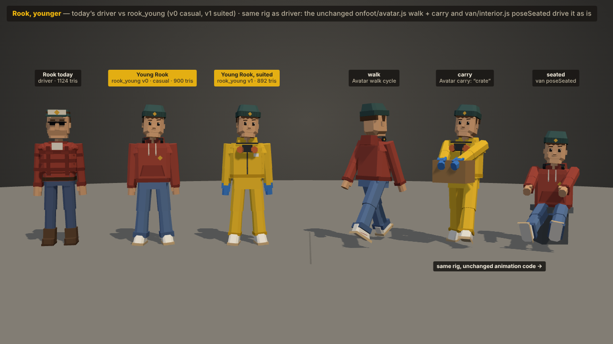
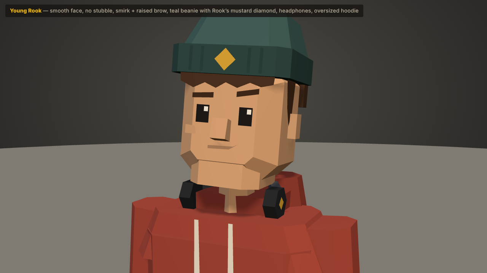
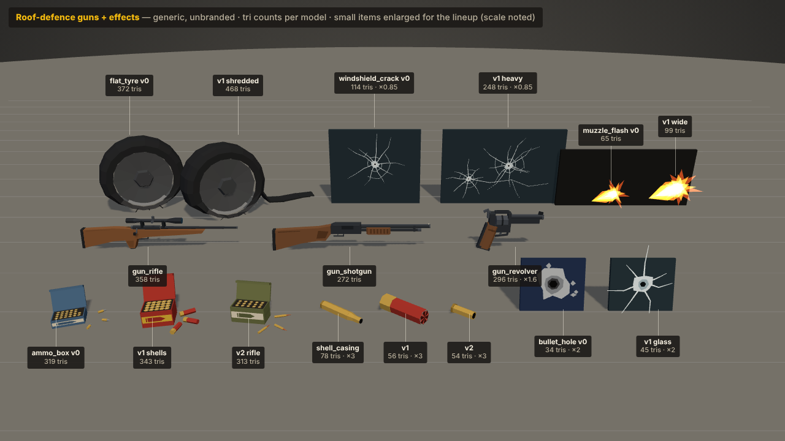
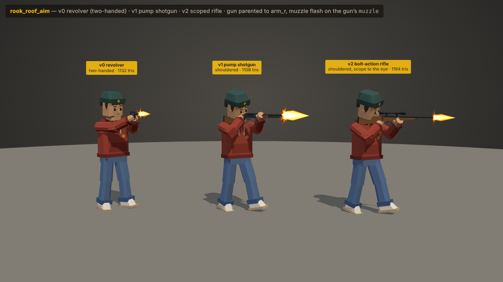
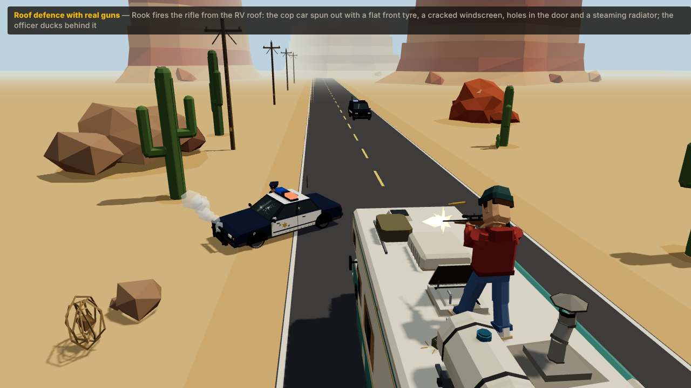
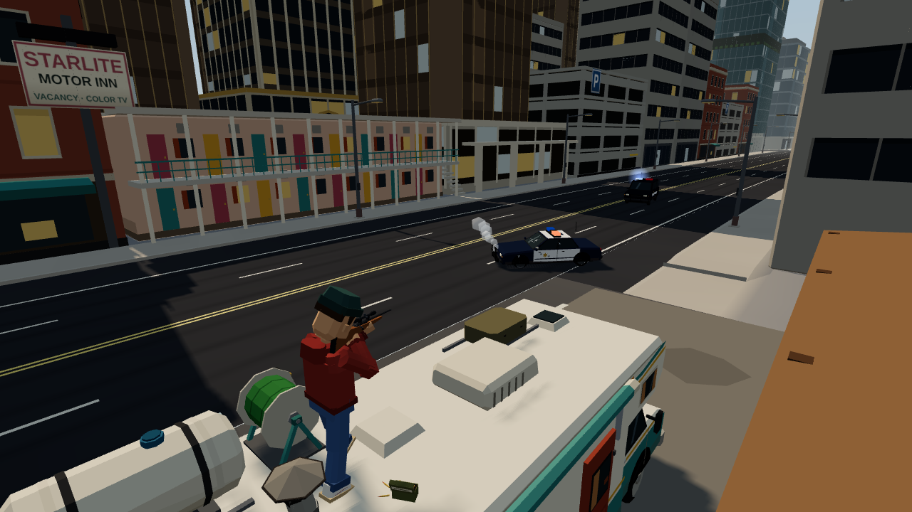

# Round 3 · a younger Rook and real guns for the roof defence (agent R3-ROOK)

**Status: proposed.** None of this is wired into the game. The new kinds are registered in the asset kit under the `x_round3` tab ("Round 3 · Proposed") and shown in a standalone preview page.

It answers two pieces of feedback:

- *"provide a model of the rook more like if he is a boy"* → `rook_young`: Rook as a young **adult** (about 20). He has a smooth face with no stubble or moustache, a narrow chin and a slim neck. He wears a teal beanie carrying his old cap's colours and mustard diamond, over-ear headphones round the neck, an oversized brick-red hoodie (the colour of his old flannel), baggy jeans and white high-tops. His stance is a bit cocky: chin up, a smirk, one raised brow, feet planted wide and turned out. It is an original outfit, not any TV character's costume.
- *"for defend add real guns"* → a revolver, a pump shotgun and a scoped bolt-action rifle, with ammo boxes, muzzle flashes and spent casings. There is a roof-aiming Rook for each gun, plus cop-car damage for the effects layer. **Tone:** shots hit the police *cars*: tyres go flat, windscreens crack, bodywork gets holed and radiators steam. Officers duck. There is no blood and no gore, and the models carry nothing that could show any.

All guns are generic, unbranded designs with no manufacturer names, logos or text.

## Images (1280 × 720)

| | |
|---|---|
|  |  |
| `rook-young.png`: today's `driver`, then `rook_young` v0 and v1, then v0/v1 driven by the **unchanged** `onfoot/avatar.js` (walk, carry "crate") and the `van/interior.js` seated pose | `rook-young-closeup.png`: head and shoulders, 3/4 view |
|  |  |
| `guns-lineup.png`: every new prop and decal with its tri count (small items enlarged; the scale is noted on each label) | `rook-roof-guns.png`: the three aiming poses, each with a muzzle flash on its gun's `muzzle` |
|  |  |
| `rook-roof-scene.png`: real `rv` + `cop` models. The cop has spun out with a flat front tyre (`fitFlatTyre`), the heavy windscreen crack (`stickOnWindscreen`), holes in the door and rear glass and a steaming grille. The officer ducks behind it and a second cop is coming | `bg-roof-rook.png`: the **real game world** (`WorldView`, driver role) parked at Bolt & Barrel, with the roof camera's over-the-shoulder pose and no labels or HUD, as a UI-mockup background |

### Preview page

Open `public/r3-rook-preview.html?view=young|closeup|guns|aim|scene|bg`.

| Parameter | What it does |
|---|---|
| `&orbit=1` | Adds orbit controls. |
| `&cam=x,y,z,tx,ty,tz,fov` | Sets a free camera. |
| `&labels=0` | Hides the caption and tags. |
| `&flash=0` | In `aim`, leaves the muzzle flashes off. |
| `&one=0..2&yaw=` | In `aim`, shows one figure at the origin, for inspection. |
| `bg`: `&lead=` `&pitch=` `&dist=` `&sh=` `&hour=` `&stop=<id>` `&flash=1` | Sets the camera lead past the target (0.3), pitch (−0.27), distance (3.4) and shoulder offset (1.05; the game uses 3.6 and 0.85, widened a little so the rifle clears his head), the time of day and the route stop. `&flash=1` adds a muzzle flash. |

To re-render, run `python3 docs/r3/render_r3_rook.py [--only young,bg]`. It uses Playwright with headless Chromium and SwiftShader against the game server on :3100. The `bg` shot takes about 25 s because it streams the real world chunks.

## Files

| Path | What |
|---|---|
| `public/js/assets/expansion/r3-rook.js` | `PACK`: builders, the `x_round3` category, labels and named parts. It also exports `R3_ROOK_KINDS` and `R3_ROOK_BUDGET`. |
| `expansion/r3-rook-body.js` | `rook_young`, `rook_roof_aim`. Exports `rookFigure` (the builder, with pose hooks), `rookPerson`, `ROOK_PIVOTS`, `EYES`, `solveAim`, `AIM_TYPES` and `ROOK_COL`. |
| `expansion/r3-rook-guns.js` | Gun parts `revolverParts`, `shotgunParts`, `rifleParts` (also as `GUN_PARTS`), plus `buildGun`, `ammo_box`, `muzzle_flash` and `shell_casing`. |
| `expansion/r3-rook-fx.js` | `bullet_hole`, `windshield_crack`, `flat_tyre`, the helpers `stickOnWindscreen(car, crack)` and `fitFlatTyre(car, wheel, model)`, `decalMaterial()`, and `WINDSCREEN` / `COP_WHEEL`. |
| `expansion/index.js` | **Two lines only**: the `r3rook` import and its entry in `PACKS`. |
| `public/r3-rook-preview.html` | The preview page. |
| `docs/r3/render_r3_rook.py` | The render script. |
| `docs/r3/*.png` | The six images above. |

No game wiring was touched: main.js, sim/\*, onfoot/\*, van/\* and render/\* are unchanged. The preview *imports* `Avatar`, `WorldView`, `sim/roof.js` (`rvToWorld`) and `hazards-util.js` (steam puffs) read-only.

## Every kind (tris = whole model; meshes = draw calls)

| Kind | v | Tris | Meshes | Named parts | Notes |
|---|---|---|---|---|---|
| `rook_young` | 0 casual | 900 | 6 | body, head, arm_l, arm_r, leg_l, leg_r | ≤ 1,200 character budget. 0.71 × 1.93 m including the beanie |
| | 1 suited | 892 | 6 | same | `crew_suited` colours (#f2c230 / seams #c99a1c / nitrile #3f7fd0), hood **down** on his back, respirator round the neck, blue gloves, beanie on |
| `rook_roof_aim` | 0 revolver | 1,132 | 11 | + gun, cylinder, hammer, muzzle, grip | Two-handed, square (isosceles) stance |
| | 1 shotgun | 1,108 | 10 | + gun, pump, muzzle, grip | Shouldered, bladed 0.4 rad |
| | 2 rifle | 1,194 | 10 | + gun, bolt, muzzle, grip | Shouldered, scope at the right eye, cheek on the comb |
| `gun_revolver` | 0 | 296 | 5 | gun, cylinder, hammer, muzzle, grip | 6-shot DA, 5" barrel with an under-lug, wood grip, ×1.25 size, 0.29 m long |
| `gun_shotgun` | 0 | 272 | 4 | gun, pump, muzzle, grip | Pump, vent rib + bead, tube magazine, ribbed wooden pump, 1.14 m |
| `gun_rifle` | 0 | 358 | 4 | gun, bolt, muzzle, grip | Walnut stock with pistol grip and comb, tapered barrel, scope on two rings, 1.15 m |
| `ammo_box` | 0 / 1 / 2 | 319 / 343 / 313 | 2 | lid | Revolver rounds / shotgun shells / rifle rounds: open carton, heads-up rounds, 3 loose rounds, colour band + cartridge silhouette (no text). `lid.rotation.x` 0 closed … −1.95 open |
| `muzzle_flash` | 0 / 1 | 65 / 99 | 1 | flash | Star / wide. Unlit additive (`CR_MuzzleFlash`, black = invisible), so not in the shadow pass |
| `shell_casing` | 0 / 1 / 2 | 78 / 56 / 54 | 1 | casing | Rifle brass / red shotgun hull / revolver brass, 1.5× size |
| `bullet_hole` | 0 / 1 | 34 / 45 | 1 | decal | In painted steel (bare-metal chip ring) / in glass (frosted ring + star cracks), ~0.1 m |
| `windshield_crack` | 0 / 1 | 114 / 248 | 1 | decal | One spider-web impact (0.6 m) / heavy: two impacts + a run crack (1 m) |
| `flat_tyre` | 0 / 1 | 372 / 468 | 1 | wheel | Deflated (squashed, bulging sidewall, scraped rim lip) / shredded (a tread flap trailing on the ground). Fits the cop/sedan wheel (r 0.34, w 0.24) |

`node public/js/assets/test/check-assets.js` ends **ALL OK** (239 kinds, 432 variants, with every pack registered). The checker allows 6k tris for any `x_*` kind, so this pack holds itself to the stated budgets: characters ≤ 1,200 (max 1,194) and props ≤ 1,500 (max 468).

## The young Rook rig: how `onfoot/avatar.js` uses it

`rook_young` is a **drop-in** for `createModel('driver')` (v0) and `crew_suited` v0 (v1). It has the same pivot names, hierarchy and positions, verified numerically against `driver`:

```
rook_young (root)
└─ body   (0, 0.88, 0)          ← pelvis
   ├─ head   (0, 1.47, 0)       ← neck top, face +Z
   ├─ arm_l  ( 0.2491, 1.36, 0) ← shoulders (driver build 1.06)
   ├─ arm_r  (−0.2491, 1.36, 0)
   ├─ leg_l  ( 0.1113, 0.88, 0) ← hips
   └─ leg_r  (−0.1113, 0.88, 0)
```

- Each pivot is a plain `Object3D` holding `<name>_mesh` with the shared vertex-colour material. In the bind pose every pivot has rotation 0 and the pose is baked into the meshes, as `people-human.js` / `crew_suited` do.
- The hand centre is pivot + (0, −0.62, 0), which is `Avatar.handR` / `handL`. Arm and leg lengths are the same as the driver's (`UPPER`, `LOWER`, `THIGH`, `SHIN` from `people-human.js`).
- **Walking and carrying:** `new Avatar(createModel('rook_young', v))` works unchanged: walk/run cycles, carry/push/reach, crouch, wave, cheer and slip. `rook-young.png` shows the walk and "crate" carry produced by the unmodified `Avatar`.
- **Sitting:** `van/interior.js poseSeated(m)` sets the same leg and arm rotations on any model with these pivots. Seat the root at `seatY − 0.88`, as the van does for `driver`.
- The baked head attitude (chin up 0.07, turned 0.1, tilted 0.05) adds under Avatar's `head.rotation`. The feet are turned out 0.2 / 0.12 rad about their own Y, which the walk cycle (rotation.x) keeps.

**To swap Rook in later:** use `createModel('rook_young', 0)` wherever `createModel('driver')` builds Rook (on foot, garage, van cab). In the garage "suit up" step, use `rook_young` 1 for `crew_suited` 0.

## `rook_roof_aim`: how the roof script would use it

The rig is the same, and the gun is a **`gun` pivot under `arm_r`**, carrying `muzzle`, `grip` and the animated parts.

**How the hold is solved** (`solveAim(type)`):

1. The head is cocked onto the sight line.
2. The gun is placed so that its sight sits in front of the aiming eye. The sight is the scope eyepiece for the rifle, the receiver rib for the shotgun and the rear sight for the revolver.
3. The right hand is IK'd to the gun's `grip` and the left hand to its `support` point (pump or fore-end).
4. The feet are IK'd flat onto the roof.

The long guns are held **0.4 rad across the body** (`userData.aim.yawOffset`). This is a bladed stance: the torso stays square to the rig, so both shoulder pivots share one pitch axis, and the left hand can reach the fore-end.

At runtime, with RV-local aim yaw and pitch as `sim/roof.js` defines them (yaw 0 = RV forward):

```js
const m = createModel('rook_roof_aim', 2);              // 0 revolver · 1 shotgun · 2 rifle
m.position.set(ROOF_GEOM.stance.x, ROOF_GEOM.roofY, ROOF_GEOM.stance.z);   // under the RV anchor
m.rotation.y = aimYaw - (m.userData.aim.yawOffset || 0);
m.getObjectByName('arm_l').rotation.x = -aimPitch;      // both arms about the shared shoulder axis,
m.getObjectByName('arm_r').rotation.x = -aimPitch;      // so the left hand stays on the gun
m.getObjectByName('head').rotation.x = -0.9 * aimPitch;
const muzzle = m.getObjectByName('muzzle');             // shot origin = world position, direction = world +Z
```

- This mirrors `RoofScene.poseDoc` (arms `rotation.x` from the aim pitch, model `rotation.y` from yaw), so the current roof camera, aim maths, `hoseTest`-style cone and `throwFlightTime` code keep their shape. The hose cone becomes a hit-scan ray from `muzzle`.
- `roofScene.js` draws `doc_roof` at scale 0.92 (the preview's `bg` does the same for Rook). Because of that scale, `ROOF_GEOM.nozzle` (y 4.2) should be read from `muzzle` instead of the constant.
- **Firing a shot:**
  1. Show a `muzzle_flash` for 1–2 frames: take `createModel('muzzle_flash', v)`, call `cloneInstanceMaterials` on it, re-parent its `flash` pivot to `muzzle` at position 0 with a random `rotation.z` and scale 0.8–1.2. Use v1 for the shotgun.
  2. Kick `camera.kick` / RoofCamera recoil.
  3. Animate the action using `userData.gun.anim`:
     - revolver: `hammer.rotation.x` 0 → −0.6 → 0, then `cylinder.rotation.z += π/3`;
     - shotgun: `pump.position.z` 0 → −0.09 → 0;
     - rifle: `bolt.rotation.z` → −1.05, then `bolt.position.z` → −0.09, then back.
  4. Eject a `shell_casing` from the gun's right side (−X): v1 on the pump, v0 on the bolt pull. A revolver keeps its brass until reloading (v2, ×6).
- **Ammo:** `ammo_box` v0/1/2 is the per-stop pickup (on the roof, or in the shop as loot), refilling 6 / 5 / 4 rounds (`userData.gun.rounds`).

## Cop-car effects layer

**Decals** (`bullet_hole`, `windshield_crack`) lie flat facing +Y. The `decal` pivot sits 3 mm up, and they use `decalMaterial()`, which is matte vertex colour with polygon offset −4.

- **Any hit:** set `d.quaternion.setFromUnitVectors(UP, hitNormal)`, add a random spin about the normal, and place it at hit + normal·0.015. The car is a rigid hierarchy, so parent the decal to the hit mesh's pivot. Use `body` for the bodywork, so it follows the suspension lean.
- **Windscreen:** `stickOnWindscreen(cop, createModel('windshield_crack', v))` uses `userData.mount.cop`. The mount is under the cop's `body` at `pos` [0.26, 1.153, 0.54] (v0, driver's side) or [0.05, 1.13, 0.573] (v1), with `rot` [0.6005, 0, 0]. It is computed from the `cop` cabin frustum in `vehicles.js`.
  - Other vehicles: add their windscreen centre and normal to `WINDSCREEN` in `r3-rook-fx.js`, or use the generic normal alignment above.
  - Escalation: first hit = `bullet_hole` v1 on the glass, second = crack v0, third = crack v1.

**Flat tyre:** `fitFlatTyre(cop, 'wheel_fl', createModel('flat_tyre', v))` does four things:

1. Hides `wheel_fl_mesh`.
2. Adds the flat wheel as a sibling of the wheel pivot, so it doesn't inherit spin, `sag` (0.07 m) lower.
3. Turns its outer face out (rotation π for −X wheels).
4. Rolls the car `body` toward that corner.

It works on `cop` and `sedan`, which share r 0.34 and w 0.24. For other cars, scale it by `r / 0.34`. In the sim this pairs with the cop's spin-out + stall state.

**Radiator steam:** the preview's `steam()` uses `hazards-util.js` `puffGeometry` + `steamMaterial` at the cop's grille (`body`-local [0, 0.7, 2.42]). The effects layer's own steam particles can use the same point.

**Officers:** `cop_officer` + `Avatar.set({ crouch: 1 })` behind the car (see the scene shot). No hit reactions on people are proposed.

## Known limits / ideas

- **Rifle stock height.** The guns are posed for the shared rig with its big head, so the long guns' stocks rest high on the shoulder (cheek weld rather than a deep shoulder pocket). It reads fine at game distance and in the close-ups.
- **Revolver one-handed.** v0 is two-handed (the stable read). A one-handed, cocky variant would be a 4th `AIM` entry in `r3-rook-body.js` (no left-arm IK) if wanted.
- **`flat_tyre` on other vehicles.** It is only authored for the cop/sedan wheel. The SUV and interceptor would need their own radius, or a scale.
- **`bg` camera.** The `bg` image uses a slightly wider shoulder offset (1.05 vs 0.85) and a 0.3 rad lead past the target, so the rifle reads in 3/4 instead of hiding behind his head. The game's roof camera would want the same tweak in "gun" mode.
- **Headphones.** They are on v0 only. They're dropped from `rook_roof_aim` to keep it under 1,200 tris.
