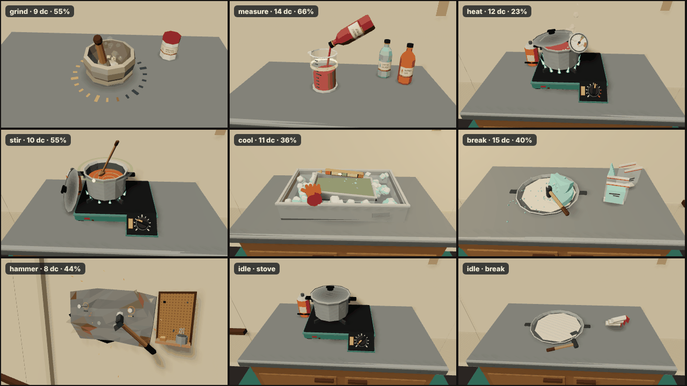

# 3D cook stations: presenters and the CookLab presence extension (Agent VANCOOK)

Each cooking step is played in 3D at a station in the van, with the mouse on real props. A **presenter** is the 3D view and input layer for one step type. It sits on a station's anchor, reads the **live** minigame (`lab.current`, the same object `CookLab.update()` advances) every frame, and turns raycast hits into that minigame's own input. The logic stays in `public/js/cook/minigames/*` and is unchanged. The 2D CookUI still works.

All chemistry is fictional. Labels show the invented `lab.json` names (Prickly Syrup, Canyon Solvent, Burner Gas, Mesa Salts).



## Files

| Path | What it does |
|---|---|
| `public/js/cook/stations.js` | `STEP_STATION`, `STEP_STATIONS`, `stationForStep(type)`. Pure, no three.js, so Node tests can import it. |
| `public/js/cook/CookLab.js` | Presence extension (additive), described below |
| `public/js/cook/test/lab-headless.js` | Adds 25 presence tests (`node public/js/cook/test/lab-headless.js`) |
| `public/js/van/presenters/index.js` | `createPresenter`, `buildIdleProps`, `disposeIdleProps`, `STEP_STATION`, `presenterTypes`, `idleStations`, `Presenter` |
| `public/js/van/presenters/Presenter.js` | Base class: state helpers, bump shake, key gating, dispose, `drawCalls()` |
| `public/js/van/presenters/{grind,measure,heat,stir,cool,break,hammer}.js` | One presenter per step type |
| `public/js/van/presenters/props.js` | Shared prop builders, `LAYOUT` (anchor-space placement), palette `VC`, cached materials, `LiquidPrism`, contact shadows, canvas labels and gauge |
| `public/js/van/presenters/idle.js` | Resting props per station. Uses the same builders and `LAYOUT` as the presenters. |
| `public/js/van/presenters/fx.js` | `ParticlePool` (one InstancedMesh per pool) and `FlameRing`. The world particle system fades within 6 m of the camera, so it can't be used at a 1 m close-up. |
| `public/van-presenters-test.html` + `presenters/test/bench.js` | Bench harness |
| `public/js/van/presenters/test/playthrough.py` | Playwright end-to-end test (real mouse and keyboard) |

## API (VAN_CONTRACT "Presenter API" plus additions)

```js
import { createPresenter, buildIdleProps, disposeIdleProps, STEP_STATION, presenterTypes, idleStations } from './van/presenters/index.js';

STEP_STATION   // { grind:'grind', measure:'measure', heat:'stove', stir:'stove', cool:'cool', break:'break', hammer:'hammer' }
presenterTypes // ['grind','measure','heat','stir','cool','break','hammer']
idleStations   // ['grind','measure','stove','cool','break','hammer']

const idle = buildIdleProps(stationId, { lab: data.lab }?)  // Object3D in anchor space, or null (unknown station)
disposeIdleProps(idle)                                      // frees the geometry it owns (materials are shared caches)

const p = createPresenter(type, { anchor, lab, game, step, recipe })  // null for an unknown type (or no live game)
p.update(dt, { feel, active })      // active = Doc is working this station; inactive → drags end, held keys clear, input ignored
p.pick() → Object3D[]               // call it PER RAYCAST: while dragging it returns only an invisible drag plane
p.pointerDown(hit) → bool           // hit = { local: Vector3 (anchor space), object } | null. Returns true if consumed.
p.pointerMove(hit) / p.pointerUp(hit)   // null-safe; pointerUp(null) always releases
p.key(code, isDown) → bool          // see "Keys" below
p.camera() → { pos, target, fov }   // anchor space, about 0.85–0.97 m from the target, fov 34–46
p.hint                              // short control hint (changes with the state: "Faster — match the pulse")
p.dispose()
// additions
p.cursor          // CSS cursor ('grab', 'pointer', 'ns-resize', 'ew-resize', 'crosshair'; 'default' when not playable)
p.game, p.type, p.progress, p.score, p.playable
p.drawCalls()     // visible draw calls under the presenter (budget check)
p.debugTargets()  // test/automation aim points in anchor space (plain arrays):
                  //  grind/stir {kind:'circle', center, radius}   measure {kind:'hold', point, beaker, level, min, max, rate}
                  //  heat {kind:'knob', point, up, right, perDial, dial, temp}   cool {kind:'slide', point, axis, perHand, d, tilt}
                  //  break/hammer {kind:'click', points:[[x,y,z],…]}
```

**Hits.** VanLab3D's `_presenterHit` matches this design. It raycasts `p.pick()` and, when nothing is hit, falls back to the counter plane (y = 0) or the wall plane (z = −0.6) with `object: null`. Every presenter accepts that fallback:
* measure pours on any press,
* break and hammer pick the nearest shard or nail,
* grind and stir only start a drag within about 0.22 m of the bowl.

**Keys.** `key()` consumes a keyup **only if it consumed the matching keydown**. A walk key can therefore never get stuck in VanLab3D's `held` set. Keys are only played while the step is playable.

| Step | Keys |
|---|---|
| heat | A / ← / ↓ / − turn the gas down; D / → / ↑ / = turn it up (tap: ±0.03, hold: 0.42/s) |
| cool | A / ← and D / → slide the glove |
| measure | hold Space to pour |

W and S always pass through. While a heat or cool presenter is playable, A and D are captured, so Doc leaves the station with Q or Esc.

## Gating and timing (CookLab extension)

```js
lab.setPresenceMode('any' | 'station')   // default 'any' = old behaviour (2D UI)
lab.setPresence(stationId | null)
lab.stationForStep(type)                 // via cook/stations.js
lab.awayFromStation                      // true in 'station' mode while a step runs and Doc isn't at its station
lab.stepStation                          // station of the current step, or of the NEXT step during the 1.1 s pause; null when not cooking (addition)
lab.presenceMode, lab.presence           // read-only state
```

In `'station'` mode:

* `inputEnabled` is false while away, so `lab.pointerDown/Move` and `lab.key` are refused.
* While away, every step type except `heat` pauses: no `update()`, no progress, no settle or judge timers.
* `heat` keeps simulating. Temperature drifts toward the dial's equilibrium, progress still counts while in the band, and going above `fireAt` starts a fire.
* Fumes and fire hazards always run.
* Walking away (going from present to away) calls `pointerUp()` on the minigame, so a held pour or drag is released.
* Emits a `presence` event `{ mode, station, away }`. CookUI ignores unknown events.
* `lab.pointerDown` no longer beats the fire from 2D focus coordinates in this mode. VanLab3D handles fire through `extinguish()` and `useExtinguisher()`.

Presenters gate input themselves too: `p.playable = active && lab.inputEnabled && lab.current === game && !done`. Direct methods (`heat.setDial`, `break.snap`) obey the same gate.

## Per presenter: what you see, how input maps to the logic

All placement is in **anchor space** (`props.js LAYOUT`): counter top at y = 0, Doc on +Z. Static parts are merged through the art `Kit` into one vertex-coloured mesh with the shared matte material. Draw calls are measured during play; all are well under the 25 budget.

### grind (7–9 draw calls)
* **Props:** stone mortar and pestle, plus a labelled Mesa Salts jar.
* **Input:** drag circles over the mortar. The pestle head follows the pointer on a horizontal plane at the rim height (y = 0.112), and the handle leans outward.
* **Mapping:** the hit's (dx, dz) from the mortar centre maps to the minigame's focus coordinates: `nx = 0.5 + dx·3/ASPECT`, `ny = 0.58 + dz·3·0.42`. This makes the angle equal `atan2(dz, dx)` and the radius `3·|d|`, inside the logic's accepted band (1.2–25 cm).
* **Feedback:**
  * Crystals (`game.chunks`) shrink and a powder mound grows with progress.
  * A ring of 4 ticks per turn lights up mustard, then turns green when done.
  * Soft dust puffs come off the pestle while turning.
  * On a bump (powder drops or `shakeT` jumps), the mortar wobbles and a spray of powder flies over the rim onto the counter.

### measure (12–16 draw calls)
* **Props:** a graduated beaker, plus a rack of 3 labelled bottles. The step's material is the bottle that pours.
* **Input:** press and hold on the bottle or beaker (or anywhere on the counter, or hold Space). This calls `game.pointerDown()`; release calls `pointerUp()`.
* **Feedback:**
  * The bottle lifts and tips (2.1 rad about Z) and a stream mesh runs from the neck to the surface, wobbling with `game.wobble`.
  * The liquid is a `LiquidPrism` whose top tilts with `game.tilt` (lateral g) and sloshes.
  * The target band `[min, max]` is an additive green ring band on the wall. It brightens when the level is inside it and pulses while settling.
  * Drops are mirrored from `game.drops` (misses, bump splashes).
  * Overfill runs down the outside and makes a puddle.

### heat (10–13 draw calls)
* **Props:** a teal camp stove with a sloped front control panel and a big chunky knob, the dented pot with its lid ajar, a gas canister, and a dial thermometer clipped to the pot.
* **Input:** drag the knob. The drag plane is parallel to the panel. Moving up the panel or to the right raises the dial: `dial = d0 + (Δ·up + Δ·right) / 0.13 m`, applied with `game.setDial()`. A and D also work.
* **Feedback:**
  * The panel ticks are coloured from the step's numbers: green for the band dials, red from the dial that reaches `fireAt` (`dialForTemp`).
  * The flame ring (an additive `FlameRing`) grows with the dial and shifts blue → orange. It flickers hard when overheating.
  * The needle follows `game.temp` on a face texture showing the band and fire zone.
  * Liquid colour and glow follow the temperature, with steam from the lid gap and bubbles when boiling.
  * The lid rattles above `bandMax` and slides from on to ajar when the step starts.
  * When `lab.fire > 0`, local flames bloom around the pot. The lab-wide fire is VANWORLD's.

### stir (10–12 draw calls)
* **Props:** the same stove set (`buildStoveSet`) with the same knob scale. The lid lifts off and is propped against the stove (animated from ajar). A wooden spoon.
* **Input:** drag circles in the pot. The plane sits at the liquid surface. Mapping is the same as grind, with centre (0.42, 0.56) and squash 0.4, matching `stir.js`.
* **Feedback:**
  * The liquid is an inverted cone whose vortex depth follows `game.rps`, with a spiral texture spinning at `game._phase`.
  * The colour blends from the heat step's material toward this step's (catalyst).
  * A rhythm ring on the rim pulses at `targetRps` (with a dot running at that tempo). It is green when `zone === 'good'`, red when too fast, mustard when slow.
  * A bump (weighted drop) sloshes drops out of the pot.
  * The thermometer stays clipped on, showing `lab.temp` cooling.

### cool (10–11 draw calls)
* **Props:** a steel tub of ice and ice water, with floating cubes taken from `game.cubes`. The product tray sits in it with a spirit level on its back rim, facing Doc.
* **Input:** move the pointer left or right over the counter. Hover is enough because the plane is in `pick()` permanently. A and D also work. The orange rubber glove sits at `x = game.hand·0.25` and presses that side of the tray down. Mapping: `nx = 0.5 + (x/0.25)/2.4`, which is `cool._setHand`.
* **Feedback:**
  * The tray tilts by `−tilt·0.26` rad. The liquid surface stays world-level (slope `−tan θ` in tray space), with its level following `game.bath`.
  * The bubble goes to the high side.
  * A red glow plus a mustard chevron appear pointing toward the bubble when it is off-centre.
  * Frost crystals appear as `progress` grows.
  * Spills slop over the low side.

### break (16–20 draw calls)
* **Props:** a round pan holding a crystal "pie". `game.shards` columns are mapped to wedges: shard x → angle, shard y → radius (outer rim at y = 0). Each wedge is a faceted prism (apex-raised top) in `MeshStandardMaterial` (roughness 0.82, emissive hint, 5 tints). Two open zip pouches stand beside the pan.
* **Input:** click a shard. The hit mesh carries `userData.shardIndex`; otherwise the nearest remaining shard within 7.5 cm is used. This calls `game.snap(i)` directly. Hover highlights the shard (hot material).
* **Feedback:**
  * The little hammer swings in from Doc's right and taps.
  * The shard leaves on impact (0.08 s), arcs into the bag mouth, spinning and shrinking. Crumbs and sparkle burst out.
  * The bag fills (`bagged / ceil(total/2)` per bag) with a squash pulse.
  * A bump-knocked shard (`flying.lost`) hops, slides off the counter's front edge and falls.

### hammer (7–8 draw calls)
* **Props:** wall station (plane z = −0.6). A dented scrap patch sits over a jagged hull hole, next to a small pegboard with a nail tin. The hammer's hook is empty because Doc holds the claw hammer.
* **Input:** click a nail. The hit point maps to focus coordinates: `nx = 0.46 + Δx/M/(4/3)`, `ny = 0.56 − Δy/M`, with `M = 0.56/0.62` m per focus height-unit. Then `game.pointerDown()` and `pointerUp()` run, and the logic picks the nearest nail, or counts a miss.
* **Feedback:**
  * The patch moves with `game.off`, and the nails with it, so they slide under the cursor like the logic.
  * Nails sink a third per hit and turn dull when done. A pulsing ring and three hit pips mark the live ones.
  * The claw hammer winds up and swings so its face lands on the nail head.
  * A hit throws orange sparks; a miss raises a dust puff.

## Idle props (`buildIdleProps`)

| Station | Idle props |
|---|---|
| grind | Empty mortar with the pestle leaning in it; Mesa Salts jar |
| measure | Empty beaker; Prickly Syrup, Canyon Solvent and Burner Gas bottles in their rack spots |
| stove | Stove with the pot (lid on) and the knob at 0. `obj.userData.knob` is exposed. |
| cool | Empty tub and tray, no ice |
| break | Empty pan, rolled bags, hammer lying in front |
| hammer | Pegboard with the claw hammer on its hook, nail tin, and a spare scrap sheet in a bracket (it becomes the patch) |

Idle and active props share builders and `LAYOUT`, so swapping between them lines up. The pot, mortar, bottles and pan sit in identical places. The heat lid animates on → ajar, and stir animates ajar → off.


## Notes for VanLab3D and the integrator

* Presenters **add no lights** (adding one would recompile every material). Glow comes from emissive or unlit materials.
* Materials and canvas textures from `props.js` and `fx.js` are **shared caches: never dispose them**. `p.dispose()` frees only what the presenter owns.
* Static meshes cast and receive shadows (Kit default). Soft contact shadows are built in, so props stay grounded with shadows off.
* Gating is in two layers:
  * `lab.setPresence(station)` decides whether the minigame takes input and advances.
  * The `active` flag decides whether the presenter accepts pointer and keys.
  * While Doc is away the heat presenter keeps animating (burner, needle, steam), because the logic keeps running.
* The presenter's `game` can be a finished minigame during the step pause; it then shows the final state. heat → stir at the stove arrive as two presenters. The stir presenter starts from the heat look (lid ajar, same knob scale) and animates.
* `lab.stepStation` gives the station of the next step during the pause. Use it for the "Next step: Stove" highlight.
* Expected draw calls per active station: 7–20. Idle props: 1–9 per station.

## Bench harness: `public/van-presenters-test.html`

The bench is a counter section (wood cabinet, steel top, cream wall, teal checker floor) under warm hemisphere, key and strip lights. Its fake host approves every recipe and sends snapshots at 15 Hz. Each snapshot has `feel.latAcc` oscillating ±4, bumps of 0.7 every 9 s, and a full inventory.

| Query | What it shows |
|---|---|
| `?step=grind\|measure\|heat\|stir\|cool\|break\|hammer` | A one-step bench recipe built from `lab.json`: premium's steps; hammer comes from patch |
| `?recipe=premium` | Real recipe; presenters swap per step |
| `?idle=<station>\|all` | Idle props |
| `?all=1` | Gallery: 3×3 tiles of every presenter frozen mid-step, plus idle stove and break |
| `?manual=1` | Test clock: `__h.advance(sec)` steps the logic, `__h.render()` draws |
| `?away=1` | Doc not at the station |
| `?feel=0` | No lateral road feel |
| `?bumps=0` | No bumps |
| `?orbit=1` | Free orbit camera |
| `?shots=1` | Hide dev chrome |

The **B** key sends a bump.

Globals:
* `window.__p` (presenter) and `__lab` (CookLab).
* `window.__h`: `advance`, `render`, `screenOf([x,y,z])` (anchor-local → client px), `screenOfMany`, `targets()`, `info()`, `bump()`.

## Tests

```bash
node public/js/cook/test/lab-headless.js                 # ALL PASS: 70 checks (45 original + 25 presence)
cd public && python3 -m http.server 8096 &
python3 public/js/van/presenters/test/playthrough.py --out /tmp/vancook-shots    # 68/68 PASS
COOK_URL=http://localhost:8096/cook-test.html python3 public/js/cook/test/playthrough.py /tmp/cook2d   # 2D CookUI: ALL PASS
```

The Playwright run uses headless Chromium with SwiftShader at 1280×720 and a fresh browser per scenario. Aim points come from `debugTargets()`, projected through the bench camera with `__h.screenOf`.

* **Every step type is played with real mouse events** (and heat, cool and measure also with real keys) until done. Each checks score > 0.6 (all scored 0.94–1.00), zero console errors, draw calls ≤ 25, and saves screenshots mid-step and near completion. The bots:
  * grind and stir: circles at the target tempo;
  * measure: press and hold, release at the band;
  * heat: grab the knob and drag along the panel's up axis with a P-controller on `temp`;
  * cool: follow `−d`;
  * break and hammer: click the first target.
* **Extra scenarios:**
  * API contract and key gating;
  * away from the station (input ignored);
  * unattended burner → fire bloom;
  * measure overfill → spill (score 0.2);
  * full premium recipe with presenters swapping (quality 0.99);
  * the realtime rAF loop;
  * gallery and idle shots.

## Unity port

* `STEP_STATION` becomes a static dictionary in the CookLab assembly. Presence becomes `SetPresenceMode`, `SetPresence(string)`, `AwayFromStation` and `StepStation` on the C# CookLab, with the same rules: heat keeps ticking while away, others skip `Update`, and leaving calls `PointerUp()`.
* A presenter is a MonoBehaviour on the station prefab, one per step type (`GrindPresenter : StepPresenter`). The prefab holds the props from `props.js`: export them through the art showroom's glTF path, or rebuild them as prefabs with the same `LAYOUT` numbers in station-local space.
* `Update()` reads the C# minigame's public state, the same fields used here:
  * grind: `turnsDone`, `powder`, `chunks`, `_spin`, `shakeT`
  * measure: `level`, `tilt`, `wobble`, `pouring`, `settle`, `drops`, `result`
  * heat: `dial`, `temp`, `bandMin`, `bandMax`, `fireAt`
  * stir: `rps`, `zone`, `_phase`, `target`, `weighted`
  * cool: `tilt`, `hand`, `d`, `bath`, `maxedFor`, `cubes`, `spills`
  * break: `shards[].state`, `flying[]`, `bagged`
  * hammer: `nails[]`, `off`, `nailPos()`, `targets()`
* `OnPointerDown/Drag/Up(RaycastHit)` convert `hit.point` to station-local space with `transform.InverseTransformPoint`, then apply the same formulas (normalised focus coordinates or direct calls such as `SetDial` and `Snap`). Drag planes are invisible colliders: a `MeshCollider` on a quad, enabled only while dragging. The camera pose is a child Transform ("CloseUp") per presenter, blended by the van camera.
* `ParticlePool` maps to a ParticleSystem (mesh render mode, size-over-lifetime fade). `FlameRing` maps to a ParticleSystem or a ring of additive cone meshes. `LiquidPrism` is a dynamic Mesh whose top vertices are rewritten per frame, or a shader that clips a level plane.

## Screenshots

`docs/vancook-*.png`:

| File | Shows |
|---|---|
| `gallery` | All seven presenters mid-step, plus idle stove and break |
| `idle` | Idle props gallery |
| `grind` | Grind near completion |
| `grind-bump` | Powder spilling on a bump |
| `measure` | Measure pouring |
| `measure-spill` | Measure overfill |
| `heat` | Heat in the band |
| `heat-fire` | Unattended burner on fire |
| `stir` | Stir |
| `cool` | Cool |
| `break` | Break mid-step |
| `break-done` | Bags filled |
| `hammer` | Hammer |
