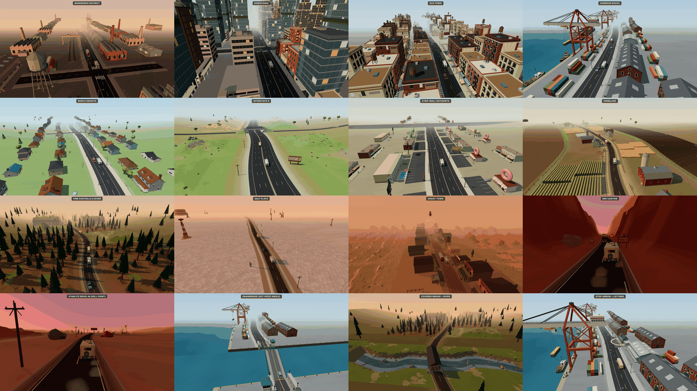
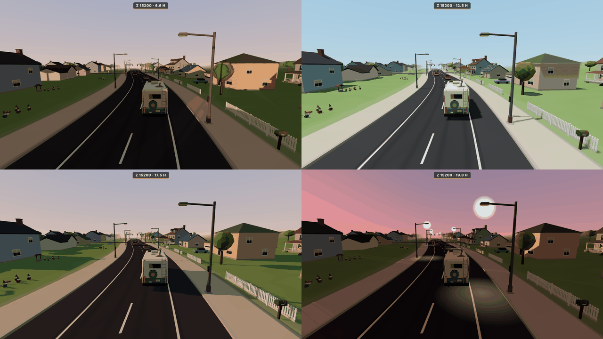

# VIEW-WORLD-A: the static world of the 40 km route

Owned files:
- `public/js/render/env.js`, `chunks.js`, `roadBuilder.js` and `WorldView.js` (the public API is unchanged and only additions were made)
- `public/js/render/world/**`
- `public/js/render/fakeSnapshots.js` (extended)
- `public/world-test.html`

## What is drawn

| Area (z) | Road | Look |
|---|---|---|
| Ironworks 0–3 k | city, 2 lanes, side streets | Chain-link fences. Factories, warehouses, a water tower and the engine shed on the right. Rail yard on the left: tracks along the road, yard gantry cranes, containers. Rail crossing at 1800. |
| Downtown 3–8 k | city, 4 lanes, side streets with traffic lights | Continuous frontage (buildings, skyscrapers, the hotel) plus two skyscraper rows behind it. Police station, cinemas and fire station as landmarks. Street trees, lights and benches. |
| Old Town 8–11 k | **cobble** (procedural stones in world space), **tram tracks** in the forward lane | Lofts with murals and awnings, diner, bunting across the street every ~46 m, streetcar stops, market stalls on the sidewalks (dense near the market stop and the square). Clock tower on a paved square at 8640. |
| Docks 11–14 k | city | The **sea on side −1** beyond a quay (yellow coping, quay wall) with an animated water material. Ship-to-shore gantry cranes on the quay edge over the water, bollard clutter, moored fishing boats, two cargo ships, a lighthouse. Land side: dock warehouses and container stacks. **Drawbridge** at 13180–13230. |
| Maple Heights 14–19 k | city | Right side: houses and two-storey houses with picket fences, mailboxes and trees; churches. Left side (`yards`): houses turned away, with **open back gardens and `yard_props`** between the sidewalk and the houses for the wide-load detour. |
| Interstate 9 19–26 k | **freeway**: 6 lanes, yellow edge lines either side of a **jersey median** (biome from+50 … to−50, the same as SIM-CORE's collider), dashed lane lines, wide paved shoulders | Sound walls in long runs, gantry signs every ~1.2 km (rotation π), billboards, power line, `terrain_hills` tiles. **Overpasses** at 20500 and 23200 with cross roads; the v0 model has its own median pier. **Toll plaza** at 24500. |
| Strip mall 26–29 k | city, 4 lanes | Motel, drive-thru, donut shop, mini golf and shop rows, each with **its own striped parking lot** in front. Tube men, billboards, MegaMart lot. **Car wash** at 28200. |
| Farmland 29–32 k | **rural** (worn edges, patched asphalt, broken edge line) | Ranch fences with gaps. Crop-row blocks with scarecrows, pumpkin patches, farmyards (farmhouse, barn, silos, windmill), polytunnels, grain elevators. `terrain_field` tiles beyond, with irrigation pivots. **Cattle grid** at 29500. |
| Foothills 32–35 k | rural | `terrain_forest_floor` tiles with a **pine on every `treeSpot`**, plus cliffs and hills. Verge pines, a far pine forest, sawmill, lookout tower, log cabins. **Covered bridge** at 33585–33615 over `terrain_river` tiles on both sides, chained 4 tiles deep so the river meanders away. |
| Salt Flats 35–37 k | rural | `terrain_salt`, hoodoos near and far, mesas, the motel ruin, the weather balloon and the plane wreck, power line, billboards. |
| Ghost Town 37–38 k | **dirt** (ruts, no paint, no curbs) | Boardwalk street: saloon, sheriff, chapel, livery stable, water towers and shacks with boardwalks in front. `terrain_dunes` behind. The dust storm still works. |
| Red Canyon 38–39.4 k | rural | The original canyon walls, rocks and cacti, with the broken bridge (lip at 38900), its signs and barricades. |
| Starlite Drive-In 39.4–40 k | rural | Dunes, mesas, cacti and rocks. The sell point (`sell_point`, the drive-in lot with speaker posts) at 39800. |

Areas cross-fade over `route.biomeBlend` (120 m): colours, look parameters, road width and lanes. Scenery thins out near each border.

## Architecture (`render/world/`)

- **`wbatch.js` (`WBatch`)**: one chunk's geometry, merged per shared material. The material groups are `ground`, `cobble`, `water`, `decal`, `marks`, `near` (casts shadows), `near:atlas` and `far`. A chunk costs about 5–8 draw calls whatever it contains. `addProtoFn` lets a terrain tile be warped vertex by vertex.
- **`materials.js`**: the shared world materials.
  - The emissive materials multiply their baked per-vertex emission by the shared uniform `GLOW` (1 by day, up to 3.4 after 18.5 h).
  - `cobbleMat` draws procedural stones in world space and fades them with distance.
  - `waterMat` is a Phong material with drifting normal ripples driven by `WTIME`.
- **`atlas.js` (`SignAtlas`)**: copies every ART sign `CanvasTexture` (opaque or alpha-cut, UVs in 0..1) into 2048² atlas pages and remaps its UVs. Neon signs that use the texture as `emissiveMap` keep that through an `aEmitMap` flag. This took downtown from 157 to about 65 draw calls. Over the full route it fills 2 pages.
- **`protos.js` (`WorldProtos`)**: the baked static prototypes.
  - Variants are normalised with ART's `variantCount`.
  - `split: ['water']` pulls a tile's water mesh into the water batch.
  - `heightAt(proto, x, z)` gives the ground height of a tile at a local point, so scenery and pines sit on tiles.
- **`layout.js` (`Layout`)**: deterministic placements, one generator per area (`GEN.<biomeId>`), seeded by route seed and biome index.
  - Placement tools: `row` (frontage facing the road), `regular`, `scatter` and landmarks.
  - A rectangle occupancy grid prevents overlaps, and RoadInfo reservations keep stops, structures, side streets and both bridges clear.
- **`terrain.js`**: places tiles from `RoadInfo.tilePlan` beyond each area's band, one tile per 60 m on each side.
  - Tiles are **bent along the road's centre line**, so they follow the curves and their seams stay seamless.
  - The base ground strip under a tile is lowered out of the way.
  - The far ground beyond the tiles is tinted with the tiles' edge colour.
- **`structures.js`**:
  - **Baked into chunks:** store models on their lots and pylon signs, the sell point, bridge-out signs, cattle grid, overpasses, the covered bridge at `roadY − deckY`, and the engine shed lined up with the rail crossing.
  - **`StructuresView`:** live instances added within 700 m of the RV (see below). It also handles the stop arrow.
- **`lights.js` (`NightLights`)**: after about 18.3 h, each street lamp in the loaded chunks gets a glowing head (one `Points` draw call) and a light pool on the road (one `InstancedMesh`).
- **`areas.js`**: the per-area look numbers (hills, salt, sand, fields, canyon) and the terrain-tile mix.

`roadBuilder.js` (`RoadInfo` and `buildRoadChunk`):
- The road types, the sea and quay, and the drawbridge channel.
  - The road mesh has a gap of zc ± 42 m. The model's own deck and leaves fill it, with water at y −3.2 underneath.
- The river crossing: a road gap from 33585 to 33615 with the bed, banks and water.
- Lots, the garage driveway, the toll apron, and the cross roads under the overpasses.
- Intersections use `track.intersectionZs()`, the same places the sim's pedestrians cross.
- The renderer's own `Track` instance gets small memo caches.

`chunks.js` builds through generators: road → tiles → structures → about 30 scenery items per step. That spreads one heavy chunk over several frames. The nearest missing chunk pre-empts a far one, and a teleport still builds everything synchronously.

## Live structures (`view.structures`)

| Structure | Transform | Driven by |
|---|---|---|
| `rooks_garage` | SIM-CORE's `structureLayout().garage`: centre `track.xAt(45, +18)`, z 45, rotation.y +π/2. It is its **own Object3D** (`userData.kind === 'rooks_garage'`, name `rooks_garage_exterior`) and is not baked. | `door.position.y = open × snap.garage.items.door`. With no garage state the door stays closed in the `garage` phase and open otherwise. **`view.setGarageExteriorVisible(bool)`** hides it (ONFOOT). |
| `drawbridge` | channel centre, `y = −deckY` (road 0), heading | the `snap.setpieces` entry of type `drawbridge`: `.angle` (leaf_l = −angle, leaf_r = +angle). Falls back to `open/lift/progress × maxAngle`. |
| `toll_plaza` | **one** model across the freeway at the road centre, rotation π. Islands at u 0, ±5, ±10, matching SIM-CORE's colliders. Jersey guard barriers run from the outer islands to the verge. | `toll_plaza.gates[i]`: 0 raises the arm, 1 lowers it, 2 means smashed (hidden). |
| `car_wash` | tunnel axis = `structureLayout().carWashes[].axisU` (side·hw/2, walls at ±3.2), rotation −π/2 for side +1 | brushes spin; faster while `car_wash.washing` |
| stop arrow | over the lot of `snap.nearStop` when `dist ≤ rules.stops.arrowDist` (600) and the stop is not in `snap.looted` or the `stopDone` events | Bobs and billboards toward the camera. It grows with distance and shows through buildings beyond 130 m. A glowing ring covers the lot: amber, teal while parked, red when blocked. The old per-stop markers in `fx.js` are hidden (the sell marker stays). |

## Time of day (`env.js`)

The hour comes from `view.setHourOverride(h)` ?? `snap.timeOfDay` ?? the route keyframes at the RV's z.

- **Sun path:** it rises behind-left, peaks at 62° at about 12:48, and sets ahead-left, near the end of the route at 19.8 h. Elevation follows a `sin^1.6` curve, so dawn and the golden hour are long, with long shadows.
- **Palette keys:** there are 10 keys from 6.0 to 20.0 h, setting sun colour and intensity, sky top, horizon, the glow around the sun, hemisphere light, fog weight and exposure. Each key is blended with the area's own `colors`.
  - Low sun warms the hemisphere fill.
  - Exposure goes through `renderer.toneMappingExposure`.
- **Night:** `env.night` runs 0 → 1 between 18.3 and 19.6 h and drives `GLOW` (baked lamps, lit windows, neon) and the `NightLights`.
- **Dust storm:** unchanged (`snap.weather` / the route event).

## Performance

Measured with headless SwiftShader at 960×540 and the ART models, teleporting through all 40 km in 500 m steps, twice (a Playwright script calling `__world.goto(z)` + `advance()` at each step). Draw calls are for the whole frame, including the RV and traffic.

| Area | Calls avg / max | Triangles avg / max |
|---|---|---|
| Ironworks | 87 / 89 | 175k / 184k |
| Downtown | 68 / 76 | 199k / 207k |
| Old Town | 90 / 96 | 281k / 296k |
| Docks | 101 / **113** | 134k / 143k |
| Maple Heights | 57 / 65 | 204k / 215k |
| Interstate | 54 / 60 | 166k / 179k |
| Strip mall | 78 / 84 | 163k / 183k |
| Farmland | 54 / 61 | 186k / 199k |
| Foothills | 57 / 68 | 200k / 228k |
| Salt Flats | 59 / 62 | 172k / 178k |
| Ghost Town | 55 / 62 | 214k / 229k |
| Canyon | 49 / 49 | 86k / 93k |
| Drive-In | 45 / 45 | 119k / 119k |

- **Draw calls:** the maximum is **113**, against a budget of ≤ 300. Before the atlas, downtown alone was 157.
- **No leaks:**
  - Over two full passes the JS heap stays flat at 92 MB, and there were 0 crashes and 0 console errors.
  - Scene meshes at the same z are identical across passes.
  - `renderer.info.memory.geometries` levels off at about 110–165. These are only the shared prototype geometries of live structures and entities, uploaded once. Chunk geometry is disposed.
  - `textures` levels off at 13: two atlas pages plus a few sign and entity textures.
- **Chunk build time:** the median is 13–66 ms per 50 m chunk in software GL, spread over frames by the generator steps. The first visit to an area also bakes its prototypes once (0.3–1.5 s on a teleport).
- **Streaming:** chunks stream from −150 to +440…600 m depending on the area's fog, so fog hides the edge.

## Harness: `public/world-test.html`

- `?z=<metres>` or `?z=<preset>`. The presets are:
  - each area id
  - `garage`, `rail`, `drawbridge`, `overpass`, `toll`, `carwash`, `cattle`, `river`, `canyonbridge`, `sell`
  - `stop_<id>`, which starts 330 m before that stop
- A scripted RV drives forward (`&speed=`, where 0 means parked), with a little ambient traffic from the area's own traffic list.
- `&hour=6.6…19.8`
- `&cam=chase|orbit|high|side`, with `&look=<z>`, `&lookU=`, `&r=`, `&h=` and `&side=`
- `&t=<sec>` advances the script deterministically before the first frame.
- `&angle=` sets the drawbridge leaf angle, and `&garage=1&door=0..1` shows the garage door.
- `&looted=a,b`
- `&lane=`
- `&shot=1` hides the UI, and `&title=` replaces the label.
- `window.__world = { view, gen, presets, goto(z), setHour(h), advance(sec), stats(), settled(), pause() }`

`fakeSnapshots.js` gained the `route` preset and puts these expansion fields on every snapshot:
- `timeOfDay`
- `nearStop {id,name,dist,side,z}`
- `looted`
- `area`
- `setpieces`: drawbridge `{angle}`, toll `{gates}`, car wash `{washing}`
- `garage {items:{door}}` and `phase: 'garage'` (with the `garage` option)

## For the integrator and other agents

- **New WorldView API (additive):**
  - `export const RV_LAYER` (VIEW-FP)
  - `view.setGarageExteriorVisible(bool)` (ONFOOT)
  - `view.setHourOverride(h|null)`
  - `view.world = { chunks, structures, protos, layout, lights }`
  - `view.structures.garage → { root, door } | null`
  - `view.stats` adds `geometries`, `textures` and `hour`

  Every existing hook is unchanged: `setCameraController`, `setVanMode`, `rvAnchor`, `setSceneOverride`, `addPreRender`, `pushSnapshot`, `render`, `stats` and `onEvent`.
- Checked against the real GameSim (`van-test.html?sim=1`): it starts in the `garage` phase and the exterior door follows `items.door`, with no errors.
- The world reads `structureLayout(track, route)` from `sim/structures.js` for the garage frame and the car-wash axis. The toll islands and median match SIM-CORE's colliders by construction. `sim/structures.js` must stay importable by the renderer; it is pure and has no DOM.
- These harnesses ran with zero console errors on the final code:
  - `view-test.html` (driver and cook)
  - `van-test.html` (fake and `sim=1`)
  - `cook-test.html`
  - `fp-test.html`
  - `onfoot-test.html` (garage)
  - `world-test.html`

  `npm run test:sim` passed 67/67.
- **Not done:**
  - Only street lamps get night glows. Windows and neon brighten through `GLOW`, but have no extra light sprites.
  - The drawbridge's barrier arms and lamps are static parts of the model, so the set-piece's `bell` and `barriers` are not shown.
  - The river does not continue past the 4-tile river chain; it fades into the far ground.
