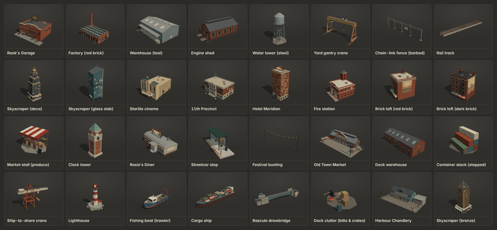
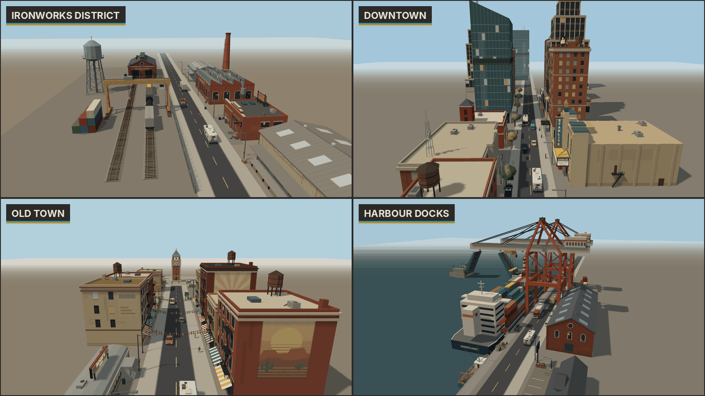

# Expansion pack: City areas (`x_city`)

These are 29 mock 3D kinds (51 variants) for the 40-minute run, covering the start garage plus four city areas: the Ironworks District, Downtown, Old Town and the Harbour Docks. Everything is procedural and built in code with the shared `Kit`. Each model is one vertex-coloured draw call plus one per sign or atlas texture. They follow the base conventions in [`docs/ASSETS.md`](../ASSETS.md): metres, Y up, origin at the ground centre of the footprint, roadside fronts face local **+Z**, deterministic rng, and rigid hierarchies of plain Meshes.

All names, signs and logos are original and fictional. Murals are abstract desert scenes (suns, mesas, cacti, mountains) with no text.

There is also a sheet of every variant: [`docs/expansion-city-variants.png`](../expansion-city-variants.png). To browse them in the showroom, open `public/assets.html?cat=x_city`.

## Files

| Path | What |
|---|---|
| `public/js/assets/expansion/city.js` | `PACK`: builders, the `x_city` category, labels and named parts. It also sets `userData.size` to the measured visual bounds. |
| `expansion/city-kit.js` | Shared helpers: face boxes, beams, rods, trusses, railings and ladders, corrugation, roll doors, steel windows, fire escapes, roof clutter, textured and atlas panels (`multiPanel`), and the sign painters (hand-painted, neon, murals, chain-link, clock dial). |
| `expansion/city-ironworks.js` | rooks_garage, factory, warehouse, rail_shed, water_tower_city, overhead_crane, chainlink_fence, rail_track |
| `expansion/city-downtown.js` | skyscraper, cinema, police_station, hotel, fire_station |
| `expansion/city-oldtown.js` | loft, market_stall (exports `stallInto` for reuse), clock_tower, diner, streetcar_stop, bunting, store_market |
| `expansion/city-docks.js` | dock_warehouse, container_stack (exports `container`), gantry_crane, lighthouse, fishing_boat, cargo_ship, drawbridge, bollard_crates, store_chandlery. It includes a small hull-lofting helper used by the boats, the ship and the chandlery's dinghy. |

## Every kind

Size is the measured visual bounds, given as **w (X) × l (Z) × h (Y)** in metres, as a range across variants. Tris is per instance and draw calls is meshes per instance, both as ranges across variants. Budget classes: **set pieces ≤ 6k tris** (`gantry_crane`, `cargo_ship`, `drawbridge`); **landmarks and stores ≤ 3k** (`rooks_garage`, `factory`, `skyscraper`, `cinema`, `police_station`, `hotel`, `fire_station`, `clock_tower`, `diner`, `lighthouse`, `store_market`, `store_chandlery`); and **everything else ≤ 1.5k**. Every kind is within its class.

| Kind | Label | Area | Size w × l × h | Variants | Named parts | What it's for | Tris | Draw calls |
|---|---|---|---|---|---|---|---|---|
| `rooks_garage` | Rook's Garage | Ironworks (start) | 22 × 18.03 × 11.6 | 1 | `door` | The run's start: brick workshop with a roll-up door the RV drives out of, hand-painted "ROOK'S GARAGE — REPAIRS & TOWING", rooftop sign, office, wall-jib tow hook, oil drums, open interior (lift, pegboard, lights). | 2753 | 4 |
| `factory` | Factory | Ironworks | 35.6–36.87 × 21.65–23.65 × 26–30 | 2 | `smoke` | Brick foundry with a glazed sawtooth roof facing the road and a 26–30 m chimney. Ghost signs "DRY CREEK IRONWORKS" (v0, red brick) and "COPPERLINE CASTINGS CO." (v1, buff brick with tin lean-to). | 2116–2164 | 3 |
| `warehouse` | Warehouse | Ironworks | 20.6–32.6 × 18.96–22.96 × 9.42–11.42 | 3 | — | Corrugated shed with a raised loading dock, roll doors, bumpers and dock lamps. v0 teal 26 m, v1 cream 32 m with an office, v2 blue 20 m. Painted names are fictional. | 930–1476 | 2 |
| `rail_shed` | Engine shed | Ironworks | 22.81 × 39.4 × 14.15 | 1 | — | Brick engine house with two arched track doorways (+Z), a clerestory smoke vent, smoke jacks and tracks running out of the doors. userData.tracks gives the door x positions. | 1440 | 2 |
| `water_tower_city` | Water tower (steel) | Ironworks | 12.52 × 13.51 × 28.59 | 1 | — | Steel tank on four braced legs, catwalk and ladders, faded "DRY CREEK" lettering on a curved panel. | 1212 | 2 |
| `overhead_crane` | Yard gantry crane | Ironworks | 25.6 × 14 × 15.7 | 1 | — | Rail-yard gantry crane: 24 m span across X, A-frame legs on their own rails, twin girders, trolley and hook, operator cab. Straddles tracks laid along Z. | 1308 | 2 |
| `chainlink_fence` | Chain-link fence | Ironworks | 10.51 × 0.48–0.69 × 2.17–2.67 | 2 | — | 10 m run along X. Mesh is an alpha-blended tiled texture. v0 plain, v1 barbed-wire outriggers (lean to +Z) and a "KEEP OUT" sign. | 294–683 | 2–3 |
| `rail_track` | Rail track | Ironworks | 3.8 × 20.64 × 0.55 | 1 | — | 20 m straight along Z: ballast, timber sleepers, rails. Rail tops at userData.railTop = 0.55, gauge 1.435 (matches the existing `train`; place the train at y = 0.55). | 390 | 1 |
| `skyscraper` | Skyscraper | Downtown | 24.05–26.05 × 20.23–26.72 × 61.83–81.25 | 3 | — | Skyline towers. v0 deco setback tower with gold crown and spire (81 m), v1 slanted glass slab with sky garden (60 m), v2 bronze tower with a lattice crown (62 m). | 652–1348 | 1 |
| `cinema` | Starlite cinema | Downtown | 20.68 × 33.67 × 23.4 | 1 | — | Old movie palace: vertical blade sign "STARLITE", marquee ("NOW SHOWING: DUST & THUNDER" / "LATE SHOW · THE LAST MESA" / "COMING SOON: CHROME COYOTE"), ticket booth, poster cases. One atlas texture. | 1087 | 2 |
| `police_station` | 11th Precinct | Downtown | 28.6 × 22.7 × 24.5 | 1 | — | "11TH PRECINCT": rusticated stone base, brick floors, projecting entrance bay with pediment and frieze, steps with green globe lamps, two flagpoles with fictional flags, sally-port door, radio mast. | 1765 | 2 |
| `hotel` | Hotel Meridian | Downtown | 19.42 × 18.61 × 43.61 | 1 | — | Ten-storey brick hotel with a stone base, entrance canopy, window ACs, fire escape and a rooftop neon "HOTEL MERIDIAN" on a steel frame (emissive, alpha-cut letters). | 2904 | 3 |
| `fire_station` | Fire station | Downtown | 17 × 19.25 × 21.8 | 1 | — | Two-bay brick firehouse, "ENGINE CO. 7", glazed sectional doors, hose-drying tower, bell, red keep-clear hatching on the apron. | 764 | 2 |
| `loft` | Brick loft | Old Town | 12.7–16.7 × 15.88 × 13.5–23.94 | 4 | — | 3–5 storey brick loft: two shopfronts with striped awnings and a fascia, steel arched windows, black front fire escape, abstract desert mural on the +X wall and a ghost ad on the −X wall. Shop names are fictional. | 880–1482 | 3 |
| `market_stall` | Market stall | Old Town | 4.12–4.29 × 3.67–3.89 × 2.63 | 4 | — | Awning stall about 3.2 × 2 m: v0 produce crates (red), v1 jars & honey (teal), v2 hanging rugs (mustard), v3 chili ristras & pottery (green). | 369–765 | 1 |
| `clock_tower` | Clock tower | Old Town | 8.4 × 8.9 × 25.85 | 1 | `hand_h`, `hand_m` | Town-hall clock tower about 26 m: brick shaft, stone clock stage with a dial on +Z, open belfry with bell, patina spire, weathervane. | 1340 | 4 |
| `diner` | Rosie's Diner | Old Town | 16.3 × 8.65 × 6.6 | 1 | — | Chrome railcar diner: barrel roof, fluted stainless panels, teal and red enamel bands, lit window strip, glass-block vestibule, rooftop neon "ROSIE'S DINER" and an "OPEN 24 HRS" sign. | 592 | 3 |
| `streetcar_stop` | Streetcar stop | Old Town | 7.25 × 2.6 × 3.35 | 1 | — | Shelter on a platform kerb with a tactile edge strip, bench, route map (Old Town, Docks, Ironworks, Downtown, Market), "LINE 2" stop pole, bin and ticket machine. | 302 | 2 |
| `bunting` | Festival bunting | Old Town | 16.3 × 0.3 × 6.74 | 1 | — | Two strings of festival pennants sagging across a 16 m street between two slim poles. Spans local X, so place it across a road that runs along Z. | 380 | 1 |
| `store_market` | Old Town Market | Old Town | 34.3 × 16.6 × 9.95 | 1 | — | OLD TOWN MARKET supply stop on a 34 × 16 lot: cast-iron arcade hall with a clerestory, gable sign, stalls inside and at the lot edges, loading dock on +X, dumpster, pole sign, chalkboards. The RV band z ∈ [−1, 8] is clear. | 2727 | 2 |
| `dock_warehouse` | Dock warehouse | Docks | 44.6 × 18.16 × 14.48 | 1 | — | 44 m brick bonded warehouse: six numbered timber doors, loophole doors with hoist beams, arched windows, slate roof, painted "PIER 9 · BONDED STORES". | 1264 | 2 |
| `container_stack` | Container stack | Docks | 14.14–16.04 × 11.37–12.24 × 5.18–7.77 | 4 | — | 12.19 × 2.44 × 2.59 m boxes (long axis X) with corrugation, door ends and fictional liveries. v0 2×2 block, v1 stepped, v2 row with 20 ft boxes on top, v3 jumbled. | 608–892 | 1 |
| `gantry_crane` | Ship-to-shore crane | Docks | 26 × 62 × 47.11 | 1 | `trolley` | Ship-to-shore crane about 47 m: four legs on quay rails along X (z = ±8), A-frame with stays, box-girder boom reaching 42 m over the water (−Z), machinery house, trolley with cab, spreader and container. | 2082 | 2 |
| `lighthouse` | Lighthouse | Docks | 14.02 × 13.51 × 19.22 | 1 | `lamp` | Pier-end lighthouse about 19 m on a rock-armoured platform: red and white tower, gallery, lantern with an emissive rotating lens, keeper's store. | 1258 | 2 |
| `fishing_boat` | Fishing boat | Docks | 5.46–9.27 × 16.01 × 9.9–11.25 | 2 | — | Moored 16 m boat with a lofted hull, keel at y = 0, userData.draft 1.45. v0 blue trawler "LUCKY PELICAN" (outriggers, stern gantry, net drum), v1 green crabber "MARGARET ANN" (aft wheelhouse, boom, crab pots). | 1172–1260 | 2 |
| `cargo_ship` | Cargo ship | Docks | 23 × 122.64 × 33.6 | 1 | — | 123 m container ship for the background: lofted hull (keel y = 0, draft 7), seven container bays, aft accommodation, funnel, lifeboats, "MARISOL DAWN" on both bows and the stern. | 2924 | 2 |
| `drawbridge` | Bascule drawbridge | Docks | 26.34 × 84.05 × 12.85 | 1 | `leaf_l`, `leaf_r` | Bascule bridge: two-lane road along Z, 48 m opening, two 24 m leaves on trunnions with counterweight tails, piers with fenders, counterweight housings with lamps, two operator houses, barrier arms, approach spans. Water at y = 0, deck at userData.deckY = 6. | 2880 | 3 |
| `bollard_crates` | Dock clutter | Docks | 5.85–6.32 × 3.77–4.44 × 1.22–2.25 | 3 | — | Quayside clutter: v0 bitts, rope coil, crates, red buoy; v1 net pile with floats, crab pots, fish crates, buoys; v2 crates, drums, navigation buoy, chain, bollards. | 617–987 | 1 |
| `store_chandlery` | Harbour Chandlery | Docks | 34.2 × 16.3 × 9.65 | 1 | — | HARBOUR CHANDLERY — SHIP SUPPLY supply stop on a 34 × 16 lot: clapboard store with a dormer and ship's wheel, lifebuoys, oars, porch with rope coils and floats, tin shed, anchors, cable drums, dinghy on blocks, pole sign. The RV band is clear. | 2930 | 2 |

## Named parts (animation contract)

Each part is a named `Object3D` pivot that holds `<name>_mesh`. All of them are listed in `PACK.namedParts`, so `check-assets.js` verifies them.

| Kind | Part | How to animate |
|---|---|---|
| `rooks_garage` | `door` | The roll-up panel **slides up** via `position.y`: `0` is closed and `userData.door.open` (4.4) is fully open. When open, the panel hides inside the thick header and the stepped false front. The opening is 5.0 m wide × 4.4 m high, which clears the RV (2.6 × 3.4, or 2.9 × 4.0 with mirrors and chimney). Interior depth is about 13 m. The empty `bay` (with `userData.bay`) marks where the RV waits, facing +Z. |
| `factory` | `smoke` | At the chimney mouth (30 m on v0, 26 m on v1). `smoke_mesh` is only the sooty mouth disc, so emit smoke particles at the pivot's world position. |
| `clock_tower` | `hand_h`, `hand_m` | Both rotate on **`rotation.z`** about the centre of the front (+Z) dial. `0` is 12 o'clock and **negative is clockwise**: `hand_m.rotation.z = −2π·min/60` and `hand_h.rotation.z = −2π·((h % 12) + min/60)/12`. The default pose is 10:10. The other three faces have blind oculi, so only one dial needs animating. |
| `gantry_crane` | `trolley` | Cab, spreader and hanging container. It slides along the boom on `position.z`: rest is −20 (over the quay edge), and `userData.trolley` gives min −38 (boom tip) and max 6. |
| `lighthouse` | `lamp` | Spin it with `rotation.y`. The two bright bullseye panels face its local ±Z. `lamp_mesh` has its own emissive material (`CR_Lamp_Lighthouse`). The kind declares `perInstanceMaterials: ['lamp_mesh']`, so `cloneInstanceMaterials(obj)` gives each instance its own copy to pulse `emissiveIntensity`. |
| `drawbridge` | `leaf_l`, `leaf_r` | Each leaf pivots on `rotation.x` at its trunnion near the outer pier (y = deckY − 1, z = ∓24). **`leaf_l` (−Z half) rises with a negative angle and `leaf_r` (+Z half) with a positive one.** ±1.25 is fully open: the tips reach about 28.5 m and the counterweight tails swing down into the piers. |

## Placement notes

- **Roadside buildings and stores** face local +Z. On the driver's right (x < road) use `rotation.y = +π/2`; on the left use `−π/2`, the same as the base kit.
  `store_market` and `store_chandlery` are 34 × 16 lots like the existing `store_*` kinds. The band z ∈ [−1, 8] in front of each building is kept free of solid props, and stalls, anchors and pole signs sit at the lot edges.
- **Runs along the road** (local X): `chainlink_fence` is 10 m long; rotate it by ±π/2 so it runs along the road and its barbed arms lean toward local +Z. `bunting` spans 16 m along X, so place it unrotated across a road that runs along world Z.
- **Rails along Z:** `rail_track` and the `rail_shed` doors carry rail tops at y = 0.55, and the shed reports its track x positions in `userData.tracks`. Put the existing `train` at y = 0.55 and the same x to sit it on the rails. `overhead_crane` straddles tracks laid along Z.
- **Water kinds** have their keel at y = 0. Sink `fishing_boat` and `cargo_ship` by `userData.draft` (1.45 and 7.0) below the water surface. Their bows face +Z.
- **`gantry_crane`:** its quay rails run along local X at z = ±8 and the boom reaches toward −Z (the water). For a quay along the road with water on +X, use `rotation.y = −π/2`; the road can run between the legs, since clearance is 14 m.
- **`drawbridge`:** origin is the water surface at the channel centre, and the road deck is at `userData.deckY` = 6. Place it at `y = roadY − 6` so it joins the quay road. Leaves rotate as described above.
- **`lighthouse`:** the platform base sits at the water line, and the platform top is 1.6 m above it.
- **Signs and lit windows** use `MeshLambertMaterial` with the CanvasTexture as `map`. The neon signs (hotel, diner) and the cinema atlas also use the texture as an `emissiveMap`, so they read as lit at night. Without a DOM (Node), signs fall back to a flat colour. The chain-link mesh falls back to a translucent grey plane.

## Testing

- `node public/js/assets/test/check-assets.js` reports **ALL OK** for every `x_city` kind and variant: named parts, rigid hierarchy, ground contact and centring, and budgets.
- In headless Chromium with SwiftShader, `assets.html?cat=x_city` (scrolled), the inspector with animated parts, and sheet mode all produced zero console errors or warnings, apart from SwiftShader's own driver notices.
- Door, leaves, clock hands, trolley and the per-instance lamp material were also checked numerically: the open door spans y 4.4–8.8, the leaves rise to 28.5 m, and a 15-minute rotation of `hand_m` points to +X.
- The scene images come from a temporary page that is not shipped. It places the area models along a road with a few base-kit props (RV, cars, pedestrians, streetlights, `train`, one `building`).
