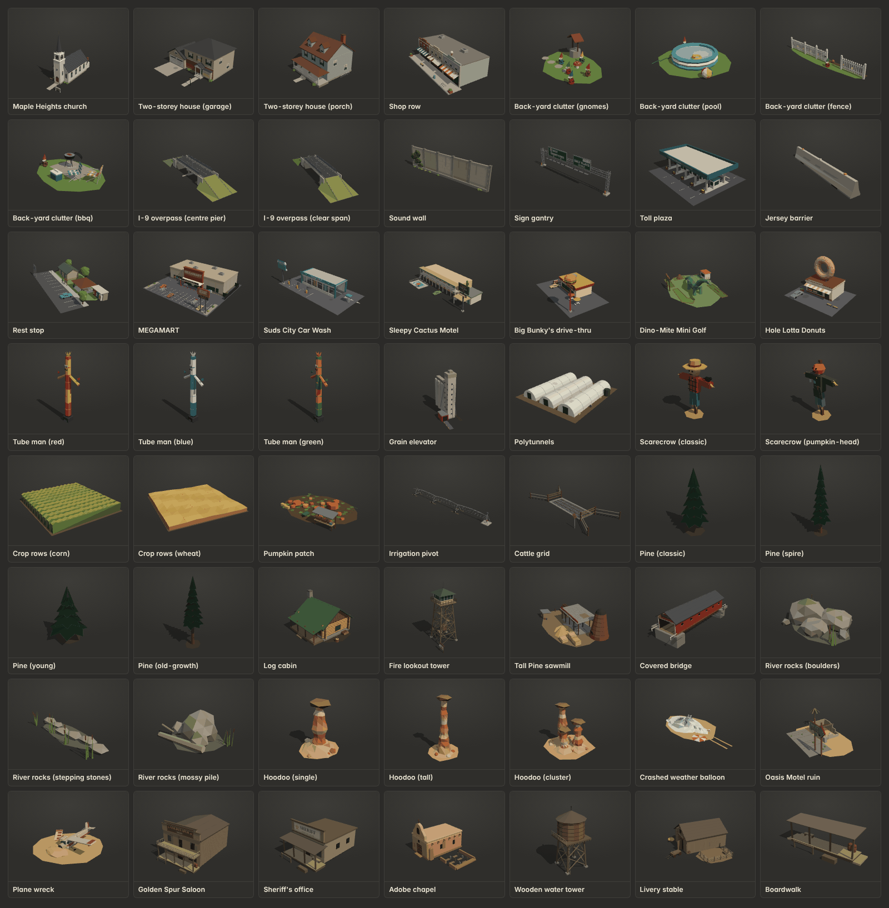
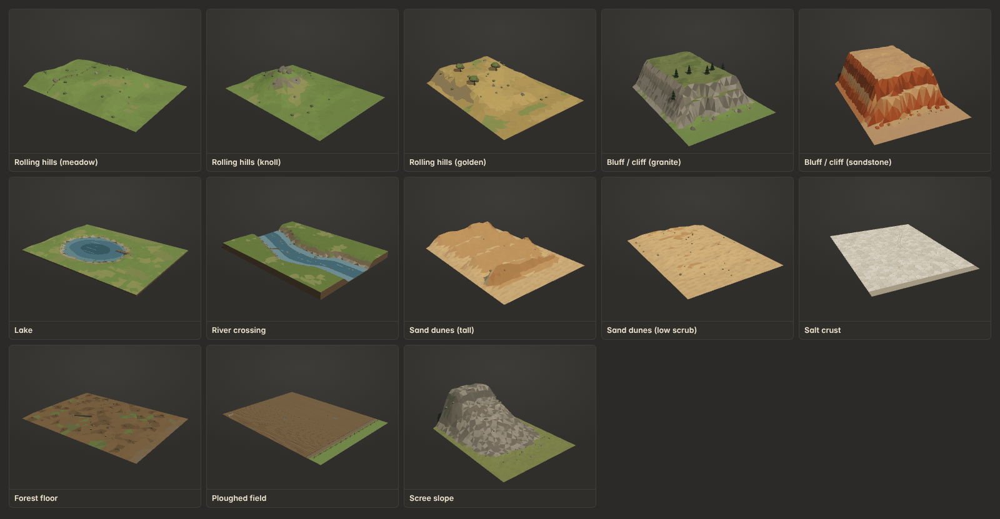
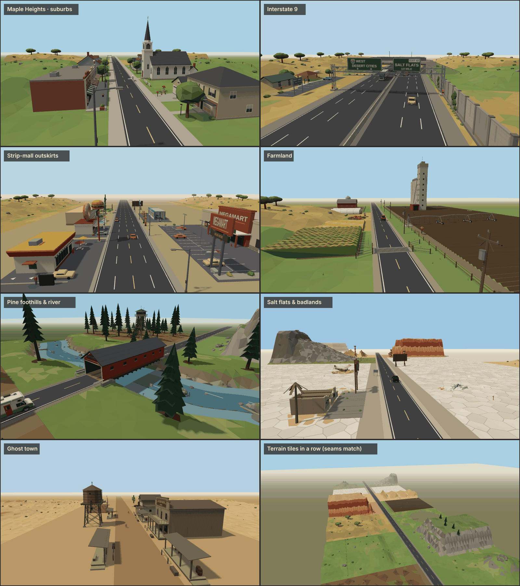

# Expansion pack: Country areas + Terrain (mock assets for the 40-minute run)

This pack adds 40 procedural low-poly buildings and props plus 9 terrain-tile kinds for the seven country areas of the
longer run: Maple Heights, Interstate 9, the strip-mall outskirts, farmland, pine foothills and river, salt flats and
badlands, and the ghost town. They use the same kit, palette and look as `models/scenery.js` and `models/stores.js`.
Everything is registered through `public/js/assets/expansion/country.js` (`PACK`). There are two showroom tabs:
**New · Country areas** (`assets.html?cat=x_country`) and **New · Terrain** (`assets.html?cat=x_terrain`).







The area scenes are composed from these assets: terrain tiles along a road with 6–12 models each. The last panel shows
a row of mixed tiles to check that their seams line up.

All names, signs and logos are original and fictional. The interstate is "I-9".

## Files

| Path | What |
|---|---|
| `public/js/assets/expansion/country.js` | `PACK`: builders, variant counts, categories (`x_country`, `x_terrain`), labels, named parts |
| `public/js/assets/expansion/country-common.js` | Shared helpers: `pivot` (named animated pivot holding `<name>_mesh`), `signMesh` (several quads sharing ONE canvas texture = one draw call), `beam`/`rod`, railings, stairs, ladders, picnic table, parked car, bushes, reeds, `recentre`/`sized` |
| `public/js/assets/expansion/country-suburb.js` | `church`, `house_2storey`, `shop_row`, `yard_props` |
| `public/js/assets/expansion/country-interstate.js` | `overpass`, `sound_wall`, `gantry_sign`, `toll_plaza`, `jersey_barrier`, `rest_stop` |
| `public/js/assets/expansion/country-strip.js` | `store_megamart`, `car_wash`, `motel_2storey`, `drive_thru`, `minigolf_dino`, `donut_shop`, `tube_man` |
| `public/js/assets/expansion/country-farm.js` | `grain_elevator`, `greenhouse`, `scarecrow`, `crop_rows`, `pumpkin_patch`, `irrigation_pivot`, `cattle_grid` |
| `public/js/assets/expansion/country-forest.js` | `pine`, `log_cabin`, `lookout_tower`, `sawmill`, `covered_bridge`, `river_rocks` |
| `public/js/assets/expansion/country-badlands.js` | `hoodoo`, `weather_balloon`, `motel_ruin`, `plane_wreck` |
| `public/js/assets/expansion/country-ghost.js` | `saloon`, `sheriff_office`, `chapel`, `water_tower_wood`, `livery_stable`, `boardwalk` |
| `public/js/assets/expansion/country-terrain.js` | The 9 `terrain_*` heightfield tiles (and `TILE`, the shared tile constants) |

## Terrain tile convention (read this before placing tiles)

Each `terrain_*` kind is a cheap vertex-coloured heightfield of 2.2k–3.9k triangles, made to line the road edge.

- **Size and origin.** A tile is **80 m wide (local X) × 60 m long (local Z)**. The origin is at the tile's ground
  centre, as for every other asset (the shared self-check requires it).
- **Road edge.** The road runs along local Z, and the **road edge is the tile's +X edge (local x = +40)**. The tile
  spreads to −X, away from the road. (The brief asked for the road side at x = 0. The asset check rejects off-centre
  origins, so the road edge sits at +40 instead. The tile's orientation is the same as asked.) Every tile carries
  `userData.tile = { roadEdgeX: 40, width: 80, length: 60, edgeY, apron }`.
- **Placement.** For a road along world Z whose right edge is at `xR` and left edge at `xL`:

  ```js
  const t = createModel('terrain_hills', v), { edgeY } = t.userData.tile;
  // right of the road (world −X, the RV's right side):
  t.position.set(xR - 40, roadY - edgeY, zCentre);                         // rotation.y = 0
  // left of the road (world +X):
  t.position.set(xL + 40, roadY - edgeY, zCentre); t.rotation.y = Math.PI;
  ```
  Tiles repeat every 60 m along Z.
- **Seams.** Every tile sits exactly at local `y = edgeY` along both Z-ends (z = ±30) and along a 4 m verge at the road
  edge (x ∈ [36, 40]). The relief blends in over about 10 m. This means **any tile can follow any tile**, and the road
  shoulder always meets flat ground. The heights were raycast along every seam and verge, and every tile is within
  5 cm of `edgeY`. All four edges that rise above the base have a skirt down to y = 0, so no gaps show from any angle.
- **Flat apron for roadside buildings.** `userData.tile.apron` is the distance from the road edge before the relief
  starts: hills 16 m, cliff 12 m, lake 12 m, dunes 10 m, field 9 m, scree 6 m, forest floor 4 m. Salt is flat
  everywhere. Put roadside buildings inside the apron. Lots deeper than the apron (MEGAMART is 40 m) need a flat tile
  such as `terrain_salt` or `terrain_field`, or plain ground.
- **Sunken tiles.** `edgeY` is 0 except for `terrain_lake` (**0.8**, water at local y 0.12) and `terrain_river`
  (**4.0**, water at local y 0.35). Lowering the tile by `edgeY` puts the banks at road level and the water below it.
- **Water.** The lake and river surfaces are a separate mesh named `water` (vertex-coloured, bluish gradient,
  `userData.water.y`). You can swap its material for an animated shader.
- **River crossing.** At the road edge the river channel spans z ∈ [−8, +8], and the banks reach `edgeY` at |z| ≈ 14.
  That fits `covered_bridge` (30 m long, deck at local y = 4 = `edgeY`): place the bridge at
  `(roadX, roadY − 4, zCentre)`. Put a `terrain_river` on **both** sides of the road. The strip under the road
  between the two tiles belongs to the road system. Fill it with a water plane at `roadY − 4 + 0.35` (the scene image
  does this).
- **Forest floor.** `userData.treeSpots` lists about 35 local `[x, z]` points with root flares already modelled under
  them. Stand a `pine` (any variant) on each point.
- **Mixing tiles.** Tiles bake to one draw call each (lake and river: two). Neighbouring tiles of different kinds butt
  together cleanly. Over a run of 60 m tiles, mix variants (e.g. `terrain_hills` 0/2) to avoid repetition.

## Every kind

Size is `userData.size` (W along X × L along Z × H, metres, variant 0). It is the footprint plus the main mass; small
dressing can poke out. Triangles are per instance (a range where variants differ). Draw calls are 1 for the merged
body, plus 1 per sign texture, plus 1 per animated pivot. Budgets met: ordinary buildings ≤ 1.5k, landmarks and
stores ≤ 3k, terrain ≤ 6k.

| Kind | Label | Area | Size W×L×H m | Variants | Named parts | What it's for | Tris |
|---|---|---|---|---|---|---|---|
| `church` | Maple Heights church | A suburbs | 10 × 26.6 × 25.2 | 1 | — | White clapboard church with a louvred belfry, octagonal spire and weathervane, pointed windows, a vestry and a "MAPLE HEIGHTS COMMUNITY CHURCH · BAKE SALE SATURDAY" lawn board. Suburb landmark. | 1710 |
| `house_2storey` | Two-storey house | A suburbs | 16.6 × 16 × 9.8 | 2: garage, porch | — | v0: brick ground floor, forward double garage, bay window, portico, lamp post. v1: full-width porch with swing, twin dormers, chimney. Adds variety next to the base `house`. | 959–1428 |
| `shop_row` | Shop row | A suburbs | 26 × 14.2 × 9 | 1 | — | Strip of 3 shops: MAPLE CUTS barber (with pole), PAGE & PEAR books, SECOND SCOOP ice cream. Striped awnings, stepped parapets, sidewalk, bench, planters. One fascia texture serves all 3 signs. | 1420 |
| `yard_props` | Back-yard clutter | A suburbs | 4.6 × 3.6 × 1.4 | 4: gnomes, pool, fence, bbq | `gnome_0` (all variants) + per variant: v0 `gnome_0…4`; v1 `pool`, `duck`, `ball`; v2 `picket_0…2`, `gate`; v3 `bbq`, `chair_0`, `chair_1`, `cooler` | Detour clutter when the RV cuts through back gardens. Every smashable piece is its own pivot (listed in `userData.smashable`) on a static lawn patch. | 1020–1344 |
| `overpass` | I-9 overpass | B interstate | 78 × 21 × 14.6 | 2: centre pier, clear span | — | Concrete bridge carrying a cross road over the 6-lane freeway: 34 m span, abutments with slope paving, approach ramps, jersey parapets, chain-link, lamp posts. 5.05 m clearance (`userData.clearance`). v0 has a centre pier in the median, v1 is a clear span with green steel girders. | 1674–2278 |
| `sound_wall` | Sound wall | B interstate | 20.5 × 1.2 × 5.4 | 1 | — | 20 m of concrete panels between H-posts. Ashlar relief, grime and streaks, ivy at one end. Runs along X with the face toward +Z. | 808 |
| `gantry_sign` | Sign gantry | B interstate | 38 × 2.6 × 11.7 | 1 | — | Truss gantry over the freeway (posts at x = ±18) with catwalk and sign lamps. Green signs: "[I-9 shield] WEST / DESERT CITIES" with lane arrows, and "EXIT 42 / SALT FLATS / 1/2 MILE". Both signs share one texture. | 2248 |
| `toll_plaza` | Toll plaza | B interstate | 26 × 22 × 6.4 | 1 | `arm_0`…`arm_3` | 4 booths on islands, a canopy with "I-9 TOLL PLAZA" fascia, lane signals and bumpers. One barrier arm per lane. Usable as a checkpoint or chase choke point. | 1930 |
| `jersey_barrier` | Jersey barrier | B interstate | 6 × 0.61 × 0.87 | 1 | — | 6 m New-Jersey-profile concrete segment along X, with lifting slots, scuffs and reflectors. Medians and roadwork lanes. | 84 |
| `rest_stop` | Rest stop | B interstate | 34 × 20 × 6.6 | 1 | — | Restroom block, picnic shelter with tables, an alcove of 3 vending machines, map kiosk, trees, car park and a blue "REST AREA · I-9 · NEXT REST 86 MI" sign. A pull-in stop. | 2840 |
| `store_megamart` | MEGAMART | C strip mall | 46 × 40 × 12.5 | 1 | — | 40 × 18 m big box with a terracotta portal, huge "MEGAMART" letters, a slogan strip ("EVERYTHING · ALWAYS · ISH"), a pylon sign, trolley corrals, car-park lines, garden centre, propane cage and ice chest. The supply stop. The band z ∈ [−1, 8] in front of the doors is kept clear. One sign texture. | 2897 |
| `car_wash` | Suds City Car Wash | C strip mall | 32 × 16 × 10.6 | 1 | `brush_0`…`brush_2` | Drive-through tunnel along X (enter at +X), with foam rollers visible through the window band, a "SUDS CITY CAR WASH" bubble pole sign, pay kiosk and vacuum posts. The tunnel is 4.8 m tall, so the RV fits. | 1944 |
| `motel_2storey` | Sleepy Cactus Motel | C strip mall | 43.5 × 19.9 × 14.5 | 1 | — | Two-storey wing with outside walkway and stairs, office with porte-cochère, fenced pool, tall sign topped by a 3D cactus. The neon "VACANCY" is its own unlit mesh named `vacancy` (`userData.neon`), so it can flicker. | 2642 |
| `drive_thru` | Big Bunky's drive-thru | C strip mall | 30 × 18 × 15.2 | 1 | `sign` | Burger joint with checker band, drive-thru window, menu board, speaker and patio. A 9 m pole carries the giant rotating burger plus a two-sided "BIG BUNKY'S" board. | 1800 |
| `minigolf_dino` | Dino-Mite Mini Golf | C strip mall | 28 × 20 × 11.5 | 1 | — | Felt fairways with timber borders, flags, a volcano and a log bridge. A big faded-teal fibreglass sauropod has its neck over a hole and peeling paint. Kiosk and a "DINO-MITE MINI GOLF" arch. | 1964 |
| `donut_shop` | Hole Lotta Donuts | C strip mall | 18 × 14 × 12.4 | 1 | — | Small pastel shop, striped awning, window trays. A giant pink-frosted donut with sprinkles stands on the roof. | 1391 |
| `tube_man` | Tube man | C strip mall | 1.8 × 0.9 × 6.4 | 3: red, blue, green | `seg_0`…`seg_3` | Inflatable air dancer on a blower, with flailing arms, face and spiky hair. Use it in front of lots, as an obstacle, or to signal an open stop. | 492 |
| `grain_elevator` | Grain elevator | D farmland | 50.1 × 17.3 × 46 | 1 | — | Row of 4 concrete silos, gallery, 37 m headhouse with vertical "PRAIRIE GOLD CO-OP" lettering, spouts, a red drive-through shed with truck scale, and a rail spur with a hopper car. Farmland landmark visible from far away. | 1668 |
| `greenhouse` | Polytunnels | D farmland | 23.6 × 26 × 3 | 1 | — | Three 22 m polytunnels running away from the road, with hoops, patch repairs, sandbags, open doors showing seedlings, a water tank and pots. | 1064 |
| `scarecrow` | Scarecrow | D farmland | 2 × 0.6 × 2.7 | 2: classic, pumpkin-head | — | v0: sack head, straw hat, plaid shirt, crow on the arm. v1: pumpkin head, tattered coat, tin-can chime. Field dressing (smashable as a whole). | 389–481 |
| `crop_rows` | Crop rows | D farmland | 20.6 × 20.6 × 2.8 | 2: corn, wheat | — | 20 × 20 m crop patch, tileable side by side. v0: 12 corn rows as jagged-silhouette slabs. v1: wind-rippled wheat block with tramlines and poppies. | 416–1452 |
| `pumpkin_patch` | Pumpkin patch | D farmland | 15 × 11 × 2.6 | 1 | — | Soil patch with vines and leaves, about 18 pumpkins including two giants, and a farm stand with a "PUMPKINS $3 · HONOR BOX" sign, hay and a wheelbarrow. Ideal for smashing through. | 1444 |
| `irrigation_pivot` | Irrigation pivot | D farmland | 53.6 × 5.1 × 5.2 | 1 | — | Centre-pivot arm: pyramid pivot tower at +X, 3 arched truss spans on wheeled A-frame towers, drop sprinklers, end boom and gun. | 1286 |
| `cattle_grid` | Cattle grid | D farmland | 16.8 × 7.6 × 2.6 | 1 | — | Steel bars in a concrete frame across a 2-lane road (8.2 m along X, ≤ 0.13 m high so you can drive over it). Flared wing fences and a "CATTLE GRID" diamond. Place at the road centre, rotation 0. | 504 |
| `pine` | Pine | E foothills | 5.1 × 5.3 × 12.2 | 4: classic 12 m, spire 18 m, young 7 m, old-growth 22 m | — | Stylised dark-green conifer made of jagged drooping skirts. The trunk is at the origin (not bbox-centred), for scattering and `treeSpots`. | 150–252 |
| `log_cabin` | Log cabin | E foothills | 10.5 × 9.4 × 6.6 | 1 | — | Notched-corner logs with end grain, green metal roof, stone chimney, porch with rocker, woodpile, chopping block with axe. | 1334 |
| `lookout_tower` | Fire lookout tower | E foothills | 12.4 × 8.8 × 20.5 | 1 | — | Timber stilts with X-bracing and switchback stairs, a glazed cab with catwalk, pyramid roof, anemometer, and a "FIRE DANGER TODAY" dial board at the base. | 2170 |
| `sawmill` | Tall Pine sawmill | E foothills | 36 × 22 × 11.6 | 1 | — | Open blade shed with a big circular saw on a carriage, log deck, lumber stacks, sawdust cone and conveyor, a rusty wigwam burner and an office. "TALL PINE LUMBER CO." fascia. | 2338 |
| `covered_bridge` | Covered bridge | E foothills | 10.8 × 36 × 11.4 | 1 | — | Red board-and-batten covered bridge for the 2-lane road (road along local Z, 30 m span, 7.4 m inside, ≈ 4.1 m clearance) on stone abutments. Portal signs read "OLD HOLLOW BRIDGE · BUILT 1891" and "CLEARANCE 11'-6\"". **Deck at local y = 4** (`userData.deckY`): place at `roadY − 4`. | 1288 |
| `river_rocks` | River rocks | E foothills | 6 × 4.5 × 2.2 | 3: boulders, stepping stones, mossy pile | — | Wet-based boulders with a little moss, reeds and cattails, and driftwood (v2). Dress the river and lake. | 228–498 |
| `hoodoo` | Hoodoo | F badlands | 7.2 × 7.3 × 8.9 | 3: single 9 m, tall 14 m, cluster | — | Banded sandstone spire (cream, salmon, rust strata) with a pinched neck, an overhanging dark cap rock and a talus skirt. | 353–961 |
| `weather_balloon` | Crashed weather balloon | F salt flats | 15.4 × 7.6 × 1.4 | 1 | — | Crumpled mylar envelope with sharp folds, an orange-white parachute, a radiosonde box with antenna, a foil radar reflector, and drag marks. A "nothing to see here" set piece. | 423 |
| `motel_ruin` | Oasis Motel ruin | F badlands | 21.7 × 15.2 × 9.5 | 1 | — | Rusty arrow sign with missing letters ("OA IS M TE") and dead bulbs, plus a crumbling office: broken walls, sagging roof, rubble, a dead palm, a rusted ice machine and a cracked forecourt. | 1160 |
| `plane_wreck` | Plane wreck | F salt flats | 13.6 × 13.7 × 3.4 | 1 | — | Sun-faded, rusting high-wing taildragger nosed into a sand drift. The left wing has snapped off and lies nearby; the prop is bent, one gear leg has collapsed, and there are rust patches and debris. | 772 |
| `saloon` | Golden Spur Saloon | G ghost town | 12.4 × 18.2 × 10.3 | 1 | `door_l`, `door_r` | Two-storey false-front saloon with a balcony on posts, boardwalk, faded flaking paint, a "GOLDEN SPUR SALOON" sign with spur rowels, hitching rail, trough and barrels. Batwing doors. | 1560 |
| `sheriff_office` | Sheriff's office | G ghost town | 8.8 × 13 × 6.9 | 1 | — | Stone-block office with false front and a "SHERIFF · COUNTY JAIL" sign with star. Barred jail windows, wanted posters, covered porch with bench, hitching rail. | 1086 |
| `chapel` | Adobe chapel | G ghost town | 14.9 × 11.9 × 9.2 | 1 | — | Rounded adobe chapel with a bell gable (bell, wooden cross), vigas, buttresses, timber doors and a small walled graveyard. | 1105 |
| `water_tower_wood` | Wooden water tower | G ghost town | 8.4 × 6.8 × 14.7 | 1 | — | Railroad-style stave tank with iron hoops and a conical roof on a braced timber trestle, plus ladders, platform rail and a hanging spout. | 1328 |
| `livery_stable` | Livery stable | G ghost town | 23 × 22.5 × 8.8 | 1 | — | Gable barn with one big door ajar, a hayloft hoist and a "LIVERY & FEED" sign. Lean-to stalls, corral, trough, hay pile, wagon wheel, buckboard. | 1240 |
| `boardwalk` | Boardwalk | G ghost town | 11.8 × 4 × 3.5 | 1 | — | 10 m covered plank boardwalk along X on a raised deck with end steps. Street side (+Z) has a hitching post, trough, barrels and a bench. Use it to line the main street. | 482 |
| `terrain_hills` | Rolling hills | H terrain | 80 × 60 × 6.5 | 3: meadow, knoll, golden | — | Grassy rolling hills (v1: 12 m rocky knoll; v2: dry golden hills with oaks). Boulders, shrubs, tufts, and a fence line on v0. 16 m flat apron. | 2484–3158 |
| `terrain_cliff` | Bluff / cliff | H terrain | 80 × 60 × 24.6 | 2: granite, sandstone | — | Two-tier bluff about 17 m from the road with strata bands, a ledge, talus boulders, and a plateau (v0: scrubby top with pines; v1: red sandstone). Ends round off into gullies at the seams. | 2966–3294 |
| `terrain_lake` | Lake | H terrain | 80 × 60 × 2.3 | 1 | `water` mesh (static) | Set-back lake with gravel and sand shore, reeds, rocks, jetty and rowboat. Flat water with a darker centre, lily pads and glints. edgeY 0.8. | 3694 |
| `terrain_river` | River crossing | H terrain | 80 × 60 × 4.6 | 1 | `water` mesh (static) | River running perpendicular to the road, straight under the bridge then meandering away. Gravel bars, rocks, reeds, fallen log. edgeY 4. Pair it with `covered_bridge`. | 3930 |
| `terrain_dunes` | Sand dunes | H terrain | 80 × 60 × 9.2 | 2: tall, low scrub | — | Asymmetric dunes with shaded slip faces toward the road, sunlit windward slopes and ripple banding. v1: low dunes with creosote scrub and tufts. | 2602–3326 |
| `terrain_salt` | Salt crust | H terrain | 80 × 60 × 1.2 | 1 | — | Irregular dished salt polygons with raised ridges along the cracks, tyre tracks, salt mounds, a marker stake and a gravel verge. Flat everywhere. | 3492 |
| `terrain_forest_floor` | Forest floor | H terrain | 80 × 60 × 1.6 | 1 | — | Needle litter with moss patches, root flares at `userData.treeSpots`, ferns, a fallen log, stumps, mossy rocks and a mushroom ring. Add `pine` on the tree spots. | 2742 |
| `terrain_field` | Ploughed field | H terrain | 80 × 60 × 1.2 | 1 | — | Furrows running away from the road (light/dark ridge faces), headland, grass verge with fence, stone pile, puddles and crows. | 2192 |
| `terrain_scree` | Scree slope | H terrain | 80 × 60 × 28.2 | 1 | — | Talus fan rising to a rock band at the far edge, about 90 loose rocks, and scrub at the foot. | 3562 |

## Named parts and how to drive them

All are rigid `Object3D` pivots, each holding a single Mesh `<name>_mesh` that shares geometry and material across
clones. Directions were checked headlessly.

| Kind | Part | Pivot | Animate |
|---|---|---|---|
| `toll_plaza` | `arm_0`…`arm_3` | On the booth island at the +X side of each lane (lanes at x = −7.5, −2.5, 2.5, 7.5). The arm extends along local −X. | `rotation.z = 0` is down/closed, `−1.45` is raised. Same convention as `crossing_gate`. |
| `car_wash` | `brush_0`…`brush_2` | Roller axis at floor level. | `rotation.y` spins the roller in place. |
| `drive_thru` | `sign` | Pole axis at the pole top. It holds the burger and a two-sided board (`sign_face`). | `rotation.y` spins it (≈ 0.6 rad/s). |
| `tube_man` | `seg_0`…`seg_3` | A chain: `seg_N` is a child of `seg_N−1`, each pivoting at its bottom ring. | Small phase-shifted sines on `rotation.x` / `rotation.z` per segment give the wiggle. |
| `saloon` | `door_l`, `door_r` | Hinges at x = ±0.92 on the front wall. `door_l` is on +X (the kit's `_l` = +X). | `door_l.rotation.y > 0` and `door_r.rotation.y < 0` swing out toward the street. Batwings swing both ways (±1.2). |
| `yard_props` | `gnome_0` in every variant, plus the rest of `userData.smashable` | Base centre of each item. | Knock over with `rotation.x`/`rotation.z`, or detach and fling. `gate` (v2) hinges at its −X post; `rotation.y < 0` opens it toward +Z. |

## Notes for the integrator

- **Facing.** Roadside buildings and lots face local +Z. Rotate `+π/2` on the RV's right (world −X) and `−π/2` on the
  left, as for the base stores. Things that run along the road (`sound_wall`, `jersey_barrier`, `boardwalk`) run along
  local X, like `fence`. Things that span the road (`overpass`, `gantry_sign`, `cattle_grid`, `toll_plaza`) are
  centred on the road with the road along local Z.
- **Traffic direction.** `gantry_sign` faces +Z, and the toll plaza assumes traffic arrives from +Z. The RV drives
  toward +Z, so give both `rotation.y = π` (the scenes image does this for the gantry).
- **Overpass.** v0's centre pier (and its 20 m median jersey run) sits at x = 0, which is only correct on a divided
  freeway. Use v1 (clear span) over an undivided road. The approach ramps run 18 m each side along X and can be
  buried in terrain.
- **Covered bridge and river.** Place the bridge at `roadY − 4` with a `terrain_river` (also lowered by 4) on each
  side. The road surface must have a 30 m gap at the bridge, and the strip under the road needs water and banks (see
  the tile convention). The interior clearance (≈ 4.1 m) passes the RV (3.4 m).
- **Pull-in space.** MEGAMART is the supply stop. Its fire lane, z ∈ [4.2, 9] in lot space (between the entrance
  bollards and the first stall row), is clear of solid props across the whole lot, and its pylon sign stands at the
  +X front corner. The other strip-mall lots are dressed with parked cars, patios, vacuum posts or the pool near their
  fronts. If one becomes a stop, clear its front strip the way the base stores do.
- **Extra `userData`.** Terrain tiles carry `tile` {roadEdgeX, width, length, edgeY, apron}. The forest floor has
  `treeSpots`. Lake and river have `water`. `covered_bridge` has `deckY`, `overpass` has `clearance`, `motel_2storey`
  has `neon` (the `vacancy` mesh uses an unlit `MeshBasicMaterial`, so clone it before tinting), `yard_props` has
  `smashable`, `toll_plaza` has `arm` and `lanes`, `drive_thru` has `spin`, `saloon` has `doors`, and `tube_man` has
  `wiggle`.
- **Signs.** Signs are CanvasTexture quads built through `signMesh`. Several panels share one texture, so each sign
  texture costs one draw call (the gantry's two boards, the shop row's three fascias, and MEGAMART's portal, slogan
  and pylon). Without a DOM (Node) they fall back to a plain colour. Texture keys are prefixed `xc_`.
- **Unity.** Same rules as the base kit: export from the showroom. The named pivots arrive as transforms, and the
  `water`, `vacancy` and `sign_face` meshes keep their names.

## Testing

- `node public/js/assets/test/check-assets.js` reports **ALL OK** with all 49 country/terrain kinds (69 variants)
  included: named parts, rigid hierarchy, ground contact, centring and budgets.
- Headless Chromium (SwiftShader) showed **zero console errors** on `assets.html?cat=x_country`,
  `assets.html?cat=x_terrain` and the inspector for both tabs.
- A headless check rotated every named part to confirm its direction (arms raise, doors open outward, brushes and the
  burger spin in place, the tube-man chain follows) and that clones share geometry.
- Tile edges were raycast along both seams and the road verge: every tile is within 5 cm of `edgeY`.
- The scenes image is rendered from a temporary page outside `public/` that places tiles and models with the
  conventions above.
