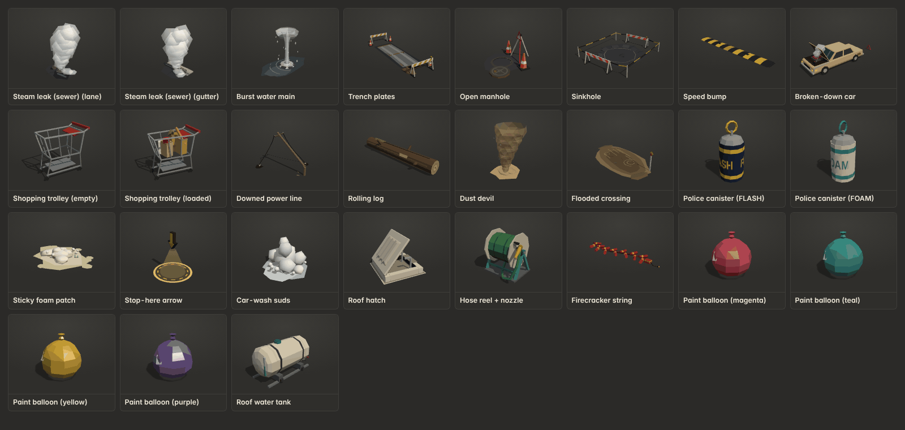
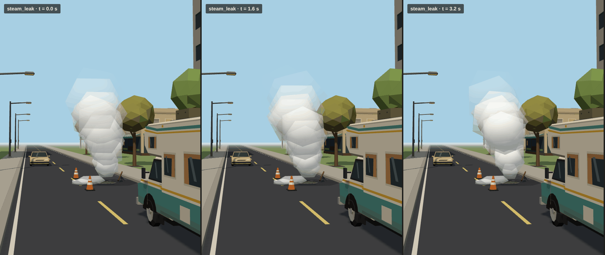
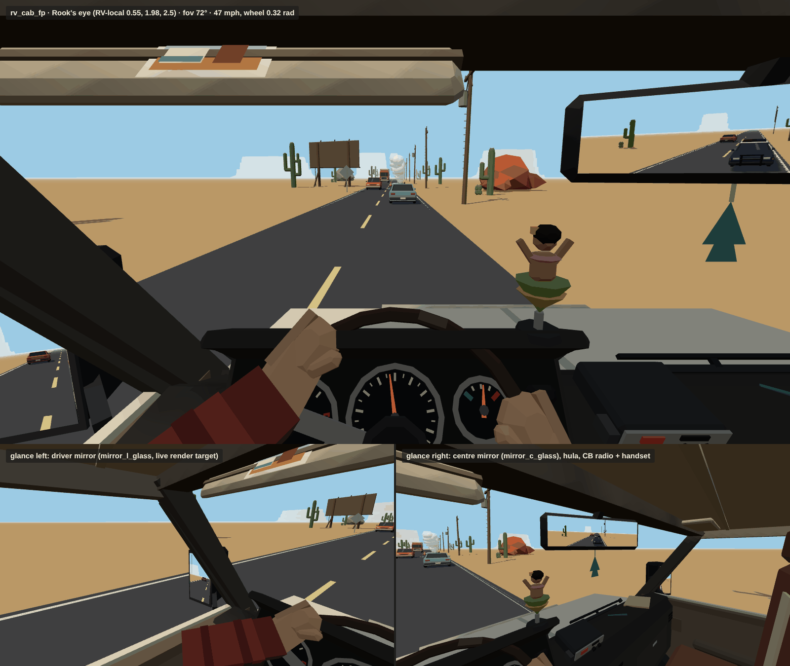
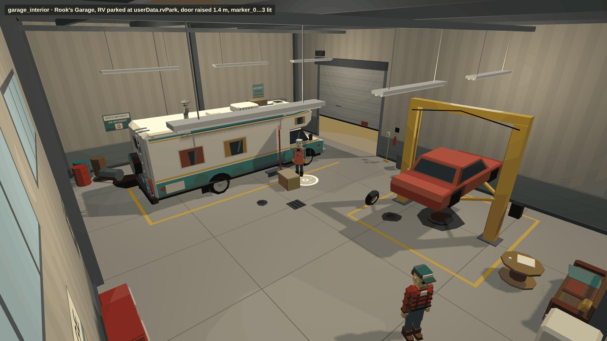
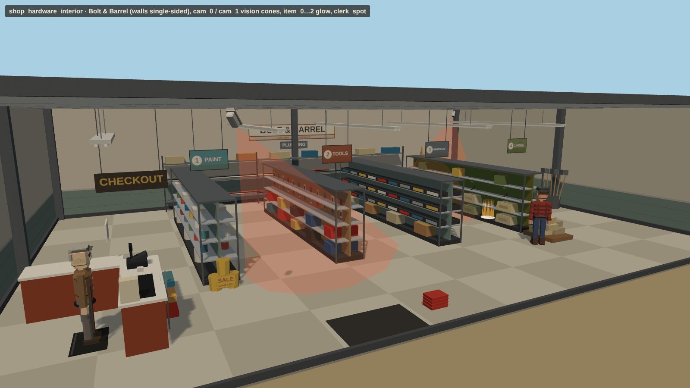

# Expansion pack: Hazards, gear and interiors (`x_hazards`, `x_interiors`)

This pack has 24 mock 3D kinds (31 variants) for the 40-minute run:

- 16 road hazards.
- 5 pieces of roof-defence and stop gear for Doc.
- 3 interiors: Rook's first-person cab, Rook's Garage for the tutorial, and the Bolt & Barrel hardware store for the first shop challenge.

Everything is procedural and built in code with the shared `Kit`. The pack follows the base conventions in [`docs/ASSETS.md`](../ASSETS.md):

- Metres, Y up, with the origin at the ground centre of the footprint.
- The front faces **+Z** and the model's right is **−X**.
- Randomness uses the deterministic kit `rng`.
- Models are rigid hierarchies of plain Meshes.
- Each animated part is a pivot named `<name>` that holds `<name>_mesh`.

The gear is listed under the `x_hazards` tab because `expansion/index.js` has no `x_gear` tab.

All signs, names and labels are original and fictional. The police canisters are cartoon-simple: a plain cylinder with stripes, a pull ring and the label "FLASH" or "FOAM", with no real-device detail. The firecrackers are a generic red string.



### Proofs

**`steam_leak`, animated with the recipe below.** The three frames are at t = 0, 1.6 and 3.2 s, on a town road with the RV approaching.



**`rv_cab_fp` seen from Rook's eye**, posed at 47 mph, 2,600 rpm, with the wheel turned 0.32 rad. All three mirrors show live render targets. The bottom row shows the two glance views.



**`garage_interior`** with the RV parked at `userData.rvPark`, the door raised 1.4 m, Rook and Doc placed in the room and the markers lit.



**`shop_hardware_interior`.** The walls are single-sided and the ceiling is open joists. It shows the vision cones, item glows and a clerk standing on `clerk_spot`.



To browse the models, open `public/assets.html?cat=x_hazards` or `?cat=x_interiors`.

## Files

| Path | What |
|---|---|
| `public/js/assets/expansion/hazards.js` | `PACK`: builders, the `x_hazards` and `x_interiors` categories, labels and named parts. |
| `expansion/hazards-util.js` | Shared helpers: `pivot()`, smooth puff geometry, `mergeTransformed()`, the shared materials (steam, jet, dust, foam, glow, additive glow, lamp, unlit), texture-atlas quads (`atlasTexture`, `atlasMesh`, `quadX/Z`, `uvRect`), `rod`, `beam` and `ring`. |
| `expansion/hazards-road.js` | The 16 road hazards. It exports `plumeRadius(t)` for the steam animation. |
| `expansion/hazards-gear.js` | roof_hatch, water_hose, firecracker_string, paint_balloon, water_tank |
| `expansion/hazards-cab.js` | rv_cab_fp. It exports `CAB` (eye, hub and offset numbers) and `GAUGES` (needle ranges). |
| `expansion/hazards-rooms.js` | garage_interior, shop_hardware_interior, and their poster and sign atlases. |

## Every kind

Size is the measured bounds, given as **w (X) × l (Z) × h (Y)** in metres. Tris is per instance. Draw calls is the number of meshes per instance.

Budgets:

- Props and gear: **≤ 600 tris**.
- Interiors: **≤ 6k tris** (the asset check's limit, below the 8k brief) and **≤ 12 draw calls**.

Every kind is within budget, and `node public/js/assets/test/check-assets.js` reports **ALL OK**.

| Kind | Label | Size w × l × h | Var. | Named parts → how they animate | What it's for | Tris | Draws |
|---|---|---|---|---|---|---|---|
| `steam_leak` | Steam leak (sewer) | 4.7 × 4.1 × 6.9 | 2 (0 lane, 1 gutter) | `puff_0`…`puff_13`: rise, scale and fade (recipe below). `cover`: the leaning cover in v0 or the lifted grate in v1, pivot at its ground edge. | The headline hazard: a broken sewer venting a 7 m column of white vapour from a dark hole in cracked, wet asphalt. It blinds the driver and pushes the RV. v1 is a storm drain at the kerb. | 572–587 | 18 |
| `water_main` | Burst water main | 4.3 × 8.1 × 5.4 | 1 | `jet`, pivot at the crater (y 0): pulse `scale.y` 0.85–1.1 and wobble `rotation.x/z` ±0.05. | Geyser over heaved asphalt and an exposed pipe, with a flooded lane patch (glossy). | 586 | 3 |
| `trench_plates` | Trench plates | 8.1 × 2.9 × 1.2 | 1 | — | Roadworks trench under two steel road plates, with barriers and cones at the ends. Use it as a bump or rattle zone. | 538 | 1 |
| `manhole_open` | Open manhole | 1.9 × 2.0 × 1.2 | 1 | `cover` (flat beside the hole). | Open shaft with ladder rungs, the cover slid aside, a warning tripod with a "!" sign and cones. | 330 | 2 |
| `sinkhole` | Sinkhole | 5.3 × 6.3 × 1.2 | 1 | — | Collapsed road with broken slab edges sagging into a dark pit, barriers front and back, and posts with yellow/black tape. | 538 | 1 |
| `speed_bump` | Speed bump | 7.2 × 0.9 × 0.09 | 1 | — | Yellow and black striped hump, 7 m wide across the lane, with worn paint and bolts. | 394 | 1 |
| `broken_car` | Broken-down car | 1.9 × 6.6 × 2.0 | 1 | `hazard_l` and `hazard_r`: emissive amber lenses (front and rear per side). Blink `emissiveIntensity` 0 ↔ 1.4. `hood`: hinge at the rear, `rotation.x` −1.05 is open and 0 is shut. | Stalled 80s sedan in the lane with its hood up, coolant steam, and a warning triangle 2.5 m behind it facing the approach (−Z). | 530 | 5 |
| `trolley` | Shopping trolley | 0.6 × 1.1 × 1.1 | 2 (0 empty, 1 loaded) | — | Runaway trolley. The nose faces +Z. v1 is full of bags. | 448–570 | 1 |
| `power_line_down` | Downed power line | 7.8 × 6.3 × 5.6 | 1 | `spark` and `spark_1`: unlit spark stars at the live wire ends. Flicker their scale and visibility. | Snapped pole leaning over the road. Wires sag across the lane down to the asphalt. Polylines are in `userData.wires`. | 517 | 3 |
| `log` | Rolling log | 6.0 × 1.2 × 1.1 | 1 | `trunk`, pivot on the axis: `rotation.x += distance / 0.44` (positive rolls toward +Z). | Heavy 6 m log lying across X, with bark ridges, end rings, stubs and moss. | 190 | 1 |
| `dust_devil` | Dust devil | 6.6 × 6.5 × 8.6 | 1 | `ring_0`…`ring_5`: spin `rotation.y` at (2.4 − 0.25·i) rad/s and sway `position.x`. `debris`: spin `rotation.y` at 1.6 rad/s. | Whirling translucent dust column of twisted swirl bands, with a ground skirt and orbiting twigs, stones and paper. | 430 | 9 |
| `flood_wash` | Flooded crossing | 9.6 × 5.2 × 2.3 | 1 | — | Shallow muddy water across the road (glossy), with current streaks, ripples, floating twigs, mud banks and a depth-marker post facing the approach. | 268 | 2 |
| `flashbang` | Police canister | 0.15 × 0.15 × 0.36 | 2 (0 FLASH, 1 FOAM) | `can`, pivot at its centre: tumble it when thrown. | Cartoon-simple police prop: a plain cylinder with stripes and a pull ring, with a "FLASH" or "FOAM" label on a CanvasTexture band (one extra draw call). | 266 | 2 |
| `foam_patch` | Sticky foam patch | 4.1 × 3.5 × 0.5 | 1 | — | Lumpy white-yellow foam splat with a spent FOAM canister lying in it. Use it as a slow zone. | 356 | 2 |
| `stop_arrow` | Stop-here arrow | 7.3 × 7.3 × 7.6 | 1 | `arrow`, pivot at its centre: `position.y = 6.1 + 0.25·sin(2t)`, plus spin `rotation.y` or billboard it. `ring`: pulse its scale or opacity. | Chunky 3 m mustard (`#d9a83a`) down-arrow with a dark outline band, hanging over a supply-stop lot (tip at y 4.6, above the RV). It has a glowing ground ring and a faint light column. | 206 | 3 |
| `car_wash_suds` | Car-wash suds | 3.1 × 2.8 × 1.5 | 1 | — | Soapy foam heap with bubbles and a slick puddle. | 380 | 2 |
| `roof_hatch` | Roof hatch | 0.8 × 0.8 × 0.7 | 1 | `lid`, hinged on its front edge: `rotation.x` 0 is closed and 1.6 is open, when it stands as a windbreak. It is authored at 0.9. | The lab roof hatch Doc climbs through: curb frame, dark shaft, grab rails and a smoked lid. `userData.rvMount.pos` is `[0.15, 3.11, −1.1]`, over buildRV's lab vent. | 306 | 2 |
| `water_hose` | Hose reel + nozzle | 0.8 × 0.7 × 0.7 | 1 | `reel`: drum spins on `rotation.x`. `nozzle`: brass nozzle that sprays along local +Z. It has a child empty `nozzle_tip`. | Roof hose reel in RV teal. Doc grabs the nozzle and drenches pursuers. Mount at `[0.75, 3.11, −1.9]`. | 586 | 4 |
| `firecracker_string` | Firecracker string | 1.3 × 0.4 × 0.05 | 1 | `fuse`: the light point (sparks emitter). | Generic red firecracker string with gold bands lying in an S-curve. Doc throws it at chasers. | 520 | 2 |
| `paint_balloon` | Paint balloon | 0.3 × 0.3 × 0.33 | 4 (magenta, teal, yellow, purple) | `balloon`, pivot at its centre: wobble or throw it. `userData.paint` is the splat colour. | Glossy latex paint bomb. | 214 | 1 |
| `water_tank` | Roof water tank | 0.7 × 1.6 × 0.8 | 1 | `valve`: lever on `rotation.z`, 0 is shut and 1.57 is open. | Strapped poly tank on rails, with a filler cap, sight gauge and outlet. Mount at `[0.55, 3.11, −3.1]`, clear of the chimney, ladder and vents. | 456 | 2 |
| `rv_cab_fp` | RV cab (first person) | 3.0 × 1.5 × 1.7 | 1 | `needle_speed`, `needle_rpm`, `needle_temp`, `wheel`, `hand_l`, `hand_r`, `wiper_l`, `wiper_r`. All of these animate on `rotation.z` only (see below). It also has the mesh planes `mirror_l_glass`, `mirror_r_glass` and `mirror_c_glass`. | Rook's first-person driver's cab, built in exact RV-local coordinates (see below). | 4225 | 12 |
| `garage_interior` | Rook's Garage | 18 × 14 × 7 | 1 | `door` (roll-up: `position.y` 0 → 4.6), `keys`, `notebook`, `crate`, `plug`, `marker_0`…`marker_3`. | Tutorial room: lift with Rook's project car, bench and pegboard, a key rack, tool chests, a desk with a police scanner and notebook, the starter crate, wall charger, cable and plug, drums, tyres, fridge, sofa, original posters, tube lights and an oil-stained floor. | 5789 | 12 |
| `shop_hardware_interior` | Bolt & Barrel (inside) | 20 × 14 × 4.6 | 1 | `cam_0` and `cam_1`: sweep on `rotation.y`. Each has a child `cam_i_view`, a vision cone that meets the floor. Also `item_0`…`item_2` (glow spots) and `clerk_spot`. | First shop challenge: 4 stocked aisles (1 paint, 2 tools, 3 hardware, 4 garden and sacks), a plumbing wall, a checkout with till, and a cutaway shell. | 4678 | 11 |

Materials that are expected to be animated are listed in `userData.perInstanceMaterials`, so call `cloneInstanceMaterials(obj)` once per instance before changing them:

- the steam puffs, which share one cloned material per instance
- the water-main jet
- the hazard lamps
- the dust rings
- the stop ring and beam
- the mirror glass
- the floor markers
- the vision cones
- the item glows

## Notes per kind

### `steam_leak`: animating the plume

The 14 puff pivots are authored at phases `p = i/13` of one rising path:

- Heights run from `y = 0.46` up to `y = 5.75`, with `y = base + (top − base)·p^1.12`.
- The path leans downwind by `userData.plume.lean`.
- Radii are `plumeRadius(p)`: 0.4 at the hole, widening to 1.75 at p 0.78, then thinning to 1.26 at the top as the plume dissipates.

Each radius is baked into the `puff_i_mesh` scale, so every pivot's scale is 1 as authored. The authored radii are in `userData.plume.radii`.

The proof uses this per-frame recipe:

```js
const piv = [...Array(14)].map((_, i) => leak.getObjectByName('puff_' + i));
const P = piv.map((p) => p.position.clone()), R = leak.userData.plume.radii;   // path samples at p = i/13
// per puff i: p = (i/13 + t*0.17) % 1  →  k = p*13, a = floor(k), f = k − a
// position = lerp(P[a], P[a+1], f) (+ a little gust sway ∝ p²)
// pivot.scale = (lerp(R[a], R[a+1], f) / R[i]) × (1 + 0.35·smoothstep(0.7, 1, p))
// opacity     = 0.6 × smoothstep(0, 0.08, p) × (1 − smoothstep(0.68, 1, p))   ← clone the material per puff
```

The puff material is `CR_Steam`: smooth-shaded translucent Lambert with a light-grey emissive, so it stays white under any lighting. It is shared. `cloneInstanceMaterials` gives each leak one shared copy, which is enough to fade the whole plume. For fading each puff on its own, clone it per puff as above; each puff is already its own mesh, so this costs no extra draw calls.

`steam_mist` is a static ground-hugging wisp that drifts downwind. The hole is a black disc with an inward shaft wall, kept above y −0.05. The wet sheen is a separate glossy (Phong) mesh.

### `rv_cab_fp`: Rook's first-person cab

**Placement.** Everything hangs under the child group `rv_frame`, whose frame is exactly RV-local (buildRV's frame). The model root is offset so that the asset check sees it centred:

```js
const cab = createModel('rv_cab_fp');
cab.position.set(...cab.userData.rvOffset);            // [0, 0, 2.8]
rv.add(cab);                                           // rv_frame now coincides with the RV
const frame = cab.getObjectByName('rv_frame');
frame.add(camera);
camera.position.set(...cab.userData.eye);              // [0.55, 1.98, 2.50], RV-local
camera.rotation.set(cab.userData.eyePitch, Math.PI, 0, 'YXZ');   // look along +Z, ~8.6° down
camera.fov = cab.userData.fov;                         // 72° vertical
```

**Eye.** The eye is at RV-local **(0.55, 1.98, 2.50)**. In the model's own frame that is `userData.eyeModel` = (0.55, 1.98, −0.30). It is derived as follows:

- Seat x is 0.55 and seat z is 2.5 (from `van.json`).
- The seat cushion top is at y 1.22, the same as `interior.js`.
- Rook's seated eye height above that gives y 1.98, which leaves 16 cm of headroom under the cab roof at y 2.14.
- The head rests near the headrest at z 2.27.

From there:

- The windshield spans about +20° to −36° vertically.
- The gauges sit at about −37°, seen through the top half of the wheel.
- The driver's mirror is about 54° to the left. The integrator can show it on a glance or as a HUD inset.

**Gauges.** The three needle pivots are children of `gauges`, a group oriented so that its local +Z faces Rook's eyes. Set only `rotation.z`; positive turns counter-clockwise as Rook sees it. The ranges are in `userData.gauges`:

| Part | Min → max | Mapping |
|---|---|---|
| `needle_speed` | +2.36 → −2.36 | 0 → 100 mph (11 major ticks plus minors) |
| `needle_rpm` | +2.1 → −2.1 | 0 → 6000 rpm, red from 5000 |
| `needle_temp` | +0.85 → −0.85 | C (blue) → H (red); 0 is normal |

The needles use an unlit material, so they read clearly in shadow.

**Wheel.** `wheel` sits under `wheel_mount` at the hub, RV-local (0.55, 1.56, 2.90). That is van.json's steering point, moved 3 cm back so the bigger rim clears the raked glass. The mount is tilted 0.6 rad, and the wheel has a 0.21 m thin rim. Local +Z is the column axis.

- **`wheel.rotation.z > 0` turns right** (clockwise as Rook sees it). A suggested full lock is ±2.2 rad.
- `hand_l` and `hand_r` are children of the wheel at 10 and 2 o'clock. Their forearms run back to IK'd elbows in flannel sleeves with check bands and cuffs.
- For big turns, set `hand_*.rotation.z = −0.5 × wheel.rotation.z` so the sleeves don't cross.

**Wipers.** `wiper_l` (pivot x 0.30) and `wiper_r` (x −0.72) sit outside the glass at its base, under `wiper_*_mount` groups lying in the windshield plane. `rotation.z` runs from 0 (parked, arm along +X) to 1.75 (top of the sweep).

**Mirrors.** `mirror_l_glass` is 0.17 × 0.33 at about (1.33, 1.6, 3.08). It sits on the rear face of a housing that encloses buildRV's own small mirror box. `mirror_r_glass` is the passenger-side match, and `mirror_c_glass` (0.27 × 0.075) hangs from the header at x 0.22, turned toward Rook.

- Each is a `PlaneGeometry` facing back toward Rook, with UV u running left to right as Rook sees it and v running bottom to top.
- The placeholder is an unlit vertex-coloured sky-over-road gradient.
- To make them live, render a rear-facing camera into a `WebGLRenderTarget`, use its texture with `wrapS = RepeatWrapping`, `repeat.x = −1` and `offset.x = 1` for the mirror flip, and set it on a per-instance material. The proof does exactly this.

**Also in the cab:**

- dashboard (vents, glovebox, radio and hazard switch) and the instrument binnacle with its PRNDL strip and warning lamps
- column shifter, turn stalk and ignition key
- A-pillars, header, cowl, headliner and B-pillars
- door panels (armrest, pull cup, chrome handle, window crank, map pocket, speaker and lock knob) and both seats
- lowered driver's sun visor with a tucked photo (Rook and Doc in front of the RV); the passenger visor is stowed
- CB radio on the dash with its handset on a coiled cord
- a generic hula dancer on the binnacle brow
- a clip-on cup holder with a coffee
- a pine air freshener on the mirror stalk

The windshield and windows are open (no glass). buildRV's exterior quads are back-face culled from inside, so the view is clear.

### `garage_interior`

- **Walls.** The walls and ceiling are single-sided and face inward. A camera anywhere outside sees in, and a camera inside sees a closed room. A solid skirting, columns and a ring beam outline the building from outside.
- **Shadows.** The shell meshes don't cast shadows, so the sun still lights the room; furniture does cast shadows.
- **Lighting.** The tube lights are vertex-coloured. Add `PointLight`s under the six fixtures at y 4.9 for a warm interior; the proof uses intensity 14, distance 11.
- **RV bay.** `userData.rvPark` is `{ pos: [4, 0, −0.2], rotY: 0 }`. The RV faces +Z toward the roll-up door, and its side door (−X) opens toward the starter crate.
- **Roll-up door.** `door` sits just outside the front-wall plane, so from inside it slides up behind the header: `position.y` runs from 0 to 4.6. The opening is x 1.5…6.5 and 4.6 m high, which clears the RV.
- **Tutorial markers.** These are additive glow discs, listed in `userData.markers`:
  - `marker_0` is at the desk and `notebook`.
  - `marker_1` is at the key rack and `keys`.
  - `marker_2` is at the starter `crate`.
  - `marker_3` is at the wall charger's `plug`.

  Pulse each one by its scale or by the opacity of its cloned material.
- **Plug.** The `plug` lies at the end of a static cable. If you move the plug, redraw the cable as a rope.
- **Exterior.** The city pack's `rooks_garage` exterior is 22 × 18 m with a 5.0 × 4.4 m roll-up door. This interior fits inside it: align the two door centres. This door's centre is at (4.0, 0, 7.07).

### `shop_hardware_interior`

- **Walls.** The walls are single-sided and the ceiling is open joists (a cutaway from any outside angle). The storefront has its glass door at x −3.8…−2.2 on +Z.
- **Security cameras.** `cam_0` and `cam_1` are ceiling mounts. Animate `rotation.y = baseYaw ± sweep·sin(t)` using `userData.cams`:
  - `cam_0`: `baseYaw` −0.85, `sweep` 0.6.
  - `cam_1`: `baseYaw` 2.45, `sweep` 0.7.

  Each camera is pitched down 0.75 rad. `cam_i_view` is an empty at the lens holding a translucent red cone (half-angle 0.34 rad). Its base polygon lies on the floor, so stealth checks can use the same cone.
- **Item glows.** `item_0` sits on the aisle-2 shelf, `item_1` on the aisle-4 bottom shelf, and `item_2` is on the floor at the back right. Each is an additive pad with a soft column.
- **Clerk.** `clerk_spot` is behind the checkout on a rubber mat, facing the counter (+X).

## Unity notes

Everything exports through the showroom's .glb button with the same node names and pivots.

- **Animated parts.** Every animated part has an identity rest rotation, except for its authored pose on the animated axis. Any fixed tilt lives on a parent (`gauges`, `wheel_mount`, `wiper_*_mount`). In Unity, drive `localRotation = Quaternion.Euler(0, 0, angle)` on those nodes, and check the sign once, because handedness flips Z.
- **Mirror glass.** The glass planes keep their UVs. Assign `RenderTexture`s, with tiling X = −1 and offset X = 1.
- **Signs.** The canvas signs are baked into the export as textures: the garage posters (one atlas), the store signs (one atlas) and the canister labels.

## Testing

`node public/js/assets/test/check-assets.js` reports **203 kinds and 371 variants, ALL OK**, including this pack. It checks named parts, the rigid hierarchy, budgets, ground contact and centring.

In headless Chromium with SwiftShader, `assets.html?cat=x_hazards`, `?cat=x_interiors` and the sheet view logged **zero console errors**. The proof pages (steam animation, first-person cab with live mirrors, garage and shop) also ran with zero errors.
