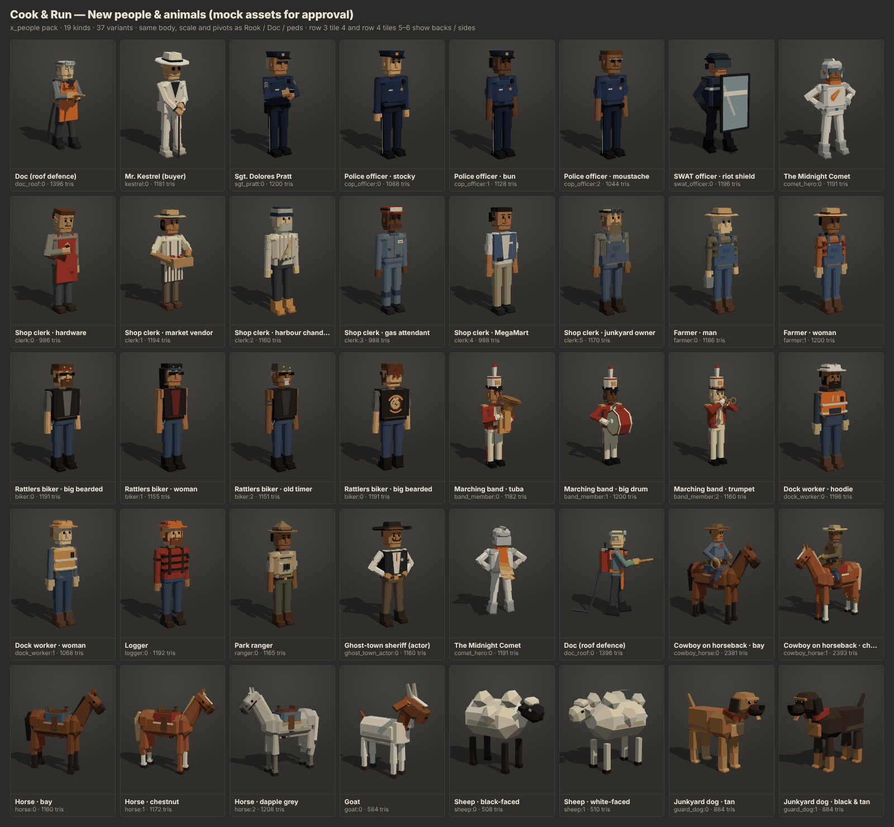
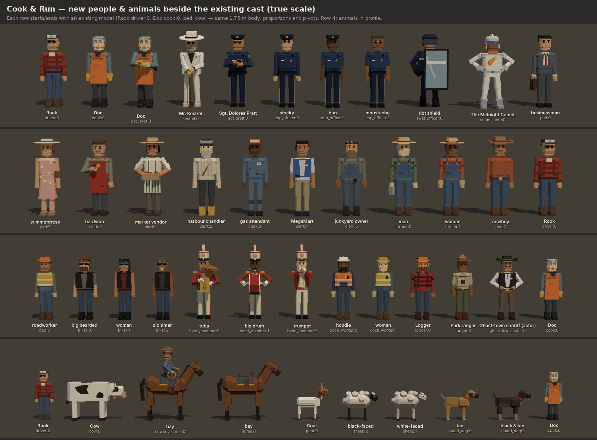

# Expansion pack: people & animals (`x_people`)

Mock 3D assets for the 40-minute version, for approval before anything else is built. Every
character is an original design and an adult. Browse them in the showroom
(`public/assets.html?cat=x_people`, tab **New · People & animals**) or see the images below.

## Files

| Path | What |
|---|---|
| `public/js/assets/expansion/people.js` | `PACK`: builders, the `x_people` category, labels, named parts |
| `public/js/assets/expansion/people-human.js` | Human builder. A copy of `models/characters.js` `buildHuman` (not exported there), verified vertex-for-vertex against `cook`. Adds pose hooks (two-bone IK for arms and legs, head tilt), more hats, hair and beards, and `bakeRigid()` |
| `public/js/assets/expansion/people-cast.js` | Every human character, plus `cowboy_horse` |
| `public/js/assets/expansion/people-animals.js` | Horse (also used under the cowboy), goat, sheep and guard dog |

## Kinds

Tris are per instance. All humans have a footprint (`userData.size`) of 0.62 × 0.36 m, the same as
`ped`/`driver`/`cook`, with their measured height. `userData.bounds` holds the full visual bounds,
which include props like the hose, scarf, shield or instrument.

| Kind | Label | Variants | Named parts | What it's for in the game | Tris |
|---|---|---|---|---|---|
| `doc_roof` | Doc (roof defence) | 1 | body, head, arm_l, arm_r, leg_l, leg_r, **nozzle** | Doc on the RV roof spraying water at threats. He's identical to `cook`, holds a brass hose nozzle in both hands and wears a red backpack water tank. A hose runs from the tank round his hip to the nozzle, and a supply hose trails behind him | 1396 ⚠ |
| `kestrel` | Mr. Kestrel (buyer) | 1 | human | The buyer at the sell point. White suit, dark shirt, teal pocket square, wide white hat, round black sunglasses, gold rings. He stands calmly with both hands stacked on a gold-collared cane | 1181 |
| `sgt_pratt` | Sgt. Dolores Pratt | 1 | human | Recurring senior police officer. Peaked cap, aviators, grey bun, navy uniform with three chevrons, badge, duty belt. She's writing in a notebook | 1200 |
| `cop_officer` | Police officer | 3 | human | Officers on foot at roadblocks and in towns. 0: stocky, long sleeves. 1: woman with a bun, short sleeves. 2: bare-headed, moustache, aviators. Holstered sidearm is a minimal silhouette | 1044–1128 |
| `swat_officer` | SWAT officer | 1 | human, **shield** | Late-game pursuit. Dark navy, helmet with the visor down, padded vest, knee and shoulder pads. Holds a riot shield, with no gun | 1196 |
| `comet_hero` | The Midnight Comet | 1 | human, **scarf** | Original costumed hero, hands on hips. Silver helmet with a teal visor, white-and-silver flight suit, small star-and-tail emblem, a long orange-to-yellow comet-tail scarf streaming behind, boots and gloves. No cape, no cowl ears, no bat symbol, no black armour | 1191 |
| `clerk` | Shop clerk | 6 | human | Shop staff at stops. 0: hardware clerk (red apron, phone, moustache, pencil behind the ear). 1: market vendor (straw hat, striped apron, crate of tomatoes). 2: harbour chandler (fisherman's sweater, beanie, beard, rope coil, yellow boots). 3: gas attendant (cap, coveralls, rag in pocket). 4: MegaMart worker (blue vest, name badge, headset). 5: junkyard owner (huge beard, overalls, welding goggles on his head) | 986–1194 |
| `farmer` | Farmer | 2 | human | Farm-supply stop and roadside farms. Straw hat, plaid shirt, bib overalls. 0: man with a feed bucket. 1: woman with a braid and work gloves | 1186–1200 |
| `cowboy_horse` | Cowboy on horseback | 2 | body, head, tail, leg_fl, leg_fr, leg_rl, leg_rr, **rider**, **rider_head**, arm_l, arm_r | Cattle-drive riders. The horse is saddled (0 bay, 1 chestnut). The rider (hat, neckerchief, leather chaps) holds the reins in his left hand and a coiled lasso in his right. `rider` is the rider's pelvis and a child of `body` | 2381–2393 (rider + horse) |
| `biker` | Rattlers biker | 3 | human | Rattlers MC members on foot. Leather vest with an original coiled-rattlesnake back patch, bandana, wraparound sunglasses. 0: big bearded man. 1: woman with long hair. 2: old timer with a goatee and a tattoo | 1151–1191 |
| `band_member` | Marching band | 3 | human, **instrument** | Parade in town. Shako with a plume, red-and-cream uniform. 0: tuba. 1: big bass drum with mallets. 2: trumpet at the mouth | 1160–1200 |
| `dock_worker` | Dock worker | 2 | human | Harbour crowd. Hi-vis vest, hard hat, gloves, boots. 0: hoodie and beard. 1: woman in a yellow vest | 1068–1196 |
| `logger` | Logger | 1 | human | Forest and logging areas. Red-black plaid, suspenders, beard, orange hard hat with ear muffs, rolled jeans | 1192 |
| `ranger` | Park ranger | 1 | human | National-park and canyon stops. Campaign hat, khaki shirt with a badge and shoulder patches, olive trousers, binoculars | 1165 |
| `ghost_town_actor` | Ghost-town sheriff (actor) | 1 | human | Tourist-show "sheriff" in the ghost town. Black hat, vest with a tin star, string tie, handlebar moustache, sleeve garters, thumbs in his belt. No gun belt | 1160 |
| `goat` | Goat | 1 | animal | Farm-supply challenge. Boer-style white body, brown head with a white blaze, horns, beard, floppy ears, cheeky tongue | 584 |
| `sheep` | Sheep | 2 | animal | Flocks on country roads. Blocky fluffy wool. 0: black face and legs. 1: white face, with a farmer's blue paint mark | 508–510 |
| `horse` | Horse | 3 | animal | Ranches, the cattle drive, and loose horses. Saddled and bridled. 0: bay. 1: chestnut with a blaze and socks. 2: dapple grey | 1160–1208 |
| `guard_dog` | Junkyard dog | 2 | animal | The Rustbucket Junkyard's big friendly dog. Tongue out, floppy ears, tail up, plain red collar with a brass tag (no spikes). 0: tan. 1: black & tan | 884 |

"human" = `body, head, arm_l, arm_r, leg_l, leg_r`. "animal" = `body, head, tail, leg_fl, leg_fr, leg_rl, leg_rr`.

⚠ `doc_roof` is the one model over the 1.2k person budget. Doc's body has to match `cook`, which
is already at exactly 1,200 tris. The roof gear adds about 200 (the apron skirt's tiny bevel was
dropped to save 48, with no visible change). Dropping the trailing supply hose would save 24. The
combined `cowboy_horse` stays under the person + animal budget (1.2k + 1.5k).

## Rig and animation notes

- **Humans** use exactly the same rig as `ped`/`driver`/`cook`. `body` is at the pelvis
  (0, 0.88, 0). `head` is at the neck (1.47). `arm_*` pivot at the shoulders and `leg_*` at the
  hips. `_l` is +X. `rotation.x > 0` swings a limb backward, so the walk cycle in `ASSETS.md` works
  unchanged.
- **Poses are baked into the limb meshes.** Hands on the cane, hands on hips, holding a shield,
  notebook, phone or instrument, and the stance all sit in the mesh. Every pivot rests at
  `rotation = 0`, so absolute rotations from the game behave like they do on peds. A walk cycle
  swings a posed arm from its posed position, which looks fine for idle and slow movement. For
  `band_member`, animate the legs only so the arms stay on the instrument.
- **`nozzle`** (`doc_roof`) is a child of `arm_r`. Its origin is at the brass tip and its **local
  +Z is the spray direction** (forward and about 10° up). It's the only pre-rotated pivot. Its mesh
  is counter-rotated so the model looks right. Spawn the water particles at
  `nozzle.getWorldPosition()` along `nozzle.getWorldDirection()`.
- **`shield`** (`swat_officer`) is a child of `arm_l`, pivoted at the grip. **`instrument`**
  (`band_member`) is a child of `body` at chest height, so you can bob it on the beat.
  **`scarf`** (`comet_hero`) is a child of `body` behind the neck: flutter it with small
  `rotation.y` / `rotation.x` waves.
- **Animals** follow the cow. `body` is at leg-top height. `leg_fl/fr/rl/rr` are at the
  shoulders and hips. `head` sits at the neck base: nod with `rotation.x`, look with `rotation.y`.
  `tail` is at the root: wag with `rotation.y` / `rotation.z`.
- **`cowboy_horse`**: the horse's parts use the same names as `horse`. `rider` is the rider's pelvis
  under `body`, so the rider rides the horse's bob. `rider_head`, `arm_l` and `arm_r` hang under
  `rider`. The rider's legs are baked into `rider_mesh` and grip the saddle. `userData.rig.seat`
  gives the saddle seat point.
- Everything is rigid: plain `Mesh` per pivot, one shared vertex-colour material, no bones and no
  skinning. Builders are deterministic, using the Kit RNG and no `Math.random`.

## Integrator notes

- `people-human.js` duplicates `buildHuman` from `models/characters.js` because it isn't exported.
  If you export it there, the copy can go. The default path with no pose options produces the same
  vertices as `cook`, checked during development to float precision.
- The kinds don't clash with existing ones or with the other packs at the time of writing. Other
  packs add `comet_car` and `kestrel_car`, which are different kinds.
- `node public/js/assets/test/check-assets.js` reports no failures for these kinds. Headless
  Chromium showed zero console errors on `assets.html?cat=x_people`, on the sheet view and in the
  inspector with animated parts.
