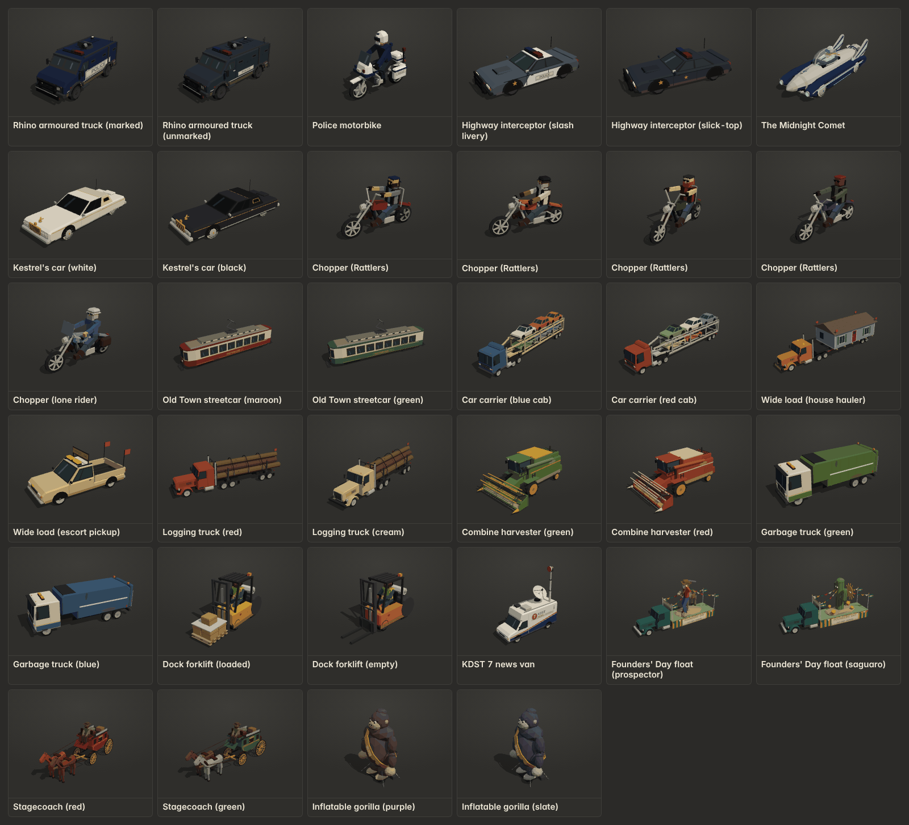
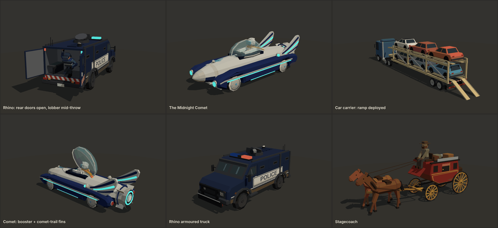

# Expansion pack: Vehicles (mock assets for the 40-minute run)

Seventeen new procedural low-poly vehicles in the same kit and style as `public/js/assets/models/vehicles.js`. They're
registered through `public/js/assets/expansion/vehicles.js` (`PACK`), and the showroom tab is **New · Vehicles**
(`assets.html?cat=x_vehicles`).

## Files

| Path | What |
|---|---|
| `public/js/assets/expansion/vehicles.js` | `PACK`: builders, variant counts, labels, named parts, variant style names |
| `public/js/assets/expansion/vehicles-common.js` | Shared helpers: `beam`/`tube`/`frameBox`, the posed `figure` (riders and drivers), lamps, text signs, spoked/bike/rail/white-wall wheels, car shell, two truck cabs, the mini car |
| `public/js/assets/expansion/vehicles-police.js` | `rhino_truck`, `moto_cop`, `interceptor` |
| `public/js/assets/expansion/vehicles-hero.js` | `comet_car`, `kestrel_car`, `chopper` |
| `public/js/assets/expansion/vehicles-heavy.js` | `streetcar`, `car_carrier`, `wide_load`, `combine`, `logging_truck` |
| `public/js/assets/expansion/vehicles-civic.js` | `forklift`, `garbage_truck`, `news_van`, `parade_float`, `stagecoach`, `inflatable_gorilla` |

## Every kind

Size is `userData.size` (L × W × H, metres). It is the nominal footprint; mirrors, antennas and masts can poke slightly outside it.
Triangles are per instance (a range is given where variants differ). Every model passes `node public/js/assets/test/check-assets.js`.

| Kind | Label | Size L×W×H m | Variants | Named parts | What it's for | Tris |
|---|---|---|---|---|---|---|
| `rhino_truck` | Rhino armoured truck | 6.6 × 2.7 × 3.1 | 2: marked, unmarked | `wheel_fl/fr/rl/rr`, `rear_door_l`, `rear_door_r`, `lobber`, `throw_point`, `light_red`, `light_blue`, `body` (+ `exhaust`) | 5-star police set piece. It overtakes, opens its rear doors and an officer lobs smoke canisters back at the RV. | 3651 |
| `moto_cop` | Police motorbike | 2.3 × 0.95 × 1.75 | 1 | `wheel_f`, `wheel_r`, `rider`, `light_red`, `light_blue`, `body` | Fast, nimble pursuer that weaves through traffic (2–3 stars). | 2132 |
| `interceptor` | Highway interceptor | 4.95 × 1.98 × 1.5 | 2: slash livery, slick-top | `wheel_fl/fr/rl/rr`, `light_red`, `light_blue`, `body` | Highway-patrol muscle car: faster than the patrol car, used for ramming. | 1740–1748 |
| `comet_car` | The Midnight Comet | 6.1 × 2.1 × 1.85 | 1 | `booster`, `wheel_fl/fr/rl/rr`, `canopy`, `glow`, `body` (+ `canopy_glass`, `headlight_l/r`) | The hero's 1950s Googie rocket car (story encounter or chase). The hero sits inside, matching the people pack's `comet_hero`. | 3632 |
| `kestrel_car` | Kestrel's car | 5.8 × 2.0 × 1.42 | 2: white, black | `wheel_fl/fr/rl/rr`, `body` | The buyer's long 1970s luxury sedan at the hand-off: gold trim, landau roof, tinted glass, gold kestrel ornament. | 1682 |
| `chopper` | Chopper | 2.7 × 0.9 × 1.7 | 5: v0–3 Rattlers, v4 lone rider | `wheel_f`, `wheel_r`, `rider`, `body` | Rattlers biker gang (adults) that swarm the RV. Each has a leather vest with an original coiled-rattlesnake back patch, a bandana or half helmet, and a different bike. v4 is a neutral touring rider. | 1922–2016 |
| `streetcar` | Old Town streetcar | 14 × 2.6 × 4.6 | 2: maroon, green | `pantograph`, `wheel_fl/fr`, `wheel_fl2/fr2`, `wheel_rl/rr`, `wheel_rl2/rr2`, `body` | Old Town tram on rails crossing or sharing the road. Big, slow, unstoppable obstacle. | 2842 |
| `car_carrier` | Car carrier | 17 × 2.6 × 4.3 | 2: blue cab, red cab | `wheel_fl/fr/rl/rr`, `wheel_rl2/rr2`, `wheel_tl/tr`, `wheel_tl2/tr2`, `cargo_0`…`cargo_5`, `ramp`, `body` | Highway set piece. It sheds cars as obstacles, and its ramp drops so the RV can jump it. | 4854 |
| `wide_load` | Wide load | v0 16.8 × 4.5 × 5.0, v1 5.4 × 2.0 × 2.45 | 2: house hauler, escort pickup | `wheel_fl/fr/rl/rr`, `light_amber`, `body` (v0 also `wheel_rl2/rr2/tl/tr/tl2/tr2`) | v0 is a flatbed hauling a one-storey house that blocks 1.5 lanes, with WIDE LOAD banners. v1 is the escort pickup with an amber bar and an OVERSIZE LOAD roof sign. | 2694 / 1541 |
| `logging_truck` | Logging truck | 14.6 × 2.6 × 3.5 | 2: red, cream | `wheel_fl/fr/rl/rr`, `wheel_rl2/rr2`, `wheel_tl/tr`, `wheel_tl2/tr2`, `log_0`…`log_5`, `chains`, `body` | Country-road hazard. Logs roll off the back when it's hit. | 3238 |
| `combine` | Combine harvester | 9.4 × 5.6 × 4.0 | 2: green, red (faded) | `reel`, `wheel_fl/fr/rl/rr`, `body` | Slow farm-road blocker with a 5.6 m header and a spinning reel. | 3232 |
| `garbage_truck` | Garbage truck | 9.2 × 3.0 × 3.4 | 2: green, blue | `wheel_fl/fr/rl/rr`, `wheel_rl2/rr2`, `lifter`, `body` | City traffic. A side-loader that stops at kerbs and swings its bin arm. | 1813 |
| `forklift` | Dock forklift | 3.3 × 1.2 × 2.2 | 2: loaded, empty | `forks`, `wheel_fl/fr/rl/rr`, `body` | Docks/warehouse district. Crosses the road with a pallet; hi-vis driver. | 2212 / 1684 |
| `news_van` | KDST 7 news van | 6.3 × 2.2 × 6.4 | 1 | `dish`, `mast`, `wheel_fl/fr/rl/rr`, `body` | Follows the RV and broadcasts its position (GAME_DESIGN "news van"). The station is fictional. | 2036 |
| `parade_float` | Founders' Day float | 12.6 × 3.0 × 6.4 | 2: prospector, saguaro | `wheel_fl/fr/rl/rr`, `flag_0`…`flag_3`, `body` | Founders' Day parade blocking Old Town. v0 is a papier-mâché prospector with his mule; v1 is a giant papier-mâché saguaro. | 3686–3714 |
| `stagecoach` | Stagecoach | 7.4 × 2.0 × 2.9 | 2: red, green | `wheel_fl/fr/rl/rr`, `horse_0`, `horse_1`, `leg_fl/fr/rl/rr` (one set under each horse), `body` | Ghost-town tourist ride: slow, spooks easily. | 3834 |
| `inflatable_gorilla` | Inflatable gorilla | 3.6 × 6.2 × 9.1 | 2: purple, slate | `arm_l`, `arm_r`, `body` (+ static `base`) | Roadside car-lot mascot with a SALE sash. It wobbles, and it can be knocked loose to bounce down the road. | 2490 |

Budgets: vehicles are about 2.5k triangles each. Set pieces (Rhino, Comet, car carrier, logging truck, combine, float,
stagecoach, streetcar) run 2.8k–4.9k, under the 6k cap. Every model uses at most 4 materials (draw calls after the renderer's
bake): the shared `CR_Matte_VCol`, plus lamps (`CR_Lamp_Red/Blue/Amber`), the Comet's `CR_Comet_Glow` and
`CR_Comet_Canopy`, and at most one CanvasTexture sign material per text. Without a DOM (Node) signs fall back to a plain
colour.

## Animation contract (for the integrator)

All pivots are plain `Object3D`s. Each holds a `<name>_mesh` child: the conventions from `docs/ASSETS.md` apply
(metres, +Z front, right side = −X, wheels spin with `rotation.x`, `+` = rolling forward, and `rotation.order 'YXZ'` so
`rotation.y` steers). The numbers below are measured from the built models.

| Kind | Part | Pivot | How to animate |
|---|---|---|---|
| `rhino_truck` | `rear_door_l` / `rear_door_r` | Outer hinge at the rear (x = ±1.24, z = −3.26) | **`rear_door_l.rotation.y < 0`, `rear_door_r.rotation.y > 0` open them** (the signs are mirrored). ±1.6 is about square to the body; ±1.85 is folded back. |
| | `lobber` | Officer's waist in the rear bay (−0.22, 1.5, −2.78), facing −Z. His torso, arms and head are on the pivot; his legs stay on `body`. | `rotation.x`: +0.3 winds up (leans back into the truck), −0.5 releases (leans out the doors). Hidden while the doors are shut. |
| | `throw_point` | Child of `lobber`, at the raised hand | Spawn the projectile at its world position on release. Its mesh is the held smoke canister: hide `throw_point_mesh` on release and show it again on the next wind-up. |
| | `light_red`, `light_blue` | Meshes on `body` | Same contract as `cop`: `cloneInstanceMaterials(obj)`, then flash `userData.flashMaterials.light_red/blue.emissiveIntensity`. Each lamp mesh also covers the grille and rear-corner strobes. |
| `moto_cop` | `rider` | Seat/hip (0, 1.0, −0.24) | Lean the rider with `rotation.z` in corners; lean the whole bike by rotating the root. Wheels are `wheel_f`, `wheel_r` (spin with `rotation.x`; steer `wheel_f` with `rotation.y`). |
| `interceptor` | `light_red`, `light_blue` | Light bar and grille strobes | As `cop`. |
| `comet_car` | `canopy` | Rear base of the bubble (0, 1.12, −0.8) | **`rotation.x < 0` opens it** (front lifts): −0.9 is fully open. `canopy_glass` is a transparent mesh under it. |
| | `booster` | Nozzle exit (0, 0.66, −3.08) | Attach the rocket flame at its origin, pointing −Z. Its mesh is the white-hot core disc. |
| | `glow` | Mesh on `body`, emissive teal (`CR_Comet_Glow`, intensity 0.9) | It's in `userData.perInstanceMaterials`: clone it and pulse `emissiveIntensity` (for example 0.6–1.6, higher on boost). |
| `chopper` | `rider` | Hip (0, 0.84, −0.3) | Same as `moto_cop`. The Rattlers back patch is a sign mesh under `rider`, so it leans with the rider. |
| `streetcar` | `pantograph` | Base hinge on the roof (0, 3.58, −0.7) | `rotation.x = 0` is raised (collector at about 5.0 m); `+0.9` folds it down. Bogie wheels `wheel_fl/fr` and `wheel_fl2/fr2` (front bogie), `wheel_rl/rr` and `wheel_rl2/rr2` (rear bogie) spin with `rotation.x`, flanges inward. |
| `car_carrier` | `cargo_0`…`cargo_5` | Each car's ground centre on its deck. 0–2 are the upper deck (y 2.89, rear → front); 3–5 are the lower deck (y 1.24). | Detach (`attach` to the scene) and tumble to drop a car. Each car is one mesh. |
| | `ramp` | Hinge at the rear of the lower deck (0, 1.2, −8.56). Stowed upright. | **`rotation.x = −2.12` lays the ramp tips on the ground** (a 31° slope the RV can drive or jump up); −1.95 leaves them hovering. |
| `wide_load` | `light_amber` | v0: two beacons on the cab roof. v1: an amber bar plus a grille lamp. | `perInstanceMaterials = ['light_amber']`; flash `emissiveIntensity` (idle 0.5). |
| `logging_truck` | `log_0`…`log_5` | Each log's centre; logs lie along Z. 0–2 are the bottom row, 3–4 the middle, 5 the top (it carries the red flag). | Roll off sideways: translate in X/Y and spin with **`rotation.z`**. Hide `chains` when the stack spills. |
| `combine` | `reel` | Reel axle (0, 1.5, 3.78); axle = local X | Spin with `rotation.x` (+ turns the bats down toward the cutter bar). Big drive wheels are at the front; steer the rear wheels (`wheel_rl/rr.rotation.y`). |
| `garbage_truck` | `lifter` | Arm root high on the kerb side (−1.32, 2.35, 1.55). It holds a wheelie bin at the kerb. | **`rotation.z` from 0 to about −3.2 swings the bin out, up and over the hopper**; −1.5 is horizontal. |
| `forklift` | `forks` | Carriage base (0, 0.1, 0.57) | Raise with **`position.y` +0 to +1.6** (the pallet load on v0 rides along). Steer the rear wheels. |
| `news_van` | `dish` | Turntable on the roof (−0.25, 2.92, −1.4) | Pan with `rotation.y`; the tilt is built in. |
| | `mast` | Base on the roof (0.58, 2.8, −2.35). It's raised to 6.4 m. | Telescope with `scale.y`, or by lowering `position.y`. |
| `parade_float` | `flag_0`…`flag_3` | Pole tops (0 front-left, 1 front-right, 2 rear-left, 3 rear-right) | Flap with a small oscillating `rotation.y` (±0.5). |
| `stagecoach` | `horse_0`, `horse_1` | Ground under each horse (x = ±0.5, z = 2.6). `horse_0` is on +X. | Bob with `position.y`. `leg_fl/fr/rl/rr` under each horse pivot at the shoulder/hip: `rotation.x > 0` swings a leg backward (same as `cow`). Use `horse.getObjectByName('leg_fl')`, because the names repeat under each horse. |
| `inflatable_gorilla` | `body` | Top of the blower pad (0, 0.3, 0) | Wobble with small `rotation.x` / `rotation.z` (±0.1). The pad and tethers stay on the static `base`. |
| | `arm_l` / `arm_r` | Shoulders (±1.98, 5.93, 0) | **`arm_l.rotation.z > 0`, `arm_r.rotation.z < 0` lift the arms outward** (about ±1.35 is horizontal); `rotation.x` flaps them forward and back. |

Also on the models: `rhino_truck` has an `exhaust` empty at the rear, `comet_car` has `headlight_l/_r` empties, and the
escort pickup (`wide_load` v1) is the base kit's `pickup` v1 with an `escort_rack` mesh and signs added.

## Design notes (content rules)

- Every design is original. There are no real brands, logos, liveries or replicas.
  - Police vehicles are generic: navy or slate paint with "POLICE" panels and no department names.
  - The station `KDST 7 NEWS` is fictional.
  - The Rattlers patch (a coiled rattlesnake with "RATTLERS / DESERT" rockers) is drawn from scratch in a CanvasTexture.
- **The Midnight Comet** has nothing bat-like about it:
  - It's a round silver/midnight-blue (`#1d2b5a`) fuselage with two pontoon pods and skirted white-wall wheels.
  - Its single bubble canopy is centred, with the hero inside. The off-white suit, silver helmet, teal visor and orange-to-gold comet scarf match the people pack's `comet_hero`.
  - The fins are rounded silver plates on the pods, with inlaid streaks (the middle one glows teal) and a chrome "comet head" orb at the leading edge. They have no points, scallops or black.
  - The rear booster is a chrome bell with a teal glow ring.
- All riders and drivers are adults. They use the shared `figure()` helper, with base-kit proportions and slightly big heads and hands.
- Grime follows the base kit: dirt bands near the wheels, mud splashes, rust patches, a dusty combine, a grimy garbage
  truck and sun-faded paint. The Kestrel car is the deliberate exception: it's spotless.

## Unity notes

These are the same as `docs/ASSETS.md`.
- Export from the showroom: each named pivot is a glTF node, and the meshes are vertex-coloured.
- Signs export as textured quads (embedded CanvasTexture images).
- The Comet's canopy is a separate transparent material (`CR_Comet_Canopy`); in URP, map it to a transparent lit shader.
- The rear-door and arm rotation signs above may flip with handedness, so check one of each in the editor.
